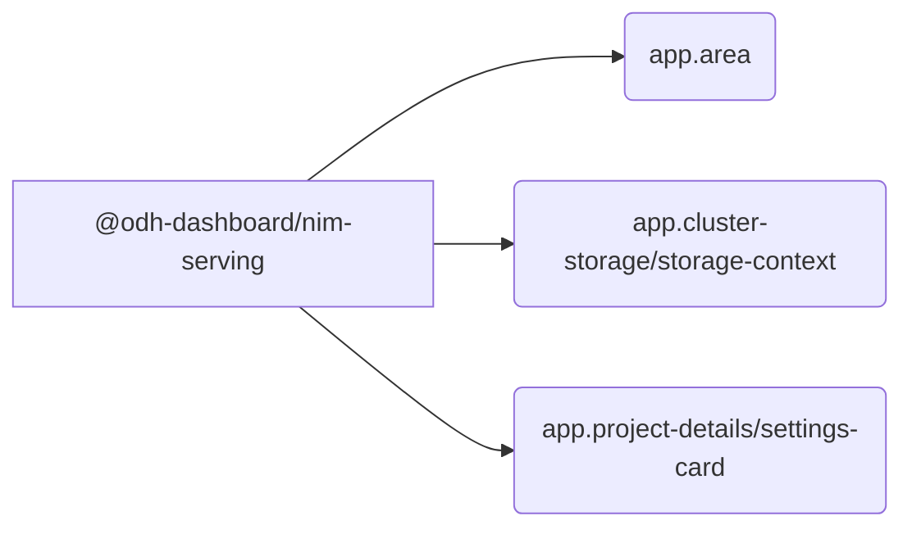

<!-- AUTO-GENERATED by @odh-dashboard/extension-map. Do not edit by hand. -->

> Generated file. Regenerate with `pnpm docs:extension-map`.

## Loading paths

| Entry | Path | Source |
| --- | --- | --- |
| @odh-dashboard/nim-serving#./extensions | static | `packages/nim-serving/extensions/index.ts` |

## Contributes

### app

| Node | Link |
| --- | --- |
| @odh-dashboard/nim-serving | [@odh-dashboard/nim-serving](#contributes) |
| app.area | [app.area](../../plugin-core/docs/extensions.md#apparea) [app.area](../extensions/nim-service.ts#L130-L137) [app.area](../extensions/wizard.ts#L74-L81) |
| app.cluster-storage/storage-context | [app.cluster-storage/storage-context](../../plugin-core/docs/extensions.md#appcluster-storagestorage-context) [app.cluster-storage/storage-context](../extensions/cluster-storage.ts#L6-L19) |
| app.project-details/settings-card | [app.project-details/settings-card](../../plugin-core/docs/extensions.md#appproject-detailssettings-card) [app.project-details/settings-card](../extensions/project-key.ts#L9-L19) |

- `-->` declared or type-resolved contribution
- `==>` derived relationship
- `-. "rendered in" .->` rendered in one hop
- `-. "federated" .->` federated contribution
- `--x` suppression
- `-- "patch" -->` patch

### model-serving

```mermaid
flowchart LR
  pkg_n__odh_dashboard_nim_serving_974017["@odh-dashboard/nim-serving"]
  point_n_model_serving_auth_5d7b65("model-serving.auth")
  pkg_n__odh_dashboard_nim_serving_974017 --> point_n_model_serving_auth_5d7b65
  point_n_model_serving_deployed_model_serving_runtime_a806c7("model-serving.deployed-model/serving-runtime")
  pkg_n__odh_dashboard_nim_serving_974017 --> point_n_model_serving_deployed_model_serving_runtime_a806c7
  point_n_model_serving_deployment_assemble_model_resource_5b5fd4("model-serving.deployment/assemble-model-resource")
  pkg_n__odh_dashboard_nim_serving_974017 --> point_n_model_serving_deployment_assemble_model_resource_5b5fd4
  point_n_model_serving_deployment_deploy_35423a("model-serving.deployment/deploy")
  pkg_n__odh_dashboard_nim_serving_974017 --> point_n_model_serving_deployment_deploy_35423a
  point_n_model_serving_deployment_form_data_a37ab2("model-serving.deployment/form-data")
  pkg_n__odh_dashboard_nim_serving_974017 --> point_n_model_serving_deployment_form_data_a37ab2
  point_n_model_serving_deployment_tracking_properties_2845ae("model-serving.deployment/tracking-properties")
  pkg_n__odh_dashboard_nim_serving_974017 --> point_n_model_serving_deployment_tracking_properties_2845ae
  point_n_model_serving_deployment_wizard_field_19398b("model-serving.deployment/wizard-field")
  pkg_n__odh_dashboard_nim_serving_974017 --> point_n_model_serving_deployment_wizard_field_19398b
  point_n_model_serving_deployment_wizard_field_apply_b7659a("model-serving.deployment/wizard-field-apply")
  pkg_n__odh_dashboard_nim_serving_974017 --> point_n_model_serving_deployment_wizard_field_apply_b7659a
  point_n_model_serving_deployment_wizard_field_deployment_functions_dd7c85("model-serving.deployment/wizard-field-deployment-functions")
  pkg_n__odh_dashboard_nim_serving_974017 --> point_n_model_serving_deployment_wizard_field_deployment_functions_dd7c85
  point_n_model_serving_deployment_wizard_field_extractor_877f9e("model-serving.deployment/wizard-field-extractor")
  pkg_n__odh_dashboard_nim_serving_974017 --> point_n_model_serving_deployment_wizard_field_extractor_877f9e
  point_n_model_serving_deployment_wizard_field_override_756caa("model-serving.deployment/wizard-field-override")
  pkg_n__odh_dashboard_nim_serving_974017 --> point_n_model_serving_deployment_wizard_field_override_756caa
  point_n_model_serving_deployments_table_start_stop_action_ea2e4f("model-serving.deployments-table/start-stop-action")
  pkg_n__odh_dashboard_nim_serving_974017 --> point_n_model_serving_deployments_table_start_stop_action_ea2e4f
  point_n_model_serving_platform_1d1e44("model-serving.platform")
  pkg_n__odh_dashboard_nim_serving_974017 --> point_n_model_serving_platform_1d1e44
  point_n_model_serving_platform_delete_deployment_259f2a("model-serving.platform/delete-deployment")
  pkg_n__odh_dashboard_nim_serving_974017 --> point_n_model_serving_platform_delete_deployment_259f2a
  point_n_model_serving_platform_exclude_deployment_af339f("model-serving.platform/exclude-deployment")
  pkg_n__odh_dashboard_nim_serving_974017 --> point_n_model_serving_platform_exclude_deployment_af339f
  point_n_model_serving_platform_global_models_page_508e89("model-serving.platform/global-models-page")
  pkg_n__odh_dashboard_nim_serving_974017 --> point_n_model_serving_platform_global_models_page_508e89
  point_n_model_serving_platform_overview_section_7dcf20("model-serving.platform/overview-section")
  pkg_n__odh_dashboard_nim_serving_974017 --> point_n_model_serving_platform_overview_section_7dcf20
  point_n_model_serving_platform_project_details_tab_fce2f7("model-serving.platform/project-details-tab")
  pkg_n__odh_dashboard_nim_serving_974017 --> point_n_model_serving_platform_project_details_tab_fce2f7
  point_n_model_serving_platform_watch_deployments_cf294d("model-serving.platform/watch-deployments")
  pkg_n__odh_dashboard_nim_serving_974017 --> point_n_model_serving_platform_watch_deployments_cf294d
```

| Node | Link |
| --- | --- |
| @odh-dashboard/nim-serving | [@odh-dashboard/nim-serving](#contributes) |
| model-serving.auth | [model-serving.auth](../../model-serving/docs/extensions.md#model-servingauth) [model-serving.auth](../extensions/nim-service.ts#L242-L252) |
| model-serving.deployed-model/serving-runtime | [model-serving.deployed-model/serving-runtime](../../model-serving/docs/extensions.md#model-servingdeployed-modelserving-runtime) [model-serving.deployed-model/serving-runtime](../extensions/nim-service.ts#L149-L158) |
| model-serving.deployment/assemble-model-resource | [model-serving.deployment/assemble-model-resource](../../model-serving/docs/extensions.md#model-servingdeploymentassemble-model-resource) [model-serving.deployment/assemble-model-resource](../extensions/nim-service.ts#L183-L194) |
| model-serving.deployment/deploy | [model-serving.deployment/deploy](../../model-serving/docs/extensions.md#model-servingdeploymentdeploy) [model-serving.deployment/deploy](../extensions/nim-kserve.ts#L139-L151) [model-serving.deployment/deploy](../extensions/nim-service.ts#L170-L182) |
| model-serving.deployment/form-data | [model-serving.deployment/form-data](../../model-serving/docs/extensions.md#model-servingdeploymentform-data) [model-serving.deployment/form-data](../extensions/nim-service.ts#L195-L241) |
| model-serving.deployment/tracking-properties | [model-serving.deployment/tracking-properties](../../model-serving/docs/extensions.md#model-servingdeploymenttracking-properties) [model-serving.deployment/tracking-properties](../extensions/nim-kserve.ts#L47-L57) |
| model-serving.deployment/wizard-field | [model-serving.deployment/wizard-field](../../model-serving/docs/extensions.md#model-servingdeploymentwizard-field) [model-serving.deployment/wizard-field](../extensions/wizard.ts#L11-L22) [model-serving.deployment/wizard-field](../extensions/wizard.ts#L24-L35) |
| model-serving.deployment/wizard-field-apply | [model-serving.deployment/wizard-field-apply](../../model-serving/docs/extensions.md#model-servingdeploymentwizard-field-apply) [model-serving.deployment/wizard-field-apply](../extensions/nim-kserve.ts#L20-L31) [model-serving.deployment/wizard-field-apply](../extensions/nim-kserve.ts#L76-L87) [model-serving.deployment/wizard-field-apply](../extensions/nim-service.ts#L26-L39) [model-serving.deployment/wizard-field-apply](../extensions/nim-service.ts#L57-L70) |
| model-serving.deployment/wizard-field-deployment-functions | [model-serving.deployment/wizard-field-deployment-functions](../../model-serving/docs/extensions.md#model-servingdeploymentwizard-field-deployment-functions) [model-serving.deployment/wizard-field-deployment-functions](../extensions/nim-kserve.ts#L62-L74) [model-serving.deployment/wizard-field-deployment-functions](../extensions/nim-service.ts#L90-L107) |
| model-serving.deployment/wizard-field-extractor | [model-serving.deployment/wizard-field-extractor](../../model-serving/docs/extensions.md#model-servingdeploymentwizard-field-extractor) [model-serving.deployment/wizard-field-extractor](../extensions/nim-kserve.ts#L34-L45) [model-serving.deployment/wizard-field-extractor](../extensions/nim-kserve.ts#L92-L108) [model-serving.deployment/wizard-field-extractor](../extensions/nim-service.ts#L42-L55) [model-serving.deployment/wizard-field-extractor](../extensions/nim-service.ts#L72-L85) |
| model-serving.deployment/wizard-field-override | [model-serving.deployment/wizard-field-override](../../model-serving/docs/extensions.md#model-servingdeploymentwizard-field-override) [model-serving.deployment/wizard-field-override](../extensions/wizard.ts#L37-L49) [model-serving.deployment/wizard-field-override](../extensions/wizard.ts#L51-L63) |
| model-serving.deployments-table/start-stop-action | [model-serving.deployments-table/start-stop-action](../../model-serving/docs/extensions.md#model-servingdeployments-tablestart-stop-action) [model-serving.deployments-table/start-stop-action](../extensions/nim-service.ts#L258-L268) |
| model-serving.platform | [model-serving.platform](../../model-serving/docs/extensions.md#model-servingplatform) [model-serving.platform](../extensions/legacy-ui.ts#L23-L58) |
| model-serving.platform/delete-deployment | [model-serving.platform/delete-deployment](../../model-serving/docs/extensions.md#model-servingplatformdelete-deployment) [model-serving.platform/delete-deployment](../extensions/nim-kserve.ts#L152-L168) |
| model-serving.platform/exclude-deployment | [model-serving.platform/exclude-deployment](../../model-serving/docs/extensions.md#model-servingplatformexclude-deployment) [model-serving.platform/exclude-deployment](../extensions/nim-service.ts#L159-L169) |
| model-serving.platform/global-models-page | [model-serving.platform/global-models-page](../../model-serving/docs/extensions.md#model-servingplatformglobal-models-page) [model-serving.platform/global-models-page](../extensions/legacy-ui.ts#L85-L95) |
| model-serving.platform/overview-section | [model-serving.platform/overview-section](../../model-serving/docs/extensions.md#model-servingplatformoverview-section) [model-serving.platform/overview-section](../extensions/legacy-ui.ts#L71-L84) |
| model-serving.platform/project-details-tab | [model-serving.platform/project-details-tab](../../model-serving/docs/extensions.md#model-servingplatformproject-details-tab) [model-serving.platform/project-details-tab](../extensions/legacy-ui.ts#L59-L70) |
| model-serving.platform/watch-deployments | [model-serving.platform/watch-deployments](../../model-serving/docs/extensions.md#model-servingplatformwatch-deployments) [model-serving.platform/watch-deployments](../extensions/nim-service.ts#L138-L148) |

- `-->` declared or type-resolved contribution
- `==>` derived relationship
- `-. "rendered in" .->` rendered in one hop
- `-. "federated" .->` federated contribution
- `--x` suppression
- `-- "patch" -->` patch

#### app.area

- **reliantAreas**: `SupportedArea.NIM_MODEL` (`"nim-model"`)
- **featureFlags**: `"nimServiceOperator"`
- **id**: `SupportedArea.NIM_SERVICE_OPERATOR` (`"nim-service-operator"`)
- **Requires**: 
- **Disallows**: 
- **CodeRef target**: 
- **Included in**: 
- **Source**: [app.area](../extensions/nim-service.ts#L130-L137)

- **reliantAreas**: `SupportedArea.NIM_MODEL` (`"nim-model"`)
- **featureFlags**: `"nimWizard"`
- **id**: `SupportedArea.NIM_WIZARD` (`"nim-wizard"`)
- **Requires**: 
- **Disallows**: 
- **CodeRef target**: 
- **Included in**: 
- **Source**: [app.area](../extensions/wizard.ts#L74-L81)

#### app.cluster-storage/storage-context

- **title**: `"NIM storage"`
- **description**: `"Appropriate for caching NIM models. Enables you to define a subpath for the NIM image."`
- **isPVCUsingStorageContextType**: packages/nim-serving/src/pages/clusterStorage/clusterStorage.tsx#[isNIMPVC](../src/pages/clusterStorage/clusterStorage.tsx#L10-L11)
- **PVCStorageContextSettingsFields**: packages/nim-serving/src/pages/clusterStorage/clusterStorage.tsx#[Fields](../src/pages/clusterStorage/clusterStorage.tsx#L13-L34)
- **Requires**: `SupportedArea.NIM_MODEL` (`"nim-model"`)
- **Disallows**: 
- **CodeRef target**: packages/nim-serving/src/pages/clusterStorage/clusterStorage.tsx#[isNIMPVC](../src/pages/clusterStorage/clusterStorage.tsx#L10-L11), packages/nim-serving/src/pages/clusterStorage/clusterStorage.tsx#[Fields](../src/pages/clusterStorage/clusterStorage.tsx#L13-L34)
- **Included in**: 
- **Source**: [app.cluster-storage/storage-context](../extensions/cluster-storage.ts#L6-L19)

#### app.project-details/settings-card

- **id**: `"nim-settings"`
- **title**: `"NVIDIA NIM"`
- **component**: packages/nim-serving/src/pages/projectSettings/NIMSettingsCard.tsx#[NIMSettingsCard](../src/pages/projectSettings/NIMSettingsCard.tsx#L59-L330)
- **Requires**: `SupportedArea.NIM_WIZARD` (`"nim-wizard"`)
- **Disallows**: 
- **CodeRef target**: packages/nim-serving/src/pages/projectSettings/NIMSettingsCard.tsx#[NIMSettingsCard](../src/pages/projectSettings/NIMSettingsCard.tsx#L59-L330)
- **Included in**: 
- **Source**: [app.project-details/settings-card](../extensions/project-key.ts#L9-L19)

#### model-serving.auth

| platform | usePlatformAuthEnabled | Requires | Disallows | CodeRef target | Included in | Source |
| --- | --- | --- | --- | --- | --- | --- |
| `NIM_SERVICE_ID` (`"nvidia-nim-service"`) | packages/nim-serving/src/pages/deploymentWizard/extractNIMFormData.ts#[isNIMAuthEnabled](../src/pages/deploymentWizard/extractNIMFormData.ts#L89-L98) | `SupportedArea.NIM_SERVICE_OPERATOR` (`"nim-service-operator"`) |  | packages/nim-serving/src/pages/deploymentWizard/extractNIMFormData.ts#[isNIMAuthEnabled](../src/pages/deploymentWizard/extractNIMFormData.ts#L89-L98) |  | [model-serving.auth](../extensions/nim-service.ts#L242-L252) |

#### model-serving.deployed-model/serving-runtime

| platform | ServingDetailsComponent | Requires | Disallows | CodeRef target | Included in | Source |
| --- | --- | --- | --- | --- | --- | --- |
| `NIM_SERVICE_ID` (`"nvidia-nim-service"`) | packages/nim-serving/src/pages/deployments/NIMServingDetails.tsx#[NIMServingDetails](../src/pages/deployments/NIMServingDetails.tsx#L3-L3) | `SupportedArea.NIM_SERVICE_OPERATOR` (`"nim-service-operator"`) |  | packages/nim-serving/src/pages/deployments/NIMServingDetails.tsx#[NIMServingDetails](../src/pages/deployments/NIMServingDetails.tsx#L3-L3) |  | [model-serving.deployed-model/serving-runtime](../extensions/nim-service.ts#L149-L158) |

#### model-serving.deployment/assemble-model-resource

- **platform**: `NIM_SERVICE_ID` (`"nvidia-nim-service"`)
- **isActive**: packages/nim-serving/src/api/deployments/deploy.ts#[isNIMDeployActive](../src/api/deployments/deploy.ts#L18-L19)
- **priority**: `100`
- **assemble**: packages/nim-serving/src/api/deployments/deploy.ts#[assembleNIMDeployment](../src/api/deployments/deploy.ts#L21-L52)
- **Requires**: `SupportedArea.NIM_SERVICE_OPERATOR` (`"nim-service-operator"`)
- **Disallows**: 
- **CodeRef target**: packages/nim-serving/src/api/deployments/deploy.ts#[isNIMDeployActive](../src/api/deployments/deploy.ts#L18-L19), packages/nim-serving/src/api/deployments/deploy.ts#[assembleNIMDeployment](../src/api/deployments/deploy.ts#L21-L52)
- **Included in**: 
- **Source**: [model-serving.deployment/assemble-model-resource](../extensions/nim-service.ts#L183-L194)

#### model-serving.deployment/deploy

- **platform**: `NIM_LEGACY_ID` (`"nvidia-nim"`)
- **isActive**: packages/nim-serving/src/nimKServe/deploy.ts#[isNIMKServeDeployActive](../src/nimKServe/deploy.ts#L25-L26)
- **priority**: `50`
- **supportsOverwrite**: `true`
- **deploy**: packages/nim-serving/src/nimKServe/deploy.ts#[deployNIMKServeDeployment](../src/nimKServe/deploy.ts#L33-L96)
- **Requires**: `SupportedArea.NIM_WIZARD` (`"nim-wizard"`)
- **Disallows**: 
- **CodeRef target**: packages/nim-serving/src/nimKServe/deploy.ts#[isNIMKServeDeployActive](../src/nimKServe/deploy.ts#L25-L26), packages/nim-serving/src/nimKServe/deploy.ts#[deployNIMKServeDeployment](../src/nimKServe/deploy.ts#L33-L96)
- **Included in**: 
- **Source**: [model-serving.deployment/deploy](../extensions/nim-kserve.ts#L139-L151)

- **platform**: `NIM_SERVICE_ID` (`"nvidia-nim-service"`)
- **isActive**: packages/nim-serving/src/api/deployments/deploy.ts#[isNIMDeployActive](../src/api/deployments/deploy.ts#L18-L19)
- **priority**: `100`
- **supportsOverwrite**: `true`
- **deploy**: packages/nim-serving/src/api/deployments/deploy.ts#[deployNIMDeployment](../src/api/deployments/deploy.ts#L68-L107)
- **Requires**: `SupportedArea.NIM_SERVICE_OPERATOR` (`"nim-service-operator"`)
- **Disallows**: 
- **CodeRef target**: packages/nim-serving/src/api/deployments/deploy.ts#[isNIMDeployActive](../src/api/deployments/deploy.ts#L18-L19), packages/nim-serving/src/api/deployments/deploy.ts#[deployNIMDeployment](../src/api/deployments/deploy.ts#L68-L107)
- **Included in**: 
- **Source**: [model-serving.deployment/deploy](../extensions/nim-service.ts#L170-L182)

#### model-serving.deployment/form-data

- **platform**: `NIM_SERVICE_ID` (`"nvidia-nim-service"`)
- **isActive**: `true`
- **priority**: `0`
- **hardwareProfilePaths**: packages/nim-serving/src/pages/deploymentWizard/extractNIMFormData.ts#[NIM_SERVICE_HARDWARE_PROFILE_PATHS](../src/api/nimservices/utils.ts#L17-L21)
- **extractHardwareProfileConfig**: packages/nim-serving/src/pages/deploymentWizard/extractNIMFormData.ts#[extractNIMHardwareProfileConfig](../src/pages/deploymentWizard/extractNIMFormData.ts#L21-L41)
- **extractReplicas**: packages/nim-serving/src/pages/deploymentWizard/extractNIMFormData.ts#[extractNIMReplicas](../src/pages/deploymentWizard/extractNIMFormData.ts#L43-L45)
- **extractRuntimeArgs**: packages/nim-serving/src/pages/deploymentWizard/extractNIMFormData.ts#[extractNIMRuntimeArgs](../src/pages/deploymentWizard/extractNIMFormData.ts#L66-L74)
- **extractEnvironmentVariables**: packages/nim-serving/src/pages/deploymentWizard/extractNIMFormData.ts#[extractNIMEnvironmentVariables](../src/pages/deploymentWizard/extractNIMFormData.ts#L47-L58)
- **extractModelAvailabilityData**: packages/nim-serving/src/pages/deploymentWizard/extractNIMFormData.ts#[extractNIMModelAvailabilityData](../src/pages/deploymentWizard/extractNIMFormData.ts#L76-L79)
- **extractModelLocationData**: packages/nim-serving/src/pages/deploymentWizard/extractNIMFormData.ts#[extractNIMModelLocationData](../src/pages/deploymentWizard/extractNIMFormData.ts#L60-L64)
- **extractModelType**: packages/nim-serving/src/pages/deploymentWizard/extractNIMFormData.ts#[extractNIMModelType](../src/pages/deploymentWizard/extractNIMFormData.ts#L81-L83)
- **extractModelServerTemplate**: packages/nim-serving/src/pages/deploymentWizard/extractNIMFormData.ts#[extractNIMModelServerTemplate](../src/pages/deploymentWizard/extractNIMFormData.ts#L85-L85)
- **Requires**: `SupportedArea.NIM_SERVICE_OPERATOR` (`"nim-service-operator"`)
- **Disallows**: 
- **CodeRef target**: packages/nim-serving/src/pages/deploymentWizard/extractNIMFormData.ts#[NIM_SERVICE_HARDWARE_PROFILE_PATHS](../src/api/nimservices/utils.ts#L17-L21), packages/nim-serving/src/pages/deploymentWizard/extractNIMFormData.ts#[extractNIMHardwareProfileConfig](../src/pages/deploymentWizard/extractNIMFormData.ts#L21-L41), packages/nim-serving/src/pages/deploymentWizard/extractNIMFormData.ts#[extractNIMReplicas](../src/pages/deploymentWizard/extractNIMFormData.ts#L43-L45), packages/nim-serving/src/pages/deploymentWizard/extractNIMFormData.ts#[extractNIMRuntimeArgs](../src/pages/deploymentWizard/extractNIMFormData.ts#L66-L74), packages/nim-serving/src/pages/deploymentWizard/extractNIMFormData.ts#[extractNIMEnvironmentVariables](../src/pages/deploymentWizard/extractNIMFormData.ts#L47-L58), packages/nim-serving/src/pages/deploymentWizard/extractNIMFormData.ts#[extractNIMModelAvailabilityData](../src/pages/deploymentWizard/extractNIMFormData.ts#L76-L79), packages/nim-serving/src/pages/deploymentWizard/extractNIMFormData.ts#[extractNIMModelLocationData](../src/pages/deploymentWizard/extractNIMFormData.ts#L60-L64), packages/nim-serving/src/pages/deploymentWizard/extractNIMFormData.ts#[extractNIMModelType](../src/pages/deploymentWizard/extractNIMFormData.ts#L81-L83), packages/nim-serving/src/pages/deploymentWizard/extractNIMFormData.ts#[extractNIMModelServerTemplate](../src/pages/deploymentWizard/extractNIMFormData.ts#L85-L85)
- **Included in**: 
- **Source**: [model-serving.deployment/form-data](../extensions/nim-service.ts#L195-L241)

**Supplies**

| CodeRef | Supply | Value |
| --- | --- | --- |
| NIM_SERVICE_HARDWARE_PROFILE_PATHS | containerResourcesPath | `"spec.resources"` |
| NIM_SERVICE_HARDWARE_PROFILE_PATHS | tolerationsPath | `"spec.tolerations"` |
| NIM_SERVICE_HARDWARE_PROFILE_PATHS | nodeSelectorPath | `"spec.nodeSelector"` |

#### model-serving.deployment/tracking-properties

| platform | getProperties | Requires | Disallows | CodeRef target | Included in | Source |
| --- | --- | --- | --- | --- | --- | --- |
| `NIM_LEGACY_ID` (`"nvidia-nim"`) | packages/nim-serving/src/tracking/nimWizardTracking.ts#[getNIMWizardTrackingProperties](../src/tracking/nimWizardTracking.ts#L76-L101) | `SupportedArea.NIM_WIZARD` (`"nim-wizard"`) |  | packages/nim-serving/src/tracking/nimWizardTracking.ts#[getNIMWizardTrackingProperties](../src/tracking/nimWizardTracking.ts#L76-L101) |  | [model-serving.deployment/tracking-properties](../extensions/nim-kserve.ts#L47-L57) |

#### model-serving.deployment/wizard-field

| field | Requires | Disallows | CodeRef target | Included in | Source |
| --- | --- | --- | --- | --- | --- |
| packages/nim-serving/src/pages/deploymentWizard/fields/NIMImageField.tsx#[NIMImageFieldWizardField](../src/pages/deploymentWizard/fields/NIMImageField.tsx#L362-L408) | `SupportedArea.NIM_WIZARD` (`"nim-wizard"`) |  | packages/nim-serving/src/pages/deploymentWizard/fields/NIMImageField.tsx#[NIMImageFieldWizardField](../src/pages/deploymentWizard/fields/NIMImageField.tsx#L362-L408) |  | [model-serving.deployment/wizard-field](../extensions/wizard.ts#L11-L22) |
| packages/nim-serving/src/pages/deploymentWizard/fields/NIMPVCField.tsx#[NIMPVCFieldWizardField](../src/pages/deploymentWizard/fields/NIMPVCField.tsx#L453-L511) | `SupportedArea.NIM_WIZARD` (`"nim-wizard"`) |  | packages/nim-serving/src/pages/deploymentWizard/fields/NIMPVCField.tsx#[NIMPVCFieldWizardField](../src/pages/deploymentWizard/fields/NIMPVCField.tsx#L453-L511) |  | [model-serving.deployment/wizard-field](../extensions/wizard.ts#L24-L35) |

**Not resolved**

| Location | Reason | Link |
| --- | --- | --- |
| properties.field supplies.reducerFunctions.setFieldData | CodeRef body is not a supported dynamic import | [diagnostics](#diagnostics) |
| properties.field supplies.reducerFunctions.getInitialFieldData | CodeRef body is not a supported dynamic import | [diagnostics](#diagnostics) |
| properties.field supplies.reducerFunctions.validationSchema | identifier does not resolve to a literal value | [diagnostics](#diagnostics) |
| properties.field supplies.reducerFunctions.resolveDependencies | CodeRef body is not a supported dynamic import | [diagnostics](#diagnostics) |
| properties.field supplies.reducerFunctions.getFieldOverrides | identifier does not resolve to a literal value | [diagnostics](#diagnostics) |
| properties.field supplies.reducerFunctions.setFieldData | CodeRef body is not a supported dynamic import | [diagnostics](#diagnostics) |
| properties.field supplies.reducerFunctions.getInitialFieldData | CodeRef body is not a supported dynamic import | [diagnostics](#diagnostics) |
| properties.field supplies.reducerFunctions.validationSchema | identifier does not resolve to a literal value | [diagnostics](#diagnostics) |
| properties.field supplies.reducerFunctions.resolveDependencies | CodeRef body is not a supported dynamic import | [diagnostics](#diagnostics) |

**Supplies**

| CodeRef | Supply | Value |
| --- | --- | --- |
| NIMImageFieldWizardField | id | `NIM_IMAGE_FIELD_ID` (`"nim-serving/nimImage"`) |
| NIMImageFieldWizardField | step | `"modelSource"` |
| NIMImageFieldWizardField | type | `"addition"` |
| NIMImageFieldWizardField | isActive | [isActive](../src/pages/deploymentWizard/fields/NIMImageField.tsx#L366-L367) |
| NIMImageFieldWizardField | reducerFunctions | setFieldData: [not resolved](#diagnostics), getInitialFieldData: [not resolved](#diagnostics), validationSchema: [not resolved](#diagnostics), resolveDependencies: [not resolved](#diagnostics), getFieldOverrides: [not resolved](#diagnostics) |
| NIMImageFieldWizardField | component | [NIMImageFieldComponent](../src/pages/deploymentWizard/fields/NIMImageField.tsx#L194-L354) |
| NIMImageFieldWizardField | externalDataHook | [useNIMImageFieldExternalData](../src/pages/deploymentWizard/fields/NIMImageField.tsx#L38-L102) |
| NIMImageFieldWizardField | getReviewSections | [getReviewSections](../src/pages/deploymentWizard/fields/NIMImageField.tsx#L381-L407) |
| NIMPVCFieldWizardField | id | `NIM_PVC_STORAGE_FIELD_ID` (`"nim-serving/pvcStorage"`) |
| NIMPVCFieldWizardField | step | `"modelDeployment"` |
| NIMPVCFieldWizardField | type | `"addition"` |
| NIMPVCFieldWizardField | isActive | [isActive](../src/pages/deploymentWizard/fields/NIMPVCField.tsx#L457-L458) |
| NIMPVCFieldWizardField | reducerFunctions | setFieldData: [not resolved](#diagnostics), getInitialFieldData: [not resolved](#diagnostics), validationSchema: [not resolved](#diagnostics), resolveDependencies: [not resolved](#diagnostics) |
| NIMPVCFieldWizardField | component | [NIMPVCFieldComponent](../src/pages/deploymentWizard/fields/NIMPVCField.tsx#L242-L449) |
| NIMPVCFieldWizardField | externalDataHook | [useNIMPVCExternalData](../src/pages/deploymentWizard/fields/NIMPVCField.tsx#L142-L195) |
| NIMPVCFieldWizardField | getReviewSections | [getReviewSections](../src/pages/deploymentWizard/fields/NIMPVCField.tsx#L474-L510) |

#### model-serving.deployment/wizard-field-apply

- **fieldId**: `NIM_PVC_STORAGE_FIELD_ID` (`"nim-serving/pvcStorage"`)
- **platform**: `NIM_LEGACY_ID` (`"nvidia-nim"`)
- **apply**: packages/nim-serving/src/nimKServe/fields/nimPVCApplyExtract.ts#[applyNIMPVCFieldData](../src/nimKServe/fields/nimPVCApplyExtract.ts#L87-L91)
- **Requires**: `SupportedArea.NIM_WIZARD` (`"nim-wizard"`)
- **Disallows**: 
- **CodeRef target**: packages/nim-serving/src/nimKServe/fields/nimPVCApplyExtract.ts#[applyNIMPVCFieldData](../src/nimKServe/fields/nimPVCApplyExtract.ts#L87-L91)
- **Included in**: 
- **Source**: [model-serving.deployment/wizard-field-apply](../extensions/nim-kserve.ts#L20-L31)

- **fieldId**: `NIM_IMAGE_FIELD_ID` (`"nim-serving/nimImage"`)
- **platform**: `NIM_LEGACY_ID` (`"nvidia-nim"`)
- **apply**: packages/nim-serving/src/nimKServe/fields/nimImageApplyExtract.ts#[applyNIMImageFieldData](../src/nimKServe/fields/nimImageApplyExtract.ts#L79-L94)
- **Requires**: `SupportedArea.NIM_WIZARD` (`"nim-wizard"`)
- **Disallows**: 
- **CodeRef target**: packages/nim-serving/src/nimKServe/fields/nimImageApplyExtract.ts#[applyNIMImageFieldData](../src/nimKServe/fields/nimImageApplyExtract.ts#L79-L94)
- **Included in**: 
- **Source**: [model-serving.deployment/wizard-field-apply](../extensions/nim-kserve.ts#L76-L87)

- **fieldId**: `NIM_IMAGE_FIELD_ID` (`"nim-serving/nimImage"`)
- **platform**: `NIM_SERVICE_ID` (`"nvidia-nim-service"`)
- **apply**: packages/nim-serving/src/pages/deploymentWizard/fields/nimImageApplyExtract.ts#[applyNIMImageFieldData](../src/pages/deploymentWizard/fields/nimImageApplyExtract.ts#L4-L20)
- **Requires**: `SupportedArea.NIM_SERVICE_OPERATOR` (`"nim-service-operator"`)
- **Disallows**: 
- **CodeRef target**: packages/nim-serving/src/pages/deploymentWizard/fields/nimImageApplyExtract.ts#[applyNIMImageFieldData](../src/pages/deploymentWizard/fields/nimImageApplyExtract.ts#L4-L20)
- **Included in**: 
- **Source**: [model-serving.deployment/wizard-field-apply](../extensions/nim-service.ts#L26-L39)

- **fieldId**: `NIM_PVC_STORAGE_FIELD_ID` (`"nim-serving/pvcStorage"`)
- **platform**: `NIM_SERVICE_ID` (`"nvidia-nim-service"`)
- **apply**: packages/nim-serving/src/pages/deploymentWizard/fields/nimPVCApplyExtract.ts#[applyNIMPVCFieldData](../src/pages/deploymentWizard/fields/nimPVCApplyExtract.ts#L27-L44)
- **Requires**: `SupportedArea.NIM_SERVICE_OPERATOR` (`"nim-service-operator"`)
- **Disallows**: 
- **CodeRef target**: packages/nim-serving/src/pages/deploymentWizard/fields/nimPVCApplyExtract.ts#[applyNIMPVCFieldData](../src/pages/deploymentWizard/fields/nimPVCApplyExtract.ts#L27-L44)
- **Included in**: 
- **Source**: [model-serving.deployment/wizard-field-apply](../extensions/nim-service.ts#L57-L70)

#### model-serving.deployment/wizard-field-deployment-functions

- **fieldId**: `NIM_PVC_STORAGE_FIELD_ID` (`"nim-serving/pvcStorage"`)
- **platform**: `NIM_LEGACY_ID` (`"nvidia-nim"`)
- **preDeploy**: packages/nim-serving/src/nimKServe/fields/nimPVCDeployFunctions.ts#[nimPVCPreDeploy](../src/nimKServe/fields/nimPVCDeployFunctions.ts#L22-L58)
- **postDeploy**: `null`
- **Requires**: `SupportedArea.NIM_WIZARD` (`"nim-wizard"`)
- **Disallows**: 
- **CodeRef target**: packages/nim-serving/src/nimKServe/fields/nimPVCDeployFunctions.ts#[nimPVCPreDeploy](../src/nimKServe/fields/nimPVCDeployFunctions.ts#L22-L58)
- **Included in**: 
- **Source**: [model-serving.deployment/wizard-field-deployment-functions](../extensions/nim-kserve.ts#L62-L74)

- **fieldId**: `NIM_PVC_STORAGE_FIELD_ID` (`"nim-serving/pvcStorage"`)
- **platform**: `NIM_SERVICE_ID` (`"nvidia-nim-service"`)
- **preDeploy**: packages/nim-serving/src/pages/deploymentWizard/fields/nimPVCDeployFunctions.ts#[nimPVCPreDeploy](../src/pages/deploymentWizard/fields/nimPVCDeployFunctions.ts#L16-L66)
- **postDeploy**: packages/nim-serving/src/pages/deploymentWizard/fields/nimPVCDeployFunctions.ts#[nimPVCPostDeploy](../src/pages/deploymentWizard/fields/nimPVCDeployFunctions.ts#L68-L70)
- **Requires**: `SupportedArea.NIM_SERVICE_OPERATOR` (`"nim-service-operator"`)
- **Disallows**: 
- **CodeRef target**: packages/nim-serving/src/pages/deploymentWizard/fields/nimPVCDeployFunctions.ts#[nimPVCPreDeploy](../src/pages/deploymentWizard/fields/nimPVCDeployFunctions.ts#L16-L66), packages/nim-serving/src/pages/deploymentWizard/fields/nimPVCDeployFunctions.ts#[nimPVCPostDeploy](../src/pages/deploymentWizard/fields/nimPVCDeployFunctions.ts#L68-L70)
- **Included in**: 
- **Source**: [model-serving.deployment/wizard-field-deployment-functions](../extensions/nim-service.ts#L90-L107)

#### model-serving.deployment/wizard-field-extractor

- **fieldId**: `NIM_PVC_STORAGE_FIELD_ID` (`"nim-serving/pvcStorage"`)
- **platform**: `KSERVE_ID` (`"kserve"`)
- **extract**: packages/nim-serving/src/nimKServe/fields/nimPVCApplyExtract.ts#[extractNIMPVCFieldData](../src/nimKServe/fields/nimPVCApplyExtract.ts#L98-L135)
- **Requires**: `SupportedArea.NIM_WIZARD` (`"nim-wizard"`)
- **Disallows**: 
- **CodeRef target**: packages/nim-serving/src/nimKServe/fields/nimPVCApplyExtract.ts#[extractNIMPVCFieldData](../src/nimKServe/fields/nimPVCApplyExtract.ts#L98-L135)
- **Included in**: 
- **Source**: [model-serving.deployment/wizard-field-extractor](../extensions/nim-kserve.ts#L34-L45)

- **fieldId**: `NIM_IMAGE_FIELD_ID` (`"nim-serving/nimImage"`)
- **platform**: `KSERVE_ID` (`"kserve"`)
- **extract**: packages/nim-serving/src/nimKServe/fields/nimImageApplyExtract.ts#[extractNIMKServeImageFieldData](../src/nimKServe/fields/nimImageApplyExtract.ts#L104-L112)
- **Requires**: `SupportedArea.NIM_WIZARD` (`"nim-wizard"`)
- **Disallows**: 
- **CodeRef target**: packages/nim-serving/src/nimKServe/fields/nimImageApplyExtract.ts#[extractNIMKServeImageFieldData](../src/nimKServe/fields/nimImageApplyExtract.ts#L104-L112)
- **Included in**: 
- **Source**: [model-serving.deployment/wizard-field-extractor](../extensions/nim-kserve.ts#L92-L108)

- **fieldId**: `NIM_IMAGE_FIELD_ID` (`"nim-serving/nimImage"`)
- **platform**: `NIM_SERVICE_ID` (`"nvidia-nim-service"`)
- **extract**: packages/nim-serving/src/pages/deploymentWizard/fields/nimImageApplyExtract.ts#[extractNIMImageFieldData](../src/pages/deploymentWizard/fields/nimImageApplyExtract.ts#L22-L30)
- **Requires**: `SupportedArea.NIM_SERVICE_OPERATOR` (`"nim-service-operator"`)
- **Disallows**: 
- **CodeRef target**: packages/nim-serving/src/pages/deploymentWizard/fields/nimImageApplyExtract.ts#[extractNIMImageFieldData](../src/pages/deploymentWizard/fields/nimImageApplyExtract.ts#L22-L30)
- **Included in**: 
- **Source**: [model-serving.deployment/wizard-field-extractor](../extensions/nim-service.ts#L42-L55)

- **fieldId**: `NIM_PVC_STORAGE_FIELD_ID` (`"nim-serving/pvcStorage"`)
- **platform**: `NIM_SERVICE_ID` (`"nvidia-nim-service"`)
- **extract**: packages/nim-serving/src/pages/deploymentWizard/fields/nimPVCApplyExtract.ts#[extractNIMPVCFieldData](../src/pages/deploymentWizard/fields/nimPVCApplyExtract.ts#L46-L59)
- **Requires**: `SupportedArea.NIM_SERVICE_OPERATOR` (`"nim-service-operator"`)
- **Disallows**: 
- **CodeRef target**: packages/nim-serving/src/pages/deploymentWizard/fields/nimPVCApplyExtract.ts#[extractNIMPVCFieldData](../src/pages/deploymentWizard/fields/nimPVCApplyExtract.ts#L46-L59)
- **Included in**: 
- **Source**: [model-serving.deployment/wizard-field-extractor](../extensions/nim-service.ts#L72-L85)

#### model-serving.deployment/wizard-field-override

| platform | field | Requires | Disallows | CodeRef target | Included in | Source |
| --- | --- | --- | --- | --- | --- | --- |
| `"nim-wizard"` | packages/nim-serving/src/wizardFields/overrides/NIMModelTypeOverride.ts#[NIMModelTypeOverride](../src/wizardFields/overrides/NIMModelTypeOverride.ts#L12-L21) | `SupportedArea.NIM_WIZARD` (`"nim-wizard"`) |  | packages/nim-serving/src/wizardFields/overrides/NIMModelTypeOverride.ts#[NIMModelTypeOverride](../src/wizardFields/overrides/NIMModelTypeOverride.ts#L12-L21) |  | [model-serving.deployment/wizard-field-override](../extensions/wizard.ts#L37-L49) |
| `"nim-wizard"` | packages/nim-serving/src/wizardFields/overrides/NIMModelLocationOverride.ts#[NIMModelLocationOverride](../src/wizardFields/overrides/NIMModelLocationOverride.ts#L7-L15) | `SupportedArea.NIM_WIZARD` (`"nim-wizard"`) |  | packages/nim-serving/src/wizardFields/overrides/NIMModelLocationOverride.ts#[NIMModelLocationOverride](../src/wizardFields/overrides/NIMModelLocationOverride.ts#L7-L15) |  | [model-serving.deployment/wizard-field-override](../extensions/wizard.ts#L51-L63) |

**Supplies**

| CodeRef | Supply | Value |
| --- | --- | --- |
| NIMModelTypeOverride | id | `"modelType"` |
| NIMModelTypeOverride | type | `"modifier"` |
| NIMModelTypeOverride | isActive | [isNIMModelTypeActive](../src/wizardFields/overrides/NIMModelTypeOverride.ts#L9-L10) |
| NIMModelTypeOverride | extraOption | key: `NIM_MODEL_TYPE` (`"NVIDIA NIM"`), label: `NIM_MODEL_TYPE` (`"NVIDIA NIM"`) |
| NIMModelTypeOverride | forced | `true` |
| NIMModelLocationOverride | id | `"modelLocation"` |
| NIMModelLocationOverride | type | `"modifier"` |
| NIMModelLocationOverride | isActive | [isActive](../src/wizardFields/overrides/NIMModelLocationOverride.ts#L10-L10) |
| NIMModelLocationOverride | locationKey | `NIMModelLocationKey` (`"nvidia-nim"`) |
| NIMModelLocationOverride | disableWhenEditing | `true` |
| NIMModelLocationOverride | disabledTooltip | `NIM_EDIT_LOCATION_DISABLED_TOOLTIP` (`"Model location cannot be changed when editing an NVIDIA NIM deployment."`) |
| NIMModelLocationOverride | hideOptionWhenEditingOtherLocation | `true` |

#### model-serving.deployments-table/start-stop-action

| platform | patchDeploymentStoppedStatus | Requires | Disallows | CodeRef target | Included in | Source |
| --- | --- | --- | --- | --- | --- | --- |
| `NIM_SERVICE_ID` (`"nvidia-nim-service"`) | packages/nim-serving/src/api/deployments/status.ts#[patchDeploymentStoppedStatus](../src/api/deployments/status.ts#L64-L81) | `SupportedArea.NIM_SERVICE_OPERATOR` (`"nim-service-operator"`) |  | packages/nim-serving/src/api/deployments/status.ts#[patchDeploymentStoppedStatus](../src/api/deployments/status.ts#L64-L81) |  | [model-serving.deployments-table/start-stop-action](../extensions/nim-service.ts#L258-L268) |

#### model-serving.platform

- **id**: `NIM_LEGACY_ID` (`"nvidia-nim"`)
- **manage**: namespaceApplicationCase: `NamespaceApplicationCase.KSERVE_NIM_PROMOTION` (`2`), priority: `100`, projectRequirements: annotations: opendatahub.io/nim-support: `"true"`, clusterRequirements: integrationAppName: `"nvidia-nim"`
- **enableCardText**: title: `"NVIDIA NIM model serving platform"`, description: `"Models are deployed using NVIDIA NIM microservices. Choose this option when you want to deploy your model within a NIM container. Please provide the API key to authenticate with the NIM service."`, selectText: `"Select NVIDIA NIM"`, enabledText: `"NVIDIA NIM serving enabled"`, objectType: `ProjectObjectType.modelServer` (`"model-server"`)
- **deployedModelsView**: startHintTitle: `"Start by adding a model server"`, startHintDescription: `"Model servers are used to deploy models and to allow apps to send requests to your models. Configuring a model server includes specifying the number of replicas being deployed, the server size, the token authentication, the serving runtime, and how the project that the model server belongs to is accessed. "`, deployButtonText: `"Add model server"`
- **Requires**: `SupportedArea.NIM_MODEL` (`"nim-model"`)
- **Disallows**: `SupportedArea.NIM_WIZARD` (`"nim-wizard"`)
- **CodeRef target**: 
- **Included in**: 
- **Source**: [model-serving.platform](../extensions/legacy-ui.ts#L23-L58)

#### model-serving.platform/delete-deployment

- **platform**: `KSERVE_ID` (`"kserve"`)
- **onDelete**: packages/kserve/src/deployments.ts#[deleteDeployment](../../kserve/src/deployments.ts#L161-L200)
- **title**: `"Delete model deployment?"`
- **submitButtonLabel**: `"Delete model deployment"`
- **isActive**: packages/nim-serving/src/nimKServe/extractFormData.ts#[isNIMKServeDeployment](../src/nimKServe/extractFormData.ts#L18-L20)
- **priority**: `50`
- **DeleteModalComponent**: packages/nim-serving/src/nimKServe/NIMKServeDeleteModal.tsx#[NIMKServeDeleteModal](../src/nimKServe/NIMKServeDeleteModal.tsx#L16-L171)
- **Requires**: `SupportedArea.NIM_WIZARD` (`"nim-wizard"`)
- **Disallows**: 
- **CodeRef target**: packages/nim-serving/src/nimKServe/extractFormData.ts#[isNIMKServeDeployment](../src/nimKServe/extractFormData.ts#L18-L20), packages/kserve/src/deployments.ts#[deleteDeployment](../../kserve/src/deployments.ts#L161-L200), packages/nim-serving/src/nimKServe/NIMKServeDeleteModal.tsx#[NIMKServeDeleteModal](../src/nimKServe/NIMKServeDeleteModal.tsx#L16-L171)
- **Included in**: 
- **Source**: [model-serving.platform/delete-deployment](../extensions/nim-kserve.ts#L152-L168)

#### model-serving.platform/exclude-deployment

- **platform**: `NIM_SERVICE_ID` (`"nvidia-nim-service"`)
- **excludeFromPlatform**: `"kserve"`
- **filter**: packages/nim-serving/src/nimOwnership.ts#[isNIMOwned](../src/nimOwnership.ts#L8-L11)
- **Requires**: `SupportedArea.NIM_SERVICE_OPERATOR` (`"nim-service-operator"`)
- **Disallows**: 
- **CodeRef target**: packages/nim-serving/src/nimOwnership.ts#[isNIMOwned](../src/nimOwnership.ts#L8-L11)
- **Included in**: 
- **Source**: [model-serving.platform/exclude-deployment](../extensions/nim-service.ts#L159-L169)

#### model-serving.platform/global-models-page

| platform | component | Requires | Disallows | CodeRef target | Included in | Source |
| --- | --- | --- | --- | --- | --- | --- |
| `NIM_LEGACY_ID` (`"nvidia-nim"`) | frontend/src/pages/modelServing/ModelServingRoutes.tsx#[ModelServingRoutes](../../../frontend/src/pages/modelServing/ModelServingRoutes.tsx#L13-L44) | `SupportedArea.NIM_MODEL` (`"nim-model"`) | `SupportedArea.NIM_WIZARD` (`"nim-wizard"`) | frontend/src/pages/modelServing/ModelServingRoutes.tsx#[ModelServingRoutes](../../../frontend/src/pages/modelServing/ModelServingRoutes.tsx#L13-L44) |  | [model-serving.platform/global-models-page](../extensions/legacy-ui.ts#L85-L95) |

#### model-serving.platform/overview-section

| platform | component | Requires | Disallows | CodeRef target | Included in | Source |
| --- | --- | --- | --- | --- | --- | --- |
| `NIM_LEGACY_ID` (`"nvidia-nim"`) | frontend/src/pages/projects/screens/detail/overview/serverModels/ServeModelsSection.tsx#[ServeModelsSection](../../../frontend/src/pages/projects/screens/detail/overview/serverModels/ServeModelsSection.tsx#L9-L29) | `SupportedArea.NIM_MODEL` (`"nim-model"`) | `SupportedArea.NIM_WIZARD` (`"nim-wizard"`) | frontend/src/pages/projects/screens/detail/overview/serverModels/ServeModelsSection.tsx#[ServeModelsSection](../../../frontend/src/pages/projects/screens/detail/overview/serverModels/ServeModelsSection.tsx#L9-L29) |  | [model-serving.platform/overview-section](../extensions/legacy-ui.ts#L71-L84) |

#### model-serving.platform/project-details-tab

| platform | component | Requires | Disallows | CodeRef target | Included in | Source |
| --- | --- | --- | --- | --- | --- | --- |
| `NIM_LEGACY_ID` (`"nvidia-nim"`) | frontend/src/pages/modelServing/screens/projects/ModelServingPlatform.tsx#[ModelServingPlatform](../../../frontend/src/pages/modelServing/screens/projects/ModelServingPlatform.tsx#L45-L300) | `SupportedArea.NIM_MODEL` (`"nim-model"`) | `SupportedArea.NIM_WIZARD` (`"nim-wizard"`) | frontend/src/pages/modelServing/screens/projects/ModelServingPlatform.tsx#[ModelServingPlatform](../../../frontend/src/pages/modelServing/screens/projects/ModelServingPlatform.tsx#L45-L300) |  | [model-serving.platform/project-details-tab](../extensions/legacy-ui.ts#L59-L70) |

#### model-serving.platform/watch-deployments

| platform | watch | Requires | Disallows | CodeRef target | Included in | Source |
| --- | --- | --- | --- | --- | --- | --- |
| `NIM_SERVICE_ID` (`"nvidia-nim-service"`) | packages/nim-serving/src/api/deployments/useWatchDeployments.ts#[useWatchDeployments](../src/api/deployments/useWatchDeployments.ts#L13-L83) | `SupportedArea.NIM_SERVICE_OPERATOR` (`"nim-service-operator"`) |  | packages/nim-serving/src/api/deployments/useWatchDeployments.ts#[useWatchDeployments](../src/api/deployments/useWatchDeployments.ts#L13-L83) |  | [model-serving.platform/watch-deployments](../extensions/nim-service.ts#L138-L148) |

## Diagnostics

| Code | Message | Link |
| --- | --- | --- |
| `unresolved-element` | object element is not checker-proven to be an extension value | [nimKServeFormDataExtension](../extensions/nim-kserve.ts#L113-L125) |
| `unresolved-value` | extension property 'field' contains a value that could not be resolved | [field](../extensions/wizard.ts#L14-L17) |
| `unresolved-value` | extension property 'field' contains a value that could not be resolved | [field](../extensions/wizard.ts#L27-L30) |
