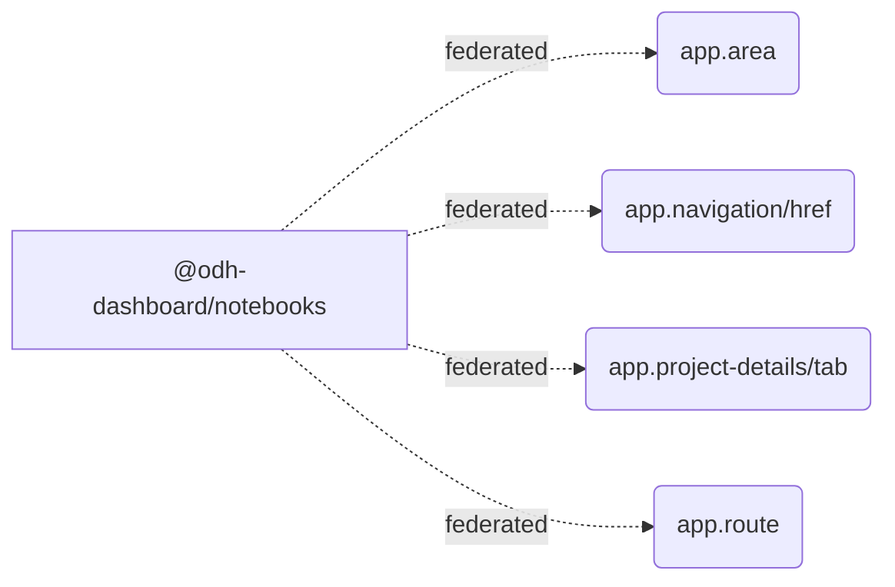

<!-- AUTO-GENERATED by @odh-dashboard/extension-map. Do not edit by hand. -->

> Generated file. Regenerate with `pnpm docs:extension-map`.

## Contents
- [Loading paths](#loading-paths)
- [Contributes](#contributes)
  - [app](#app)
    - [app.area](#apparea)
    - [app.navigation/href](#appnavigationhref)
    - [app.project-details/tab](#appproject-detailstab)
    - [app.route](#approute)

## Loading paths

| Entry | Path | Source |
| --- | --- | --- |
| @odh-dashboard/notebooks#mf:./extensions | federated | `packages/notebooks/upstream/workspaces/frontend/src/odh/extensions.ts` |

## Contributes

### app

| Node | Contract | Registration sources |
| --- | --- | --- |
| [@odh-dashboard/notebooks](#loading-paths) | — | — |
| app.area | [app.area](../../plugin-core/docs/extensions.md#apparea) | [../upstream/workspaces/frontend/src/odh/extensions.ts:13](../upstream/workspaces/frontend/src/odh/extensions.ts#L13-L19) |
| app.navigation/href | [app.navigation/href](../../plugin-core/docs/extensions.md#appnavigationhref) | [../upstream/workspaces/frontend/src/odh/extensions.ts:20](../upstream/workspaces/frontend/src/odh/extensions.ts#L20-L38) |
| app.project-details/tab | [app.project-details/tab](../../plugin-core/docs/extensions.md#appproject-detailstab) | [../upstream/workspaces/frontend/src/odh/extensions.ts:49](../upstream/workspaces/frontend/src/odh/extensions.ts#L49-L59) |
| app.route | [app.route](../../plugin-core/docs/extensions.md#approute) | [../upstream/workspaces/frontend/src/odh/extensions.ts:39](../upstream/workspaces/frontend/src/odh/extensions.ts#L39-L48) |

- `-->` declared or type-resolved contribution
- `==>` derived relationship
- `-. "rendered in" .->` rendered in one hop
- `-. "federated" .->` federated contribution
- `--x` suppression
- `-- "patch" -->` patch

#### app.area

| featureFlags | id | Source |
| --- | --- | --- |
| `"workbenchesV2"` | `PLUGIN_NOTEBOOKS` (`"plugin-notebooks"`) | [app.area](../upstream/workspaces/frontend/src/odh/extensions.ts#L13-L19) |

#### app.navigation/href

**Contribution:** `app.navigation/href` at `packages/notebooks/upstream/workspaces/frontend/src/odh/extensions.ts:20`

- **id**: `"notebooks-kf-workspacekinds"`
- **title**: `"Workbench templates"`
- **section**: `"settings-environment-setup"`
- **label**: `"Dev Preview"`
- **href**: `"/notebooks/workspacekinds"`
- **accessReview**: group: `"kubeflow.org"`, resource: `"workspacekinds"`, verb: `"create"`
- **path**: `"/notebooks/workspacekinds/*"`
- **Requires**: `PLUGIN_NOTEBOOKS` (`"plugin-notebooks"`)
- **Source**: [app.navigation/href](../upstream/workspaces/frontend/src/odh/extensions.ts#L20-L38)

#### app.project-details/tab

| id | title | component | Requires | CodeRef target | Source |
| --- | --- | --- | --- | --- | --- |
| `"workbenches-v2"` | `"Workbenches v2"` | packages/notebooks/upstream/workspaces/frontend/src/odh/WorkspacesProjectDetailsTab.tsx#[WorkspacesProjectDetailsTab](../upstream/workspaces/frontend/src/odh/WorkspacesProjectDetailsTab.tsx#L65-L81) | `PLUGIN_NOTEBOOKS` (`"plugin-notebooks"`) | packages/notebooks/upstream/workspaces/frontend/src/odh/WorkspacesProjectDetailsTab.tsx#[WorkspacesProjectDetailsTab](../upstream/workspaces/frontend/src/odh/WorkspacesProjectDetailsTab.tsx#L65-L81) | [app.project-details/tab](../upstream/workspaces/frontend/src/odh/extensions.ts#L49-L59) |

#### app.route

| component | path | Requires | CodeRef target | Source |
| --- | --- | --- | --- | --- |
| packages/notebooks/upstream/workspaces/frontend/src/odh/NotebooksWrapper.tsx#[NotebooksWrapper](../upstream/workspaces/frontend/src/odh/NotebooksWrapper.tsx#L72-L85) | `"/notebooks/*"` | `PLUGIN_NOTEBOOKS` (`"plugin-notebooks"`) | packages/notebooks/upstream/workspaces/frontend/src/odh/NotebooksWrapper.tsx#[NotebooksWrapper](../upstream/workspaces/frontend/src/odh/NotebooksWrapper.tsx#L72-L85) | [app.route](../upstream/workspaces/frontend/src/odh/extensions.ts#L39-L48) |
