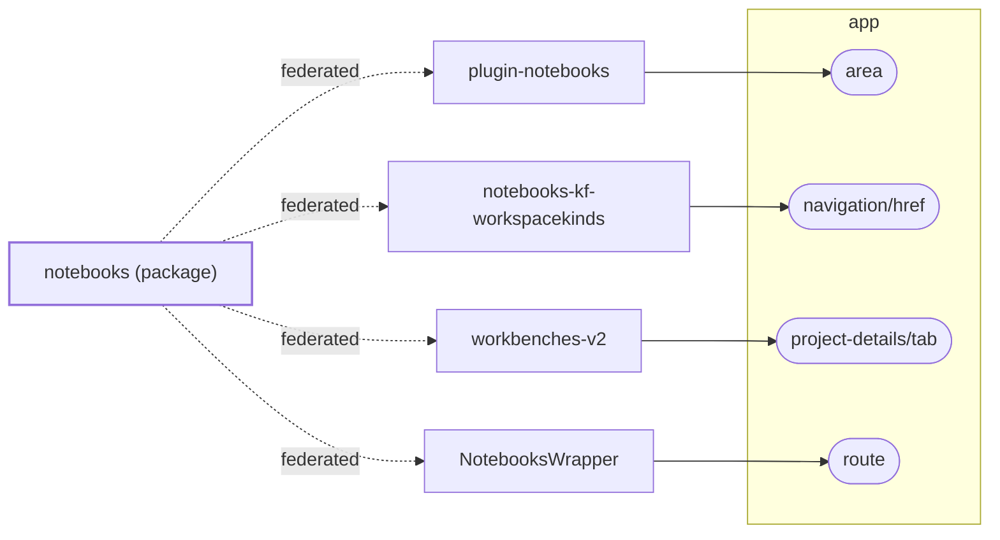

<!-- AUTO-GENERATED by @odh-dashboard/extension-map. Do not edit by hand. -->

> Generated file. Regenerate with `pnpm docs:extension-map`.

# Extensions in notebooks

Package `@odh-dashboard/notebooks` (package) at `packages/notebooks`. Everything below is read out of this repository's sources by static analysis.

## Loading paths

- [extensions.ts](../upstream/workspaces/frontend/src/odh/extensions.ts) (`mf:./extensions`) — loaded at runtime by the host as a Module Federation remote

## Contributes

The extensions this package declares, grouped by the namespace of the extension point they target.

### Namespace `app`

| Node | What | Link |
| --- | --- | --- |
| notebooks (package) | this package | [packages/notebooks](..) |
| plugin-notebooks | extension of app.area — federated | [extensions.ts](../upstream/workspaces/frontend/src/odh/extensions.ts#L13-L19) |
| notebooks-kf-workspacekinds | extension of app.navigation/href — federated | [extensions.ts](../upstream/workspaces/frontend/src/odh/extensions.ts#L20-L38) |
| workbenches-v2 | extension of app.project-details/tab — federated | [extensions.ts](../upstream/workspaces/frontend/src/odh/extensions.ts#L49-L59) |
| NotebooksWrapper | extension of app.route — federated | [extensions.ts](../upstream/workspaces/frontend/src/odh/extensions.ts#L39-L48) |
| area | extension point | [app.area](../../plugin-core/docs/extensions.md#apparea) |
| navigation/href | extension point | [app.navigation/href](../../plugin-core/docs/extensions.md#appnavigationhref) |
| project-details/tab | extension point | [app.project-details/tab](../../plugin-core/docs/extensions.md#appproject-detailstab) |
| route | extension point | [app.route](../../plugin-core/docs/extensions.md#approute) |

#### Contributes to app.area

Defined in [app.area](../../plugin-core/docs/extensions.md#apparea).

| featureFlags | id | Source |
| --- | --- | --- |
| `'workbenchesV2'` | `PLUGIN_NOTEBOOKS` (`'plugin-notebooks'`) | [extensions.ts](../upstream/workspaces/frontend/src/odh/extensions.ts#L13-L19) |

#### Contributes to app.navigation/href

Defined in [app.navigation/href](../../plugin-core/docs/extensions.md#appnavigationhref).

##### notebooks-kf-workspacekinds

- **id:** `'notebooks-kf-workspacekinds'`
- **title:** `'Workbench templates'`
- **section:** `'settings-environment-setup'`
- **label:** `'Dev Preview'`
- **href:** `'/notebooks/workspacekinds'`
- **accessReview:** `{ group: 'kubeflow.org', resource: 'workspacekinds', verb: 'create' }`
- **path:** `'/notebooks/workspacekinds/*'`
- **Requires:** `PLUGIN_NOTEBOOKS` (`'plugin-notebooks'`)
- **Source:** [extensions.ts](../upstream/workspaces/frontend/src/odh/extensions.ts#L20-L38)

#### Contributes to app.project-details/tab

Defined in [app.project-details/tab](../../plugin-core/docs/extensions.md#appproject-detailstab).

| id | title | Requires | CodeRef target | Source |
| --- | --- | --- | --- | --- |
| `'workbenches-v2'` | `'Workbenches v2'` | `PLUGIN_NOTEBOOKS` (`'plugin-notebooks'`) | [WorkspacesProjectDetailsTab#default](../upstream/workspaces/frontend/src/odh/WorkspacesProjectDetailsTab.tsx#L65-L81) | [extensions.ts](../upstream/workspaces/frontend/src/odh/extensions.ts#L49-L59) |

#### Contributes to app.route

Defined in [app.route](../../plugin-core/docs/extensions.md#approute).

| path | Requires | CodeRef target | Source |
| --- | --- | --- | --- |
| `'/notebooks/*'` | `PLUGIN_NOTEBOOKS` (`'plugin-notebooks'`) | [NotebooksWrapper#default](../upstream/workspaces/frontend/src/odh/NotebooksWrapper.tsx#L72-L85) | [extensions.ts](../upstream/workspaces/frontend/src/odh/extensions.ts#L39-L48) |

## Legend

| Edge | What it means in these diagrams |
| --- | --- |
| `A --> B` | A is declared by this package and bundled into an app at build time. It may also be exposed through Module Federation — the node table beside each diagram names every loading path. |
| `A -. "federated" .-> B` | A reaches the host only through a Module Federation remote, loaded at runtime. |
| `A ==> B` | Derived: proven through a type or a JSDoc tag rather than a direct reference. |
| `A -. "rendered in" .-> B` | B renders A (one hop). |
| `A --x B` | A suppresses B. |
| `A -- "patch" --> B` | A patches B. |

A node with a dashed border stands for several extensions of the same point; its `×N` label is
the number of extensions, and the table beside the diagram always lists every one of them.
Anything the analysis could not resolve is never drawn — it is listed in a "Not resolved" table
instead.
