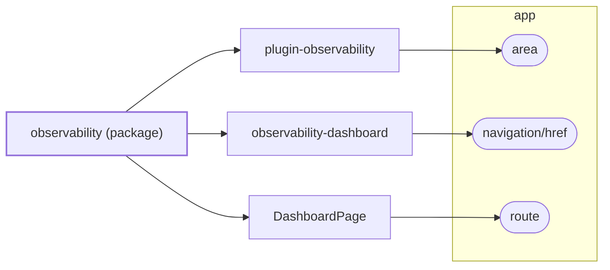

<!-- AUTO-GENERATED by @odh-dashboard/extension-map. Do not edit by hand. -->

> Generated file. Regenerate with `pnpm docs:extension-map`.

# Extensions in observability

Package `@odh-dashboard/observability` (package) at `packages/observability`. Everything below is read out of this repository's sources by static analysis.

## Loading paths

- [extensions.ts](../extensions.ts) (`./extensions`) — bundled into the host at build time (the `./extensions` export)
- [static.ts](../extensions/static.ts) (`./extensions/static`) — bundled by a distribution that imports this export

> **Federation declared but not loaded.** @odh-dashboard/observability declares module federation but the host does not load it as a remote: its module-federation config has no remoteEntry.

## Contributes

The extensions this package declares, grouped by the namespace of the extension point they target.

### Namespace `app`

| Node | What | Link |
| --- | --- | --- |
| observability (package) | this package | [packages/observability](..) |
| plugin-observability | extension of app.area — bundled and bundled by a distribution | [area.ts](../extensions/area.ts#L7-L14) |
| observability-dashboard | extension of app.navigation/href — bundled | [extensions.ts](../extensions.ts#L11-L24) |
| DashboardPage | extension of app.route — bundled | [extensions.ts](../extensions.ts#L25-L34) |
| area | extension point | [app.area](../../plugin-core/docs/extensions.md#apparea) |
| navigation/href | extension point | [app.navigation/href](../../plugin-core/docs/extensions.md#appnavigationhref) |
| route | extension point | [app.route](../../plugin-core/docs/extensions.md#approute) |

#### Contributes to app.area

Defined in [app.area](../../plugin-core/docs/extensions.md#apparea).

| featureFlags | customCondition | id | Source |
| --- | --- | --- | --- |
| `'observabilityDashboard'` | `function` ([customCondition](../extensions/area.ts#L12)) | `PLUGIN_OBSERVABILITY` (`'plugin-observability'`) | [area.ts](../extensions/area.ts#L7-L14) |

#### Contributes to app.navigation/href

Defined in [app.navigation/href](../../plugin-core/docs/extensions.md#appnavigationhref).

##### observability-dashboard

- **id:** `'observability-dashboard'`
- **title:** `'Metrics'`
- **section:** `'observe-and-monitor'`
- **group:** `'1_top'`
- **href:** `'/observe-and-monitor/dashboard'`
- **path:** `'/observe-and-monitor/dashboard/*'`
- **Requires:** `PLUGIN_OBSERVABILITY` (`'plugin-observability'`)
- **Source:** [extensions.ts](../extensions.ts#L11-L24)

#### Contributes to app.route

Defined in [app.route](../../plugin-core/docs/extensions.md#approute).

| path | Requires | CodeRef target | Source |
| --- | --- | --- | --- |
| `'/observe-and-monitor/dashboard/*'` | `PLUGIN_OBSERVABILITY` (`'plugin-observability'`) | [DashboardPage#default](../src/pages/DashboardPage.tsx#L46-L71) | [extensions.ts](../extensions.ts#L25-L34) |

## Diagnostics

What the analysis could not prove, or thought worth reporting, about this package. Warnings are gaps in the generated map; info entries are observations.

| Code | Severity | Message | Source |
| --- | --- | --- | --- |
| `federation-not-loaded` | info | @odh-dashboard/observability declares module federation but the host does not load it as a remote: its module-federation config has no remoteEntry. | — |

## Legend

| Edge | What it means in these diagrams |
| --- | --- |
| `A --> B` | A is declared by this package and bundled into an app at build time. It may also be exposed through Module Federation — the node table beside each diagram names every loading path. |
| `A -. "federated" .-> B` | A reaches the host only through a Module Federation remote, loaded at runtime. |
| `A ==> B` | Derived: proven through a type or a JSDoc tag rather than a direct reference. |
| `A -. "rendered in" .-> B` | B renders A (one hop). |
| `A --x B` | A suppresses B. |
| `A -- "patch" --> B` | A patches B. |

A node with a dashed border stands for several extensions of the same point; its `×N` label is
the number of extensions, and the table beside the diagram always lists every one of them.
Anything the analysis could not resolve is never drawn — it is listed in a "Not resolved" table
instead.
