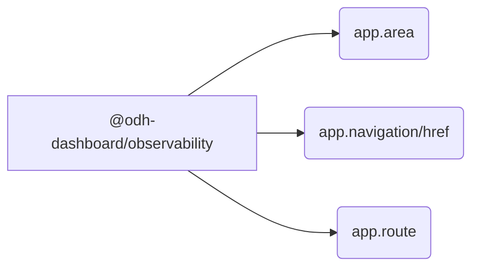

<!-- AUTO-GENERATED by @odh-dashboard/extension-map. Do not edit by hand. -->

> Generated file. Regenerate with `pnpm docs:extension-map`.

## Contents
- [Loading paths](#loading-paths)
- [Contributes](#contributes)
  - [app](#app)
    - [app.area](#apparea)
    - [app.navigation/href](#appnavigationhref)
    - [app.route](#approute)
- [Diagnostics](#diagnostics)

## Loading paths

| Entry | Path | Source |
| --- | --- | --- |
| @odh-dashboard/observability#./extensions | static | `packages/observability/extensions.ts` |
| @odh-dashboard/observability#./extensions/static | distribution-static | `packages/observability/extensions/static.ts` |

_Federation declared but not loaded by the host._

## Contributes

### app

| Node | Contract | Registration sources |
| --- | --- | --- |
| [@odh-dashboard/observability](#loading-paths) | — | — |
| app.area | [app.area](../../plugin-core/docs/extensions.md#apparea) | [../extensions/area.ts:7](../extensions/area.ts#L7-L14) |
| app.navigation/href | [app.navigation/href](../../plugin-core/docs/extensions.md#appnavigationhref) | [../extensions.ts:11](../extensions.ts#L11-L24) |
| app.route | [app.route](../../plugin-core/docs/extensions.md#approute) | [../extensions.ts:25](../extensions.ts#L25-L34) |

- `-->` declared or type-resolved contribution
- `==>` derived relationship
- `-. "rendered in" .->` rendered in one hop
- `-. "federated" .->` federated contribution
- `--x` suppression
- `-- "patch" -->` patch

#### app.area

| featureFlags | customCondition | id | Source |
| --- | --- | --- | --- |
| `"observabilityDashboard"` | [not resolved](#diagnostics) | `PLUGIN_OBSERVABILITY` (`"plugin-observability"`) | [app.area](../extensions/area.ts#L7-L14) |

**Not resolved**

| Location | Reason | Link |
| --- | --- | --- |
| properties.customCondition | CodeRef body is not a supported dynamic import | [diagnostics](#diagnostics) |

#### app.navigation/href

**Contribution:** `app.navigation/href` at `packages/observability/extensions.ts:11`

- **id**: `"observability-dashboard"`
- **title**: `"Metrics"`
- **section**: `"observe-and-monitor"`
- **group**: `"1_top"`
- **href**: `"/observe-and-monitor/dashboard"`
- **path**: `"/observe-and-monitor/dashboard/*"`
- **Requires**: `PLUGIN_OBSERVABILITY` (`"plugin-observability"`)
- **Source**: [app.navigation/href](../extensions.ts#L11-L24)

#### app.route

| component | path | Requires | CodeRef target | Source |
| --- | --- | --- | --- | --- |
| packages/observability/src/pages/DashboardPage.tsx#[DashboardPage](../src/pages/DashboardPage.tsx#L46-L71) | `"/observe-and-monitor/dashboard/*"` | `PLUGIN_OBSERVABILITY` (`"plugin-observability"`) | packages/observability/src/pages/DashboardPage.tsx#[DashboardPage](../src/pages/DashboardPage.tsx#L46-L71) | [app.route](../extensions.ts#L25-L34) |

## Diagnostics

| Code | Message | Link |
| --- | --- | --- |
| `federation-not-loaded` | the host would not load '@odh-dashboard/observability' as a federated remote (no-remoteEntry) | [details](#diagnostics) |
| `unresolved-value` | extension property 'customCondition' contains a value that could not be resolved | [customCondition](../extensions/area.ts#L12-L12) |
