<!-- AUTO-GENERATED by @odh-dashboard/extension-map. Do not edit by hand. -->

> Generated file. Regenerate with `pnpm docs:extension-map`.

# Extensions in plugin-core

Package `@odh-dashboard/plugin-core` (package) at `packages/plugin-core`. Everything below is read out of this repository's sources by static analysis.

[Defines](#defines) · [Consumes](#consumes) · [Diagnostics](#diagnostics) · [Legend](#legend)

## On this page

Every extension point, extension and consumer on this page, each linking to its own section. Links to the code are in those sections.

**Defines**

| Extension point | Implemented by | Consumed in |
| --- | --- | --- |
| [app.area](#apparea) | [agent-ops](../../agent-ops/docs/extensions.md#contributes-to-apparea), [ai-safety](../../ai-safety/docs/extensions.md#contributes-to-apparea), [automl](../../automl/docs/extensions.md#contributes-to-apparea), [autorag](../../autorag/docs/extensions.md#contributes-to-apparea), [core-bff](../../../distributions/core-bff/docs/extensions.md#contributes-to-apparea), [data-connect-hub](../../data-connect-hub/docs/extensions.md#contributes-to-apparea), [data-registry](../../data-registry/docs/extensions.md#contributes-to-apparea), [feature-store](../../feature-store/docs/extensions.md#contributes-to-apparea), [gen-ai](../../gen-ai/docs/extensions.md#contributes-to-apparea), [gpuaas](../../gpuaas/docs/extensions.md#contributes-to-apparea), [kserve](../../kserve/docs/extensions.md#contributes-to-apparea), [llmd-serving](../../llmd-serving/docs/extensions.md#contributes-to-apparea), [maas](../../maas/docs/extensions.md#contributes-to-apparea), [mlflow-embedded](../../mlflow-embedded/docs/extensions.md#contributes-to-apparea), [model-registry](../../model-registry/docs/extensions.md#contributes-to-apparea), [model-serving](../../model-serving/docs/extensions.md#contributes-to-apparea), [model-training](../../model-training/docs/extensions.md#contributes-to-apparea), [nim-serving](../../nim-serving/docs/extensions.md#contributes-to-apparea), [notebooks](../../notebooks/docs/extensions.md#contributes-to-apparea), [observability](../../observability/docs/extensions.md#contributes-to-apparea) | [frontend (core app)](../../../frontend/docs/extensions.md#consumes-apparea) |
| [app.cluster-storage/connected-resources](#appcluster-storageconnected-resources) | [kserve](../../kserve/docs/extensions.md#contributes-to-appcluster-storageconnected-resources) | [frontend (core app)](../../../frontend/docs/extensions.md#consumes-appcluster-storageconnected-resources) |
| [app.cluster-storage/storage-context](#appcluster-storagestorage-context) | [nim-serving](../../nim-serving/docs/extensions.md#contributes-to-appcluster-storagestorage-context) | [frontend (core app)](../../../frontend/docs/extensions.md#consumes-appcluster-storagestorage-context) |
| [app.connection-types/default-value-renderer](#appconnection-typesdefault-value-renderer) | [frontend (core app)](../../../frontend/docs/extensions.md#contributes-to-appconnection-typesdefault-value-renderer) | — |
| [app.connection-types/details-helper](#appconnection-typesdetails-helper) | [frontend (core app)](../../../frontend/docs/extensions.md#contributes-to-appconnection-typesdetails-helper) | — |
| [app.connection-types/form](#appconnection-typesform) | [frontend (core app)](../../../frontend/docs/extensions.md#contributes-to-appconnection-typesform) | — |
| [app.connection-types/form-fields](#appconnection-typesform-fields) | [frontend (core app)](../../../frontend/docs/extensions.md#contributes-to-appconnection-typesform-fields) | — |
| [app.connection-types/service](#appconnection-typesservice) | [frontend (core app)](../../../frontend/docs/extensions.md#contributes-to-appconnection-typesservice) | [connection-types](../../connection-types/docs/extensions.md#consumes-appconnection-typesservice) |
| [app.masthead/about](#appmastheadabout) | unused | unused |
| [app.masthead/brand](#appmastheadbrand) | — | [base-distribution](../../../distributions/base/docs/extensions.md#consumes-appmastheadbrand) |
| [app.masthead/toolbar-item](#appmastheadtoolbar-item) | [maas-portal-distribution](../../../distributions/maas-portal/docs/extensions.md#contributes-to-appmastheadtoolbar-item), [rhaii-distribution](../../../distributions/rhaii/docs/extensions.md#contributes-to-appmastheadtoolbar-item) | [base-distribution](../../../distributions/base/docs/extensions.md#consumes-appmastheadtoolbar-item) |
| [app.masthead/user-menu](#appmastheaduser-menu) | unused | unused |
| [app.navigation/href](#appnavigationhref) | [ai-safety](../../ai-safety/docs/extensions.md#contributes-to-appnavigationhref), [automl](../../automl/docs/extensions.md#contributes-to-appnavigationhref), [autorag](../../autorag/docs/extensions.md#contributes-to-appnavigationhref), [core-bff](../../../distributions/core-bff/docs/extensions.md#contributes-to-appnavigationhref), [data-connect-hub](../../data-connect-hub/docs/extensions.md#contributes-to-appnavigationhref), [eval-hub](../../eval-hub/docs/extensions.md#contributes-to-appnavigationhref), [feature-store](../../feature-store/docs/extensions.md#contributes-to-appnavigationhref), [gen-ai](../../gen-ai/docs/extensions.md#contributes-to-appnavigationhref), [gpuaas](../../gpuaas/docs/extensions.md#contributes-to-appnavigationhref), [hardware-profiles](../../hardware-profiles/docs/extensions.md#contributes-to-appnavigationhref), [frontend (core app)](../../../frontend/docs/extensions.md#contributes-to-appnavigationhref), [maas](../../maas/docs/extensions.md#contributes-to-appnavigationhref), [maas-portal-distribution](../../../distributions/maas-portal/docs/extensions.md#contributes-to-appnavigationhref), [mlflow-embedded](../../mlflow-embedded/docs/extensions.md#contributes-to-appnavigationhref), [model-registry](../../model-registry/docs/extensions.md#contributes-to-appnavigationhref), [model-training](../../model-training/docs/extensions.md#contributes-to-appnavigationhref), [notebooks](../../notebooks/docs/extensions.md#contributes-to-appnavigationhref), [observability](../../observability/docs/extensions.md#contributes-to-appnavigationhref) | [base-distribution](../../../distributions/base/docs/extensions.md#consumes-appnavigationhref), [frontend (core app)](../../../frontend/docs/extensions.md#consumes-appnavigationhref) |
| [app.navigation/section](#appnavigationsection) | [ai-safety](../../ai-safety/docs/extensions.md#contributes-to-appnavigationsection), [core-bff](../../../distributions/core-bff/docs/extensions.md#contributes-to-appnavigationsection), [feature-store](../../feature-store/docs/extensions.md#contributes-to-appnavigationsection), [gen-ai](../../gen-ai/docs/extensions.md#contributes-to-appnavigationsection), [frontend (core app)](../../../frontend/docs/extensions.md#contributes-to-appnavigationsection), [maas](../../maas/docs/extensions.md#contributes-to-appnavigationsection), [rhaii-distribution](../../../distributions/rhaii/docs/extensions.md#contributes-to-appnavigationsection) | [base-distribution](../../../distributions/base/docs/extensions.md#consumes-appnavigationsection), [frontend (core app)](../../../frontend/docs/extensions.md#consumes-appnavigationsection), [plugin-core](#consumes-appnavigationsection) |
| [app.patch](#apppatch) | [maas-portal-distribution](../../../distributions/maas-portal/docs/extensions.md#contributes-to-apppatch) | [plugin-core](#consumes-apppatch) |
| [app.project-details/overview-section](#appproject-detailsoverview-section) | [model-serving](../../model-serving/docs/extensions.md#contributes-to-appproject-detailsoverview-section) | [frontend (core app)](../../../frontend/docs/extensions.md#consumes-appproject-detailsoverview-section) |
| [app.project-details/settings-card](#appproject-detailssettings-card) | [nim-serving](../../nim-serving/docs/extensions.md#contributes-to-appproject-detailssettings-card) | [frontend (core app)](../../../frontend/docs/extensions.md#consumes-appproject-detailssettings-card) |
| [app.project-details/tab](#appproject-detailstab) | [model-serving](../../model-serving/docs/extensions.md#contributes-to-appproject-detailstab), [notebooks](../../notebooks/docs/extensions.md#contributes-to-appproject-detailstab) | [frontend (core app)](../../../frontend/docs/extensions.md#consumes-appproject-detailstab) |
| [app.route](#approute) | [agent-ops](../../agent-ops/docs/extensions.md#contributes-to-approute), [ai-safety](../../ai-safety/docs/extensions.md#contributes-to-approute), [automl](../../automl/docs/extensions.md#contributes-to-approute), [autorag](../../autorag/docs/extensions.md#contributes-to-approute), [core-bff](../../../distributions/core-bff/docs/extensions.md#contributes-to-approute), [data-connect-hub](../../data-connect-hub/docs/extensions.md#contributes-to-approute), [eval-hub](../../eval-hub/docs/extensions.md#contributes-to-approute), [feature-store](../../feature-store/docs/extensions.md#contributes-to-approute), [gen-ai](../../gen-ai/docs/extensions.md#contributes-to-approute), [gpuaas](../../gpuaas/docs/extensions.md#contributes-to-approute), [hardware-profiles](../../hardware-profiles/docs/extensions.md#contributes-to-approute), [frontend (core app)](../../../frontend/docs/extensions.md#contributes-to-approute), [kserve](../../kserve/docs/extensions.md#contributes-to-approute), [llmd-serving](../../llmd-serving/docs/extensions.md#contributes-to-approute), [maas](../../maas/docs/extensions.md#contributes-to-approute), [maas-portal-distribution](../../../distributions/maas-portal/docs/extensions.md#contributes-to-approute), [mlflow](../../mlflow/docs/extensions.md#contributes-to-approute), [mlflow-embedded](../../mlflow-embedded/docs/extensions.md#contributes-to-approute), [model-registry](../../model-registry/docs/extensions.md#contributes-to-approute), [model-serving](../../model-serving/docs/extensions.md#contributes-to-approute), [model-training](../../model-training/docs/extensions.md#contributes-to-approute), [notebooks](../../notebooks/docs/extensions.md#contributes-to-approute), [observability](../../observability/docs/extensions.md#contributes-to-approute), [rhaii-distribution](../../../distributions/rhaii/docs/extensions.md#contributes-to-approute) | [base-distribution](../../../distributions/base/docs/extensions.md#consumes-approute), [frontend (core app)](../../../frontend/docs/extensions.md#consumes-approute) |
| [app.status-provider](#appstatus-provider) | [hardware-profiles](../../hardware-profiles/docs/extensions.md#contributes-to-appstatus-provider) | [frontend (core app)](../../../frontend/docs/extensions.md#consumes-appstatus-provider) |
| [app.suppress](#appsuppress) | [maas-portal-distribution](../../../distributions/maas-portal/docs/extensions.md#contributes-to-appsuppress) | [plugin-core](#consumes-appsuppress) |
| [app.tab-route/page](#apptab-routepage) | [data-registry](../../data-registry/docs/extensions.md#contributes-to-apptab-routepage), [frontend (core app)](../../../frontend/docs/extensions.md#contributes-to-apptab-routepage), [model-serving](../../model-serving/docs/extensions.md#contributes-to-apptab-routepage), [rhaii-distribution](../../../distributions/rhaii/docs/extensions.md#contributes-to-apptab-routepage) | [base-distribution](../../../distributions/base/docs/extensions.md#consumes-apptab-routepage), [gen-ai](../../gen-ai/docs/extensions.md#consumes-apptab-routepage), [frontend (core app)](../../../frontend/docs/extensions.md#consumes-apptab-routepage), [model-registry](../../model-registry/docs/extensions.md#consumes-apptab-routepage) |
| [app.tab-route/tab](#apptab-routetab) | [agent-ops](../../agent-ops/docs/extensions.md#contributes-to-apptab-routetab), [data-registry](../../data-registry/docs/extensions.md#contributes-to-apptab-routetab), [kserve](../../kserve/docs/extensions.md#contributes-to-apptab-routetab), [llmd-serving](../../llmd-serving/docs/extensions.md#contributes-to-apptab-routetab), [mlflow-embedded](../../mlflow-embedded/docs/extensions.md#contributes-to-apptab-routetab), [model-registry](../../model-registry/docs/extensions.md#contributes-to-apptab-routetab), [model-serving](../../model-serving/docs/extensions.md#contributes-to-apptab-routetab) | [base-distribution](../../../distributions/base/docs/extensions.md#consumes-apptab-routetab), [gen-ai](../../gen-ai/docs/extensions.md#consumes-apptab-routetab), [frontend (core app)](../../../frontend/docs/extensions.md#consumes-apptab-routetab), [model-registry](../../model-registry/docs/extensions.md#consumes-apptab-routetab) |
| [app.task/group](#apptaskgroup) | [gen-ai](../../gen-ai/docs/extensions.md#contributes-to-apptaskgroup), [frontend (core app)](../../../frontend/docs/extensions.md#contributes-to-apptaskgroup) | [frontend (core app)](../../../frontend/docs/extensions.md#consumes-apptaskgroup) |
| [app.task/item](#apptaskitem) | [autorag](../../autorag/docs/extensions.md#contributes-to-apptaskitem), [eval-hub](../../eval-hub/docs/extensions.md#contributes-to-apptaskitem), [feature-store](../../feature-store/docs/extensions.md#contributes-to-apptaskitem), [gen-ai](../../gen-ai/docs/extensions.md#contributes-to-apptaskitem), [frontend (core app)](../../../frontend/docs/extensions.md#contributes-to-apptaskitem), [maas](../../maas/docs/extensions.md#contributes-to-apptaskitem), [mlflow-embedded](../../mlflow-embedded/docs/extensions.md#contributes-to-apptaskitem), [model-training](../../model-training/docs/extensions.md#contributes-to-apptaskitem) | [frontend (core app)](../../../frontend/docs/extensions.md#consumes-apptaskitem) |
| [core.action](#coreaction) | [mlflow](../../mlflow/docs/extensions.md#contributes-to-coreaction), [model-registry](../../model-registry/docs/extensions.md#contributes-to-coreaction), [model-serving](../../model-serving/docs/extensions.md#contributes-to-coreaction) | [mlflow-embedded](../../mlflow-embedded/docs/extensions.md#consumes-coreaction), [model-registry](../../model-registry/docs/extensions.md#consumes-coreaction) |
| [core.detail-card](#coredetail-card) | [model-serving](../../model-serving/docs/extensions.md#contributes-to-coredetail-card) | [model-registry](../../model-registry/docs/extensions.md#consumes-coredetail-card) |
| [core.detail/tab](#coredetailtab) | [maas](../../maas/docs/extensions.md#contributes-to-coredetailtab), [model-registry](../../model-registry/docs/extensions.md#contributes-to-coredetailtab), [model-serving](../../model-serving/docs/extensions.md#contributes-to-coredetailtab) | [model-registry](../../model-registry/docs/extensions.md#consumes-coredetailtab), [model-serving](../../model-serving/docs/extensions.md#consumes-coredetailtab) |
| [core.table-column](#coretable-column) | [model-serving](../../model-serving/docs/extensions.md#contributes-to-coretable-column) | [model-registry](../../model-registry/docs/extensions.md#consumes-coretable-column) |

**Consumes**

| Consumer | Extension point |
| --- | --- |
| [getTopLevelExtensions](#consumes-appnavigationsection) | [app.navigation/section](#appnavigationsection) |
| [extractPatches](#consumes-apppatch) | [app.patch](#apppatch) |
| [applySuppress](#consumes-appsuppress) | [app.suppress](#appsuppress) |

## Defines

The extension points this package declares. Each heading is the point ID other packages use as an extension's `type`.

### app.area

Provides feature flags for the host application.

Declared as [AreaExtension](../src/extension-points/areas.ts#L7-L15).

**Properties:**

| Property | Required | Type | CodeRef of | Description |
| --- | --- | --- | --- | --- |
| `reliantAreas` | — | `SupportedAreaType[]` | — | An area can be reliant on another area being enabled. The list is "OR"-ed together. Example, Model Serving is a shell for KServe. It has no value on its own. It can also be a chain of reliance... example, Custom Runtimes is a Model Serving feature. TODO: support AND -- maybe double array? |
| `requiredCapabilities` | — | `StackCapability[]` | — | Required capabilities supported by the Operator. The list is "AND"-ed together. If the Operator does not support the capability, the area is not available. The capabilities are retrieved from the DSCI status. |
| `devFlags` | — | `string[]` | — | Flags that are only available to developers. |
| `featureFlags` | — | `FeatureFlag[]` | — | Refers to OdhDashboardConfig's feature flags, any number of them to be "enabled", the result is AND-ed. Omit to not be related to any feature flag. Note: "disable<FlagName>" methodology is confusing and needs to be removed Note: "Enabled" will mean "disable<FlagName>" is false |
| `requiredComponents` | — | `DataScienceStackComponent[]` | — | Refers to the related stack component names. If a backend component is not installed, this can prevent the feature flag from enabling the item. Omit to not be reliant on a backend component. |
| `customCondition` | — | `CustomConditionFunction` | — | Optional function to check for a condition that is not covered by other checks. Example, checking there exists a specific condition in the DSC status. |
| `id` | yes | `string` | — | The ID of the area. |

**Implemented by:** [agent-ops](../../agent-ops/docs/extensions.md#contributes-to-apparea), [ai-safety](../../ai-safety/docs/extensions.md#contributes-to-apparea), [automl](../../automl/docs/extensions.md#contributes-to-apparea), [autorag](../../autorag/docs/extensions.md#contributes-to-apparea), [core-bff](../../../distributions/core-bff/docs/extensions.md#contributes-to-apparea), [data-connect-hub](../../data-connect-hub/docs/extensions.md#contributes-to-apparea), [data-registry](../../data-registry/docs/extensions.md#contributes-to-apparea), [feature-store](../../feature-store/docs/extensions.md#contributes-to-apparea), [gen-ai](../../gen-ai/docs/extensions.md#contributes-to-apparea), [gpuaas](../../gpuaas/docs/extensions.md#contributes-to-apparea), [kserve](../../kserve/docs/extensions.md#contributes-to-apparea), [llmd-serving](../../llmd-serving/docs/extensions.md#contributes-to-apparea), [maas](../../maas/docs/extensions.md#contributes-to-apparea), [mlflow-embedded](../../mlflow-embedded/docs/extensions.md#contributes-to-apparea), [model-registry](../../model-registry/docs/extensions.md#contributes-to-apparea), [model-serving](../../model-serving/docs/extensions.md#contributes-to-apparea), [model-training](../../model-training/docs/extensions.md#contributes-to-apparea), [nim-serving](../../nim-serving/docs/extensions.md#contributes-to-apparea), [notebooks](../../notebooks/docs/extensions.md#contributes-to-apparea), [observability](../../observability/docs/extensions.md#contributes-to-apparea)

**Consumed in:** [frontend (core app)](../../../frontend/docs/extensions.md#consumes-apparea)

**Consumers:**

| Consumer | Package | Query | Uses | Rendered or called in |
| --- | --- | --- | --- | --- |
| [Inner](../../../frontend/src/concepts/areas/AreaContext.tsx#L36-L102) | frontend (core app) | [useExtensions](../../../frontend/src/concepts/areas/AreaContext.tsx#L48) | `properties` — read, direct ([AreaContext.tsx:67](../../../frontend/src/concepts/areas/AreaContext.tsx#L67)) `properties.id` — read, direct ([AreaContext.tsx:67](../../../frontend/src/concepts/areas/AreaContext.tsx#L67)) | AreaContextProvider ([AreaContext.tsx:141](../../../frontend/src/concepts/areas/AreaContext.tsx#L141-L147)) |
| [useDevFlags](../../../frontend/src/app/featureFlags/useDevFeatureFlags.ts#L19-L35) | frontend (core app) | [useExtensions](../../../frontend/src/app/featureFlags/useDevFeatureFlags.ts#L20) | `properties.devFlags` — read, direct ([useDevFeatureFlags.ts:27](../../../frontend/src/app/featureFlags/useDevFeatureFlags.ts#L27)) | FeatureFlagModal (called at [FeatureFlagModal.tsx:25](../../../frontend/src/app/featureFlags/FeatureFlagModal.tsx#L25)) useDevFeatureFlags (called at [useDevFeatureFlags.ts:67](../../../frontend/src/app/featureFlags/useDevFeatureFlags.ts#L67)) |

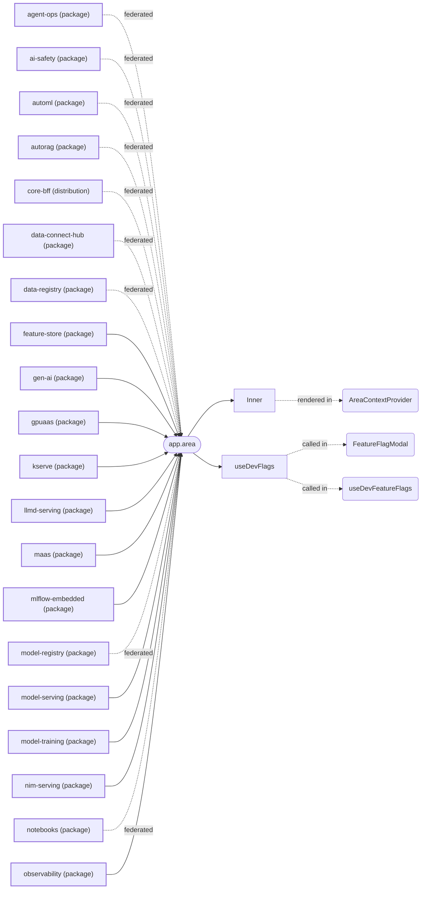

### app.cluster-storage/connected-resources

Contributes "connected resources" to the cluster storage table: a feature package lists its own
resources for the project (e.g. KServe ServingRuntimes) and renders which ones reference a given
PVC, without the host knowing about those resource types.

Declared as [ClusterStorageConnectedResourcesExtension](../src/extension-points/cluster-storage.ts#L76-L79), with type parameters `TData`.

**Properties:**

| Property | Required | Type | CodeRef of | Description |
| --- | --- | --- | --- | --- |
| `useConnectedResources` | yes | `CodeRef<(project: ProjectKind) => ClusterStorageConnectedResources<TData>>` | `(project: ProjectKind) => ClusterStorageConnectedResources<TData>` | Hook listing the project resources that may be connected to a PVC. |
| `getConnectedResources` | yes | `CodeRef< (pvc: PersistentVolumeClaimKind, data: TData) => ConnectedResourceLabel[] >` | `(pvc: PersistentVolumeClaimKind, data: TData) => ConnectedResourceLabel[]` | Given a PVC and the data fetched by `useConnectedResources`, returns label descriptors for the resources connected to that PVC (empty when none). |

**Implemented by:** [kserve](../../kserve/docs/extensions.md#contributes-to-appcluster-storageconnected-resources)

**Consumed in:** [frontend (core app)](../../../frontend/docs/extensions.md#consumes-appcluster-storageconnected-resources)

**Consumers:**

| Consumer | Package | Query | Uses | Rendered or called in |
| --- | --- | --- | --- | --- |
| [getConnectedResourceLabels](../../../frontend/src/pages/projects/screens/detail/storage/useClusterStorageConnectedResources.tsx#L45-L52) | frontend (core app) | — | `properties.getConnectedResources` — call, direct ([useClusterStorageConnectedResources.tsx:49](../../../frontend/src/pages/projects/screens/detail/storage/useClusterStorageConnectedResources.tsx#L49)) | — |
| [useClusterStorageConnectedResources](../../../frontend/src/pages/projects/screens/detail/storage/useClusterStorageConnectedResources.tsx#L26-L69) | frontend (core app) | [useExtensions](../../../frontend/src/pages/projects/screens/detail/storage/useClusterStorageConnectedResources.tsx#L29) [useResolvedExtensions](../../../frontend/src/pages/projects/screens/detail/storage/useClusterStorageConnectedResources.tsx#L30-L32) | `properties.useConnectedResources` — hook-run, direct ([useClusterStorageConnectedResources.tsx:57](../../../frontend/src/pages/projects/screens/detail/storage/useClusterStorageConnectedResources.tsx#L57)) | StorageTable (called at [StorageTable.tsx:61](../../../frontend/src/pages/projects/screens/detail/storage/StorageTable.tsx#L61)) |

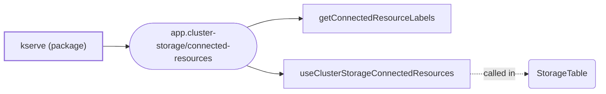

### app.cluster-storage/storage-context

Contributes a storage context type (e.g. "NIM storage") to the cluster storage tab and the
cluster storage form, letting feature packages label their own PVCs without the host knowing
about them.

Declared as [ClusterStorageContextExtension](../src/extension-points/cluster-storage.ts#L33-L36).

**Properties:**

| Property | Required | Type | CodeRef of | Description |
| --- | --- | --- | --- | --- |
| `title` | yes | `string` | — | Display name of the storage context, shown in the storage table and the PVC form. |
| `description` | — | `string` | — | Optional help text describing when to use this storage context. |
| `isPVCUsingStorageContextType` | yes | `CodeRef<(pvc: PersistentVolumeClaimKind) => boolean>` | `(pvc: PersistentVolumeClaimKind) => boolean` | Returns `true` when the given PVC belongs to this storage context. |
| `PVCStorageContextSettingsFields` | yes | `ComponentCodeRef<PVCStorageContextSettingsFieldsProps>` | `{ default: ComponentType<PVCStorageContextSettingsFieldsProps>; }` | Settings fields shown when editing an existing PVC of this context type. |

**Implemented by:** [nim-serving](../../nim-serving/docs/extensions.md#contributes-to-appcluster-storagestorage-context)

**Consumed in:** [frontend (core app)](../../../frontend/docs/extensions.md#consumes-appcluster-storagestorage-context)

**Consumers:**

| Consumer | Package | Query | Uses | Rendered or called in |
| --- | --- | --- | --- | --- |
| [useStorageContextType](../../../frontend/src/pages/projects/screens/detail/storage/useStorageContextType.tsx#L33-L60) | frontend (core app) | [useResolvedExtensions](../../../frontend/src/pages/projects/screens/detail/storage/useStorageContextType.tsx#L37-L39) | — | StorageList (called at [StorageList.tsx:22](../../../frontend/src/pages/projects/screens/detail/storage/StorageList.tsx#L22)) |

**Flow:** nim-serving → app.cluster-storage/storage-context → frontend (core app) · useStorageContextType → called in StorageList

### app.connection-types/default-value-renderer

Declared as [DefaultValueTextRendererExtension](../src/extension-points/connection-types.ts#L74-L77).

**Properties:**

| Property | Required | Type | CodeRef of | Description |
| --- | --- | --- | --- | --- |
| `component` | yes | `ComponentCodeRef<DefaultValueTextRendererProps>` | `{ default: ComponentType<DefaultValueTextRendererProps>; }` |  |

**Implemented by:** [frontend (core app)](../../../frontend/docs/extensions.md#contributes-to-appconnection-typesdefault-value-renderer)

> **No consumers.** No code in this repository queries or uses this point.

**Flow:** frontend (core app) → app.connection-types/default-value-renderer → (no consumers)

### app.connection-types/details-helper

Declared as [ConnectionDetailsHelperTextExtension](../src/extension-points/connection-types.ts#L58-L61).

**Properties:**

| Property | Required | Type | CodeRef of | Description |
| --- | --- | --- | --- | --- |
| `component` | yes | `ComponentCodeRef<ConnectionDetailsHelperTextProps>` | `{ default: ComponentType<ConnectionDetailsHelperTextProps>; }` |  |

**Implemented by:** [frontend (core app)](../../../frontend/docs/extensions.md#contributes-to-appconnection-typesdetails-helper)

> **No consumers.** No code in this repository queries or uses this point.

**Flow:** frontend (core app) → app.connection-types/details-helper → (no consumers)

### app.connection-types/form

Declared as [ConnectionTypeFormExtension](../src/extension-points/connection-types.ts#L84-L87).

**Properties:**

| Property | Required | Type | CodeRef of | Description |
| --- | --- | --- | --- | --- |
| `component` | yes | `ComponentCodeRef` | `{ default: ComponentType<AnyObject>; }` |  |

**Implemented by:** [frontend (core app)](../../../frontend/docs/extensions.md#contributes-to-appconnection-typesform)

> **No consumers.** No code in this repository queries or uses this point.

**Flow:** frontend (core app) → app.connection-types/form → (no consumers)

### app.connection-types/form-fields

Declared as [ConnectionTypeFormFieldsExtension](../src/extension-points/connection-types.ts#L45-L48).

**Properties:**

| Property | Required | Type | CodeRef of | Description |
| --- | --- | --- | --- | --- |
| `component` | yes | `ComponentCodeRef<ConnectionTypeFormFieldsProps>` | `{ default: ComponentType<ConnectionTypeFormFieldsProps>; }` |  |

**Implemented by:** [frontend (core app)](../../../frontend/docs/extensions.md#contributes-to-appconnection-typesform-fields)

> **No consumers.** No code in this repository queries or uses this point.

**Flow:** frontend (core app) → app.connection-types/form-fields → (no consumers)

### app.connection-types/service

Declared as [ConnectionTypesServiceExtension](../src/extension-points/connection-types.ts#L21-L24).

**Properties:**

| Property | Required | Type | CodeRef of | Description |
| --- | --- | --- | --- | --- |
| `fetchConnectionTypes` | yes | `CodeRef<() => Promise<ConnectionTypeConfigMapObj[]>>` | `() => Promise<ConnectionTypeConfigMapObj[]>` |  |
| `fetchConnections` | yes | `CodeRef<(namespace: string, labelSelector?: string) => Promise<Connection[]>>` | `(namespace: string, labelSelector?: string \| undefined) => Promise<Connection[]>` |  |

**Implemented by:** [frontend (core app)](../../../frontend/docs/extensions.md#contributes-to-appconnection-typesservice)

**Consumed in:** [connection-types](../../connection-types/docs/extensions.md#consumes-appconnection-typesservice)

**Consumers:**

| Consumer | Package | Query | Uses | Rendered or called in |
| --- | --- | --- | --- | --- |
| [useServingConnections](../../connection-types/src/useServingConnections.ts#L15-L49) | connection-types | [useResolvedExtensions](../../connection-types/src/useServingConnections.ts#L20-L22) | `properties.fetchConnections` — read, direct ([useServingConnections.ts:24](../../connection-types/src/useServingConnections.ts#L24)) | ConnectionDropdown (called at [ConnectionDropdown.tsx:29](../../../frontend/src/concepts/modelRegistry/content/ConnectionDropdown.tsx#L29)) DeployPrefilledModelModalContents (called at [DeployPrefilledModelModal.tsx:68](../../../frontend/src/pages/modelServing/screens/projects/DeployPrefilledModelModal.tsx#L68)) usePrefillModelDeployModal (called at [usePrefillModelDeployModal.ts:40](../../../frontend/src/pages/modelServing/screens/projects/usePrefillModelDeployModal.ts#L40-L42)) |
| [useWatchConnectionTypes](../../connection-types/src/useWatchConnectionTypes.ts#L15-L42) | connection-types | [useResolvedExtensions](../../connection-types/src/useWatchConnectionTypes.ts#L18-L20) | `properties.fetchConnectionTypes` — read, direct ([useWatchConnectionTypes.ts:22](../../connection-types/src/useWatchConnectionTypes.ts#L22)) | ConnectionTypesPage (called at [ConnectionTypesPage.tsx:11](../../../frontend/src/pages/connectionTypes/ConnectionTypesPage.tsx#L11)) ManageConnectionTypePage (called at [ManageConnectionTypePage.tsx:63](../../../frontend/src/pages/connectionTypes/manage/ManageConnectionTypePage.tsx#L63)) ConnectionSection (called at [ConnectionSection.tsx:268](../../../frontend/src/pages/modelServing/screens/projects/InferenceServiceModal/ConnectionSection.tsx#L268)) usePrefillModelDeployModal (called at [usePrefillModelDeployModal.ts:48](../../../frontend/src/pages/modelServing/screens/projects/usePrefillModelDeployModal.ts#L48)) FineTunePage (called at [FineTunePage.tsx:63](../../../frontend/src/pages/pipelines/global/modelCustomization/FineTunePage.tsx#L63)) ConnectionsList (called at [ConnectionsList.tsx:25](../../../frontend/src/pages/projects/screens/detail/connections/ConnectionsList.tsx#L25)) ConnectionsFormSection (called at [ConnectionsFormSection.tsx:82](../../../frontend/src/pages/projects/screens/spawner/connections/ConnectionsFormSection.tsx#L82)) AutomlConfigure (called at [AutomlConfigure.tsx:137](../../automl/frontend/src/app/components/configure/AutomlConfigure.tsx#L137)) AutoragConfigure (called at [AutoragConfigure.tsx:184](../../autorag/frontend/src/app/components/configure/AutoragConfigure.tsx#L184)) |

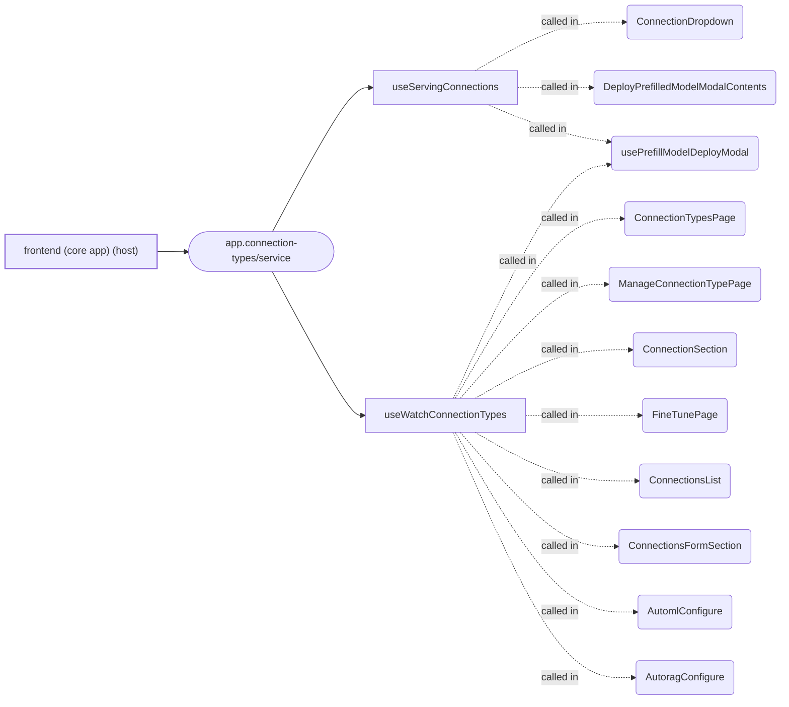

### app.masthead/about

Provides about/help modal content for the host application masthead.

The rendered component receives `onClose` — it MUST call it to dismiss the modal.

Declared as [MastheadAboutExtension](../src/extension-points/masthead.ts#L70-L76).

**Properties:**

| Property | Required | Type | CodeRef of | Description |
| --- | --- | --- | --- | --- |
| `component` | yes | `ComponentCodeRef<{ onClose: () => void }>` | `{ default: ComponentType<{ onClose: () => void; }>; }` | The component to render inside the about/help modal. Receives { onClose: () => void }. |

> **Unused.** No package in this repository contributes an extension of this point, and no code queries or uses it.

### app.masthead/brand

Provides branding for the host application masthead.

Declared as [MastheadBrandExtension](../src/extension-points/masthead.ts#L17-L27).

**Properties:**

| Property | Required | Type | CodeRef of | Description |
| --- | --- | --- | --- | --- |
| `logoComponent` | yes | `ComponentCodeRef` | `{ default: ComponentType<AnyObject>; }` | The component to render as the brand logo. |
| `logoAlt` | yes | `string` | — | Alt text for the brand logo. |
| `href` | — | `string` | — | Optional link href for the brand. Defaults to '/'. |

**Consumed in:** [base-distribution](../../../distributions/base/docs/extensions.md#consumes-appmastheadbrand)

> **No contributors.** No package in this repository contributes an extension of this point.

**Consumers:**

| Consumer | Package | Query | Uses | Rendered or called in |
| --- | --- | --- | --- | --- |
| [ShellBrand](../../../distributions/base/src/ShellHeader.tsx#L27-L55) | base-distribution | [useExtensions](../../../distributions/base/src/ShellHeader.tsx#L28) | `properties.href` — read, direct ([ShellHeader.tsx:32](../../../distributions/base/src/ShellHeader.tsx#L32)) `properties.logoComponent` — lazy-render, direct ([ShellHeader.tsx:32](../../../distributions/base/src/ShellHeader.tsx#L32)) | ShellHeader ([ShellHeader.tsx:93](../../../distributions/base/src/ShellHeader.tsx#L93)) |

**Flow:** (no contributors) → app.masthead/brand → base-distribution · ShellBrand → rendered in ShellHeader

### app.masthead/toolbar-item

Adds a toolbar item to the host application masthead.

Declared as [MastheadToolbarItemExtension](../src/extension-points/masthead.ts#L32-L44).

**Properties:**

| Property | Required | Type | CodeRef of | Description |
| --- | --- | --- | --- | --- |
| `id` | yes | `string` | — | A unique identifier for this toolbar item. |
| `component` | yes | `ComponentCodeRef` | `{ default: ComponentType<AnyObject>; }` | The component to render in the toolbar. |
| `group` | — | `string` | — | Group used for lexicographic sorting of toolbar items. |
| `position` | — | `'leading' \| 'trailing'` | — | Where to render relative to the theme toggle. Defaults to 'leading'. |

**Implemented by:** [maas-portal-distribution](../../../distributions/maas-portal/docs/extensions.md#contributes-to-appmastheadtoolbar-item), [rhaii-distribution](../../../distributions/rhaii/docs/extensions.md#contributes-to-appmastheadtoolbar-item)

**Consumed in:** [base-distribution](../../../distributions/base/docs/extensions.md#consumes-appmastheadtoolbar-item)

**Consumers:**

| Consumer | Package | Query | Uses | Rendered or called in |
| --- | --- | --- | --- | --- |
| [ToolbarItems](../../../distributions/base/src/ShellHeader.tsx#L66-L76) | base-distribution | — | `properties.component` — lazy-render, direct ([ShellHeader.tsx:72](../../../distributions/base/src/ShellHeader.tsx#L72)) | ShellHeader ([ShellHeader.tsx:99](../../../distributions/base/src/ShellHeader.tsx#L99)) ShellHeader ([ShellHeader.tsx:116](../../../distributions/base/src/ShellHeader.tsx#L116)) |
| [useToolbarExtensions](../../../distributions/base/src/ShellHeader.tsx#L57-L64) | base-distribution | [useExtensions](../../../distributions/base/src/ShellHeader.tsx#L58) | `properties.position` — read, direct ([ShellHeader.tsx:60](../../../distributions/base/src/ShellHeader.tsx#L60) (+1 more)) | ShellHeader (called at [ShellHeader.tsx:80](../../../distributions/base/src/ShellHeader.tsx#L80)) |

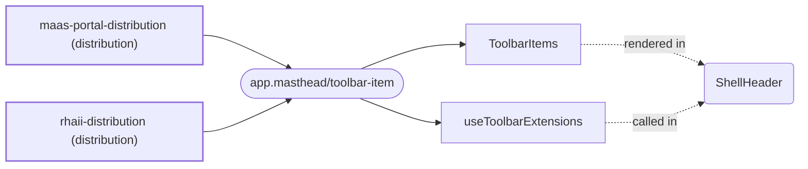

### app.masthead/user-menu

Provides user identity and menu for the host application masthead.

The shell owns the dropdown structure and assembles these pieces.
Unlike fully plugin-driven controls, the shell controls layout,
loading state, and consistent positioning (e.g. logout is always last).

Declared as [MastheadUserMenuExtension](../src/extension-points/masthead.ts#L53-L63).

**Properties:**

| Property | Required | Type | CodeRef of | Description |
| --- | --- | --- | --- | --- |
| `usernameRef` | yes | `ComponentCodeRef` | `{ default: ComponentType<AnyObject>; }` | Component that renders the current user's display name. |
| `logoutRef` | yes | `ComponentCodeRef` | `{ default: ComponentType<AnyObject>; }` | Component that renders the logout action (button, link, or redirect trigger). |
| `menuItemsRef` | — | `ComponentCodeRef` | `ComponentCodeRef` | Optional component that renders additional menu items (profile, preferences). |

> **Unused.** No package in this repository contributes an extension of this point, and no code queries or uses it.

### app.navigation/href

Adds a navigation item to the host application.

Declared as [HrefNavItemExtension](../src/extension-points/navigation.ts#L15-L34).

**Properties:**

| Property | Required | Type | CodeRef of | Description |
| --- | --- | --- | --- | --- |
| `id` | yes | `string` | — | A unique identifier for this item. |
| `title` | yes | `string` | — | The title of this item. |
| `section` | — | `string` | — | Navigation section to which this item belongs to. If not specified, render this item at the top level. |
| `dataAttributes` | — | `{ [key: string]: string }` | — | Adds data attributes to the DOM. |
| `group` | — | `string` | — | Group are used to sort items lexicographically. Unspecified items will be sorted into the '5_default' group. |
| `iconRef` | — | `ComponentCodeRef` | `ComponentCodeRef` | Icon reference for this item. |
| `label` | — | `string` | — | Label for this item. |
| `href` | yes | `string` | — | The link href value. |
| `accessReview` | — | `AccessReviewResourceAttributes` | — | The access review resource attributes for this item. |
| `statusProviderId` | — | `string` | — | The status provider ID for this item. |
| `path` | — | `string` | — | The react-router path pattern to match against the current location. If not supplied, the `href` is used to match against current location. A successful match will highlight the item as active. |
| `trackingEvent` | — | `NavTrackingEvent` | — | Optional tracking event fired when the nav item is clicked. |

**Implemented by:** [ai-safety](../../ai-safety/docs/extensions.md#contributes-to-appnavigationhref), [automl](../../automl/docs/extensions.md#contributes-to-appnavigationhref), [autorag](../../autorag/docs/extensions.md#contributes-to-appnavigationhref), [core-bff](../../../distributions/core-bff/docs/extensions.md#contributes-to-appnavigationhref), [data-connect-hub](../../data-connect-hub/docs/extensions.md#contributes-to-appnavigationhref), [eval-hub](../../eval-hub/docs/extensions.md#contributes-to-appnavigationhref), [feature-store](../../feature-store/docs/extensions.md#contributes-to-appnavigationhref), [gen-ai](../../gen-ai/docs/extensions.md#contributes-to-appnavigationhref), [gpuaas](../../gpuaas/docs/extensions.md#contributes-to-appnavigationhref), [hardware-profiles](../../hardware-profiles/docs/extensions.md#contributes-to-appnavigationhref), [frontend (core app)](../../../frontend/docs/extensions.md#contributes-to-appnavigationhref), [maas](../../maas/docs/extensions.md#contributes-to-appnavigationhref), [maas-portal-distribution](../../../distributions/maas-portal/docs/extensions.md#contributes-to-appnavigationhref), [mlflow-embedded](../../mlflow-embedded/docs/extensions.md#contributes-to-appnavigationhref), [model-registry](../../model-registry/docs/extensions.md#contributes-to-appnavigationhref), [model-training](../../model-training/docs/extensions.md#contributes-to-appnavigationhref), [notebooks](../../notebooks/docs/extensions.md#contributes-to-appnavigationhref), [observability](../../observability/docs/extensions.md#contributes-to-appnavigationhref)

**Consumed in:** [base-distribution](../../../distributions/base/docs/extensions.md#consumes-appnavigationhref), [frontend (core app)](../../../frontend/docs/extensions.md#consumes-appnavigationhref)

**Consumers:**

| Consumer | Package | Query | Uses | Rendered or called in |
| --- | --- | --- | --- | --- |
| [NavSectionItem](../../../distributions/base/src/ShellNav.tsx#L100-L166) | base-distribution | [useExtensions](../../../distributions/base/src/ShellNav.tsx#L106) | `properties.section` — read, direct, one of: app.navigation/href, app.navigation/section, app.tab-route/page ([ShellNav.tsx:124](../../../distributions/base/src/ShellNav.tsx#L124)) `properties.href` — read, direct ([ShellNav.tsx:131](../../../distributions/base/src/ShellNav.tsx#L131)) `properties.path` — read, direct ([ShellNav.tsx:131](../../../distributions/base/src/ShellNav.tsx#L131)) | ShellNavItem ([ShellNav.tsx:172](../../../distributions/base/src/ShellNav.tsx#L172)) |
| [ShellNav](../../../distributions/base/src/ShellNav.tsx#L183-L203) | base-distribution | [useExtensions](../../../distributions/base/src/ShellNav.tsx#L184) | — | `<module>` ([bootstrap.tsx:19](../../../distributions/base/src/bootstrap.tsx#L19)) DistributionApp ([createDistribution.tsx:58](../../../distributions/base/src/createDistribution.tsx#L58)) |
| [ExtensibleNav](../../../frontend/src/app/navigation/ExtensibleNav.tsx#L18-L35) | frontend (core app) | [useExtensions](../../../frontend/src/app/navigation/ExtensibleNav.tsx#L19) | `properties.id` — read, direct, one of: app.navigation/href, app.navigation/section, app.tab-route/page ([ExtensibleNav.tsx:30](../../../frontend/src/app/navigation/ExtensibleNav.tsx#L30)) | NavSidebar ([NavSidebar.tsx:8](../../../frontend/src/app/NavSidebar.tsx#L8)) |
| [NavSection](../../../frontend/src/app/navigation/NavSection.tsx#L57-L214) | frontend (core app) | [useExtensions](../../../frontend/src/app/navigation/NavSection.tsx#L64) | `properties.section` — read, direct, one of: app.navigation/href, app.navigation/section, app.tab-route/page ([NavSection.tsx:83](../../../frontend/src/app/navigation/NavSection.tsx#L83)) `properties.id` — read, direct, one of: app.navigation/href, app.navigation/section, app.tab-route/page ([NavSection.tsx:90](../../../frontend/src/app/navigation/NavSection.tsx#L90) (+2 more)) | NavItem ([NavItem.tsx:20](../../../frontend/src/app/navigation/NavItem.tsx#L20)) |
| [collectDescendants](../../../frontend/src/app/navigation/NavSection.tsx#L92-L105) | frontend (core app) | — | `properties.section` — read, direct, one of: app.navigation/href, app.navigation/section, app.tab-route/page ([NavSection.tsx:99](../../../frontend/src/app/navigation/NavSection.tsx#L99)) `properties.id` — read, direct, one of: app.navigation/href, app.navigation/section, app.tab-route/page ([NavSection.tsx:101](../../../frontend/src/app/navigation/NavSection.tsx#L101)) | collectDescendants (called at [NavSection.tsx:102](../../../frontend/src/app/navigation/NavSection.tsx#L102)) NavSection (called at [NavSection.tsx:108](../../../frontend/src/app/navigation/NavSection.tsx#L108)) |
| [getLeafAccessReview](../../../frontend/src/app/navigation/NavSection.tsx#L43-L51) | frontend (core app) | — | `properties.accessReview` — read, direct ([NavSection.tsx:45](../../../frontend/src/app/navigation/NavSection.tsx#L45)) | NavSection (called at [NavSection.tsx:115](../../../frontend/src/app/navigation/NavSection.tsx#L115)) |
| [getLeafPath](../../../frontend/src/app/navigation/NavSection.tsx#L32-L40) | frontend (core app) | — | `properties.href` — read, direct ([NavSection.tsx:34](../../../frontend/src/app/navigation/NavSection.tsx#L34)) `properties.path` — read, direct ([NavSection.tsx:34](../../../frontend/src/app/navigation/NavSection.tsx#L34)) | NavSection (called at [NavSection.tsx:159](../../../frontend/src/app/navigation/NavSection.tsx#L159)) |

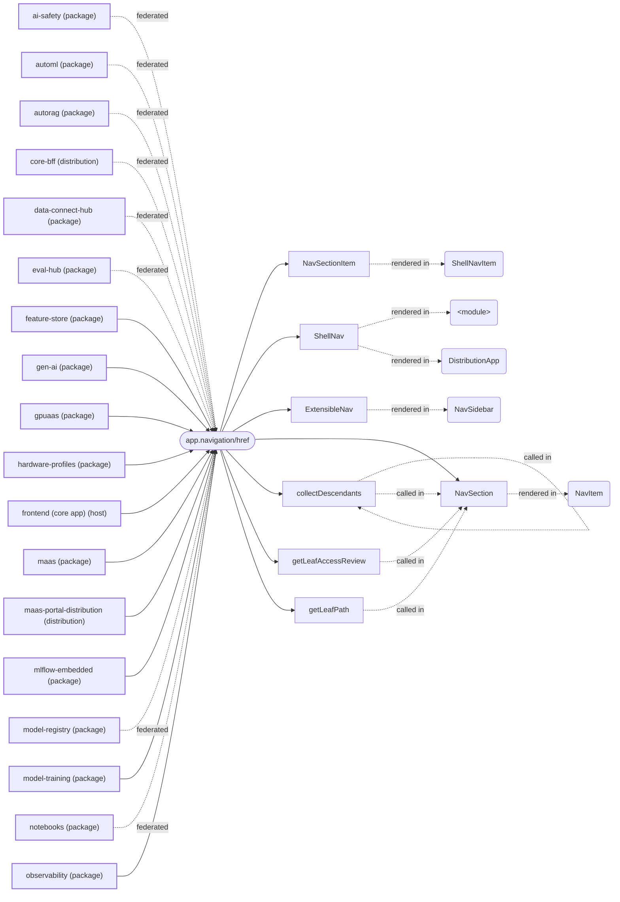

**Not resolved** (never drawn in a diagram):

| Code | Message | Source |
| --- | --- | --- |
| `unresolved-value` | Cannot resolve 'href' of extension 'app.navigation/href': CallExpression is not a resolvable value. | [extensions.ts:257](../../model-registry/upstream/frontend/src/odh/extensions.ts#L257) |
| `unresolved-value` | Cannot resolve 'path' of extension 'app.navigation/href': template literal with a part that is not a literal. | [extensions.ts:259](../../model-registry/upstream/frontend/src/odh/extensions.ts#L259) |
| `unresolved-value` | Cannot resolve 'href' of extension 'app.navigation/href': CallExpression is not a resolvable value. | [extensions.ts:282](../../model-registry/upstream/frontend/src/odh/extensions.ts#L282) |
| `unresolved-value` | Cannot resolve 'path' of extension 'app.navigation/href': template literal with a part that is not a literal. | [extensions.ts:284](../../model-registry/upstream/frontend/src/odh/extensions.ts#L284) |
| `point-id-literal` | The string 'app.navigation/href' names an extension point outside its declaration and outside an extension. | [extensionResolution.ts:8](../src/core/extensionResolution.ts#L8) |

### app.navigation/section

Adds a navigation section to the host application.

Declared as [NavSectionExtension](../src/extension-points/navigation.ts#L39).

**Properties:**

| Property | Required | Type | CodeRef of | Description |
| --- | --- | --- | --- | --- |
| `id` | yes | `string` | — | A unique identifier for this item. |
| `title` | yes | `string` | — | The title of this item. |
| `section` | — | `string` | — | Navigation section to which this item belongs to. If not specified, render this item at the top level. |
| `dataAttributes` | — | `{ [key: string]: string }` | — | Adds data attributes to the DOM. |
| `group` | — | `string` | — | Group are used to sort items lexicographically. Unspecified items will be sorted into the '5_default' group. |
| `iconRef` | — | `ComponentCodeRef` | `ComponentCodeRef` | Icon reference for this item. |
| `label` | — | `string` | — | Label for this item. |

**Implemented by:** [ai-safety](../../ai-safety/docs/extensions.md#contributes-to-appnavigationsection), [core-bff](../../../distributions/core-bff/docs/extensions.md#contributes-to-appnavigationsection), [feature-store](../../feature-store/docs/extensions.md#contributes-to-appnavigationsection), [gen-ai](../../gen-ai/docs/extensions.md#contributes-to-appnavigationsection), [frontend (core app)](../../../frontend/docs/extensions.md#contributes-to-appnavigationsection), [maas](../../maas/docs/extensions.md#contributes-to-appnavigationsection), [rhaii-distribution](../../../distributions/rhaii/docs/extensions.md#contributes-to-appnavigationsection)

**Consumed in:** [base-distribution](../../../distributions/base/docs/extensions.md#consumes-appnavigationsection), [frontend (core app)](../../../frontend/docs/extensions.md#consumes-appnavigationsection), [plugin-core](#consumes-appnavigationsection)

**Consumers:**

| Consumer | Package | Query | Uses | Rendered or called in |
| --- | --- | --- | --- | --- |
| [NavSectionItem](../../../distributions/base/src/ShellNav.tsx#L100-L166) | base-distribution | [useExtensions](../../../distributions/base/src/ShellNav.tsx#L106) | `properties.section` — read, direct, one of: app.navigation/href, app.navigation/section, app.tab-route/page ([ShellNav.tsx:124](../../../distributions/base/src/ShellNav.tsx#L124)) | ShellNavItem ([ShellNav.tsx:172](../../../distributions/base/src/ShellNav.tsx#L172)) |
| [ShellNav](../../../distributions/base/src/ShellNav.tsx#L183-L203) | base-distribution | [useExtensions](../../../distributions/base/src/ShellNav.tsx#L184) | — | `<module>` ([bootstrap.tsx:19](../../../distributions/base/src/bootstrap.tsx#L19)) DistributionApp ([createDistribution.tsx:58](../../../distributions/base/src/createDistribution.tsx#L58)) |
| [ExtensibleNav](../../../frontend/src/app/navigation/ExtensibleNav.tsx#L18-L35) | frontend (core app) | [useExtensions](../../../frontend/src/app/navigation/ExtensibleNav.tsx#L19) | `properties.id` — read, direct, one of: app.navigation/href, app.navigation/section, app.tab-route/page ([ExtensibleNav.tsx:30](../../../frontend/src/app/navigation/ExtensibleNav.tsx#L30)) | NavSidebar ([NavSidebar.tsx:8](../../../frontend/src/app/NavSidebar.tsx#L8)) |
| [NavSection](../../../frontend/src/app/navigation/NavSection.tsx#L57-L214) | frontend (core app) | [useExtensions](../../../frontend/src/app/navigation/NavSection.tsx#L64) | `properties.section` — read, direct, one of: app.navigation/href, app.navigation/section, app.tab-route/page ([NavSection.tsx:83](../../../frontend/src/app/navigation/NavSection.tsx#L83)) `properties.id` — read, direct, one of: app.navigation/href, app.navigation/section, app.tab-route/page ([NavSection.tsx:90](../../../frontend/src/app/navigation/NavSection.tsx#L90) (+3 more)) | NavItem ([NavItem.tsx:20](../../../frontend/src/app/navigation/NavItem.tsx#L20)) |
| [collectDescendants](../../../frontend/src/app/navigation/NavSection.tsx#L92-L105) | frontend (core app) | — | `properties.id` — read, direct ([NavSection.tsx:97](../../../frontend/src/app/navigation/NavSection.tsx#L97) (+1 more)) `properties.section` — read, direct, one of: app.navigation/href, app.navigation/section, app.tab-route/page ([NavSection.tsx:99](../../../frontend/src/app/navigation/NavSection.tsx#L99)) | collectDescendants (called at [NavSection.tsx:102](../../../frontend/src/app/navigation/NavSection.tsx#L102)) NavSection (called at [NavSection.tsx:108](../../../frontend/src/app/navigation/NavSection.tsx#L108)) |
| [getTopLevelExtensions](../src/core/navigation.ts#L13-L60) | plugin-core | — | `properties.id` — read, direct ([navigation.ts:16](../src/core/navigation.ts#L16) (+2 more)) `type` — filter, direct ([navigation.ts:16](../src/core/navigation.ts#L16)) | ShellNav (called at [ShellNav.tsx:187](../../../distributions/base/src/ShellNav.tsx#L187)) ExtensibleNav (called at [ExtensibleNav.tsx:22](../../../frontend/src/app/navigation/ExtensibleNav.tsx#L22)) |

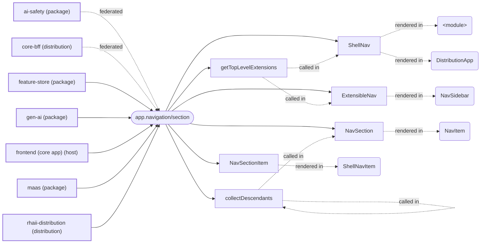

**Not resolved** (never drawn in a diagram):

| Code | Message | Source |
| --- | --- | --- |
| `point-id-literal` | The string 'app.navigation/section' names an extension point outside its declaration and outside an extension. | [extensionResolution.ts:9](../src/core/extensionResolution.ts#L9) |

### app.patch

Declared as [PatchExtension](../src/extension-points/patch.ts#L17-L24), with type parameters `P`.

**Properties:**

| Property | Required | Type | CodeRef of | Description |
| --- | --- | --- | --- | --- |
| `targetType` | yes | `string` | — |  |
| `targetId` | yes | `string` | — |  |
| `patch` | yes | `P` | — |  |

**Implemented by:** [maas-portal-distribution](../../../distributions/maas-portal/docs/extensions.md#contributes-to-apppatch)

**Consumed in:** [plugin-core](#consumes-apppatch)

**Consumers:**

| Consumer | Package | Query | Uses | Rendered or called in |
| --- | --- | --- | --- | --- |
| [extractPatches](../src/core/extensionResolution.ts#L66-L93) | plugin-core | — | `type` — type-check, direct ([extensionResolution.ts:73](../src/core/extensionResolution.ts#L73)) | PluginStore (called at [plugin-store.ts:51](../src/core/plugin-store.ts#L51)) |

**Flow:** maas-portal-distribution → app.patch → plugin-core · extractPatches → called in PluginStore

### app.project-details/overview-section

Declared as [OverviewSectionExtension](../src/extension-points/overview-card.ts#L4-L11).

**Properties:**

| Property | Required | Type | CodeRef of | Description |
| --- | --- | --- | --- | --- |
| `id` | yes | `string` | — |  |
| `title` | yes | `string` | — |  |
| `component` | yes | `ComponentCodeRef` | `{ default: ComponentType<AnyObject>; }` |  |

**Implemented by:** [model-serving](../../model-serving/docs/extensions.md#contributes-to-appproject-detailsoverview-section)

**Consumed in:** [frontend (core app)](../../../frontend/docs/extensions.md#consumes-appproject-detailsoverview-section)

**Consumers:**

| Consumer | Package | Query | Uses | Rendered or called in |
| --- | --- | --- | --- | --- |
| [OverviewModelsSection](../../../frontend/src/concepts/projects/overviewTab/ServeModels.tsx#L7-L18) | frontend (core app) | [useExtensions](../../../frontend/src/concepts/projects/overviewTab/ServeModels.tsx#L8) | `properties.component` — lazy-render, direct ([ServeModels.tsx:9](../../../frontend/src/concepts/projects/overviewTab/ServeModels.tsx#L9-L11)) `properties.id` — read, direct ([ServeModels.tsx:10](../../../frontend/src/concepts/projects/overviewTab/ServeModels.tsx#L10)) | ProjectOverview ([ProjectOverview.tsx:21](../../../frontend/src/pages/projects/screens/detail/overview/ProjectOverview.tsx#L21)) |

**Flow:** model-serving → app.project-details/overview-section → frontend (core app) · OverviewModelsSection → rendered in ProjectOverview

### app.project-details/settings-card

Declared as [ProjectDetailsSettingsCardExtension](../src/extension-points/project-details.ts#L20-L27).

**Properties:**

| Property | Required | Type | CodeRef of | Description |
| --- | --- | --- | --- | --- |
| `id` | yes | `string` | — |  |
| `title` | yes | `string` | — |  |
| `component` | yes | `ComponentCodeRef<ProjectDetailsSettingsCardProps>` | `{ default: ComponentType<ProjectDetailsSettingsCardProps>; }` |  |

**Implemented by:** [nim-serving](../../nim-serving/docs/extensions.md#contributes-to-appproject-detailssettings-card)

**Consumed in:** [frontend (core app)](../../../frontend/docs/extensions.md#consumes-appproject-detailssettings-card)

**Consumers:**

| Consumer | Package | Query | Uses | Rendered or called in |
| --- | --- | --- | --- | --- |
| [ProjectDetails](../../../frontend/src/pages/projects/screens/detail/ProjectDetails.tsx#L53-L312) | frontend (core app) | [useExtensions](../../../frontend/src/pages/projects/screens/detail/ProjectDetails.tsx#L67) | — | ProjectViewRoutes ([ProjectViewRoutes.tsx:29](../../../frontend/src/pages/projects/ProjectViewRoutes.tsx#L29)) |
| [ProjectSettingsPage](../../../frontend/src/pages/projects/projectSettings/ProjectSettingsPage.tsx#L10-L39) | frontend (core app) | [useExtensions](../../../frontend/src/pages/projects/projectSettings/ProjectSettingsPage.tsx#L13) | `properties.id` — read, direct ([ProjectSettingsPage.tsx:29](../../../frontend/src/pages/projects/projectSettings/ProjectSettingsPage.tsx#L29)) `properties.component` — lazy-render, direct ([ProjectSettingsPage.tsx:31](../../../frontend/src/pages/projects/projectSettings/ProjectSettingsPage.tsx#L31)) | ProjectDetails ([ProjectDetails.tsx:290](../../../frontend/src/pages/projects/screens/detail/ProjectDetails.tsx#L290)) |

```mermaid
flowchart LR
  classDef pkg stroke-width:2px
  classDef point stroke-width:1px
  n_pkg__odh_dashboard_nim_serving_241793["nim-serving (package)"]:::pkg
  n_app_project_details_settings_card_bc8e85(["app.project-details/settings-card"]):::point
  n_pkg__odh_dashboard_nim_serving_241793 --> n_app_project_details_settings_card_bc8e85
  n_symbol_frontend_src_pages_projects_screens_detail_ProjectDetails_tsx_ProjectDetails_2a7cef["ProjectDetails"]
  n_app_project_details_settings_card_bc8e85 --> n_symbol_frontend_src_pages_projects_screens_detail_ProjectDetails_tsx_ProjectDetails_2a7cef
  n_symbol_frontend_src_pages_projects_projectSettings_ProjectSettingsPage_tsx_ProjectSettingsPage_113f30["ProjectSettingsPage"]
  n_app_project_details_settings_card_bc8e85 --> n_symbol_frontend_src_pages_projects_projectSettings_ProjectSettingsPage_tsx_ProjectSettingsPage_113f30
  n_symbol_frontend_src_pages_projects_ProjectViewRoutes_tsx_ProjectViewRoutes_9ce9ef("ProjectViewRoutes")
  n_symbol_frontend_src_pages_projects_screens_detail_ProjectDetails_tsx_ProjectDetails_2a7cef -. "rendered in" .-> n_symbol_frontend_src_pages_projects_ProjectViewRoutes_tsx_ProjectViewRoutes_9ce9ef
  n_symbol_frontend_src_pages_projects_projectSettings_ProjectSettingsPage_tsx_ProjectSettingsPage_113f30 -. "rendered in" .-> n_symbol_frontend_src_pages_projects_screens_detail_ProjectDetails_tsx_ProjectDetails_2a7cef
```

### app.project-details/tab

Declared as [ProjectDetailsTab](../src/extension-points/project-details.ts#L4-L12).

**Properties:**

| Property | Required | Type | CodeRef of | Description |
| --- | --- | --- | --- | --- |
| `id` | yes | `string` | — |  |
| `title` | yes | `string` | — |  |
| `component` | yes | `ComponentCodeRef` | `{ default: ComponentType<AnyObject>; }` |  |

**Implemented by:** [model-serving](../../model-serving/docs/extensions.md#contributes-to-appproject-detailstab), [notebooks](../../notebooks/docs/extensions.md#contributes-to-appproject-detailstab)

**Consumed in:** [frontend (core app)](../../../frontend/docs/extensions.md#consumes-appproject-detailstab)

**Consumers:**

| Consumer | Package | Query | Uses | Rendered or called in |
| --- | --- | --- | --- | --- |
| [useDeploymentsTab](../../../frontend/src/concepts/projects/projectDetails/useDeploymentsTab.tsx#L9-L32) | frontend (core app) | [useExtensions](../../../frontend/src/concepts/projects/projectDetails/useDeploymentsTab.tsx#L12) | `properties.component` — lazy-render, direct ([useDeploymentsTab.tsx:13](../../../frontend/src/concepts/projects/projectDetails/useDeploymentsTab.tsx#L13-L15)) `properties.id` — read, direct ([useDeploymentsTab.tsx:14](../../../frontend/src/concepts/projects/projectDetails/useDeploymentsTab.tsx#L14)) | ProjectDetails (called at [ProjectDetails.tsx:69](../../../frontend/src/pages/projects/screens/detail/ProjectDetails.tsx#L69)) |
| [useWorkbenchesV2Tab](../../../frontend/src/concepts/projects/projectDetails/useWorkbenchesV2Tab.tsx#L9-L37) | frontend (core app) | [useExtensions](../../../frontend/src/concepts/projects/projectDetails/useWorkbenchesV2Tab.tsx#L11) | `properties.component` — lazy-render, direct ([useWorkbenchesV2Tab.tsx:12](../../../frontend/src/concepts/projects/projectDetails/useWorkbenchesV2Tab.tsx#L12-L14)) `properties.id` — read, direct ([useWorkbenchesV2Tab.tsx:13](../../../frontend/src/concepts/projects/projectDetails/useWorkbenchesV2Tab.tsx#L13)) | ProjectDetails (called at [ProjectDetails.tsx:70](../../../frontend/src/pages/projects/screens/detail/ProjectDetails.tsx#L70)) |

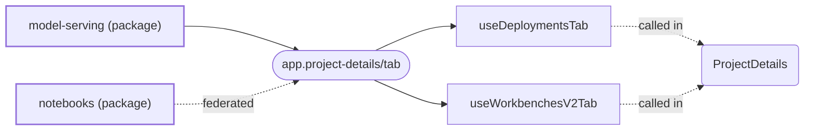

### app.route

Adds a route to the host application.

Declared as [RouteExtension](../src/extension-points/routes.ts#L7-L17).

**Properties:**

| Property | Required | Type | CodeRef of | Description |
| --- | --- | --- | --- | --- |
| `id` | — | `string` | — | Optional identifier used by distribution overrides and suppression. |
| `component` | yes | `ComponentCodeRef` | `{ default: ComponentType<AnyObject>; }` | The component to render for this route. |
| `path` | yes | `string` | — | The react-router path pattern to match against the current location. |

**Implemented by:** [agent-ops](../../agent-ops/docs/extensions.md#contributes-to-approute), [ai-safety](../../ai-safety/docs/extensions.md#contributes-to-approute), [automl](../../automl/docs/extensions.md#contributes-to-approute), [autorag](../../autorag/docs/extensions.md#contributes-to-approute), [core-bff](../../../distributions/core-bff/docs/extensions.md#contributes-to-approute), [data-connect-hub](../../data-connect-hub/docs/extensions.md#contributes-to-approute), [eval-hub](../../eval-hub/docs/extensions.md#contributes-to-approute), [feature-store](../../feature-store/docs/extensions.md#contributes-to-approute), [gen-ai](../../gen-ai/docs/extensions.md#contributes-to-approute), [gpuaas](../../gpuaas/docs/extensions.md#contributes-to-approute), [hardware-profiles](../../hardware-profiles/docs/extensions.md#contributes-to-approute), [frontend (core app)](../../../frontend/docs/extensions.md#contributes-to-approute), [kserve](../../kserve/docs/extensions.md#contributes-to-approute), [llmd-serving](../../llmd-serving/docs/extensions.md#contributes-to-approute), [maas](../../maas/docs/extensions.md#contributes-to-approute), [maas-portal-distribution](../../../distributions/maas-portal/docs/extensions.md#contributes-to-approute), [mlflow](../../mlflow/docs/extensions.md#contributes-to-approute), [mlflow-embedded](../../mlflow-embedded/docs/extensions.md#contributes-to-approute), [model-registry](../../model-registry/docs/extensions.md#contributes-to-approute), [model-serving](../../model-serving/docs/extensions.md#contributes-to-approute), [model-training](../../model-training/docs/extensions.md#contributes-to-approute), [notebooks](../../notebooks/docs/extensions.md#contributes-to-approute), [observability](../../observability/docs/extensions.md#contributes-to-approute), [rhaii-distribution](../../../distributions/rhaii/docs/extensions.md#contributes-to-approute)

**Consumed in:** [base-distribution](../../../distributions/base/docs/extensions.md#consumes-approute), [frontend (core app)](../../../frontend/docs/extensions.md#consumes-approute)

**Consumers:**

| Consumer | Package | Query | Uses | Rendered or called in |
| --- | --- | --- | --- | --- |
| [ShellRoutes](../../../distributions/base/src/ShellRoutes.tsx#L22-L81) | base-distribution | [useExtensions](../../../distributions/base/src/ShellRoutes.tsx#L23) | `properties.path` — read, direct ([ShellRoutes.tsx:39](../../../distributions/base/src/ShellRoutes.tsx#L39)) `properties.component` — lazy-render, direct ([ShellRoutes.tsx:44](../../../distributions/base/src/ShellRoutes.tsx#L44)) | `<module>` ([bootstrap.tsx:20](../../../distributions/base/src/bootstrap.tsx#L20)) DistributionApp ([createDistribution.tsx:59](../../../distributions/base/src/createDistribution.tsx#L59)) |
| [AppRoutes](../../../frontend/src/app/AppRoutes.tsx#L23-L77) | frontend (core app) | [useExtensions](../../../frontend/src/app/AppRoutes.tsx#L25) | `properties.path` — read, direct ([AppRoutes.tsx:33](../../../frontend/src/app/AppRoutes.tsx#L33)) `properties.component` — lazy-render, direct ([AppRoutes.tsx:37](../../../frontend/src/app/AppRoutes.tsx#L37)) | App ([App.tsx:191](../../../frontend/src/app/App.tsx#L191)) |

```mermaid
flowchart LR
  classDef pkg stroke-width:2px
  classDef point stroke-width:1px
  n_pkg__odh_dashboard_agent_ops_64201e["agent-ops (package)"]:::pkg
  n_pkg__odh_dashboard_ai_safety_7fe101["ai-safety (package)"]:::pkg
  n_pkg__odh_dashboard_automl_28eb04["automl (package)"]:::pkg
  n_pkg__odh_dashboard_autorag_fc0d99["autorag (package)"]:::pkg
  n_pkg__odh_dashboard_core_bff_09a36a["core-bff (distribution)"]:::pkg
  n_pkg__odh_dashboard_data_connect_hub_02c9b3["data-connect-hub (package)"]:::pkg
  n_pkg__odh_dashboard_eval_hub_277a4a["eval-hub (package)"]:::pkg
  n_pkg__odh_dashboard_feature_store_007774["feature-store (package)"]:::pkg
  n_pkg__odh_dashboard_gen_ai_f11571["gen-ai (package)"]:::pkg
  n_pkg__odh_dashboard_gpuaas_2769c7["gpuaas (package)"]:::pkg
  n_pkg__odh_dashboard_hardware_profiles_48b483["hardware-profiles (package)"]:::pkg
  n_pkg__odh_dashboard_internal_143c2f["frontend (core app) (host)"]:::pkg
  n_pkg__odh_dashboard_kserve_5ec96a["kserve (package)"]:::pkg
  n_pkg__odh_dashboard_llmd_serving_3e146e["llmd-serving (package)"]:::pkg
  n_pkg__odh_dashboard_maas_87d494["maas (package)"]:::pkg
  n_pkg__odh_dashboard_maas_portal_distribution_5c89ae["maas-portal-distribution (distribution)"]:::pkg
  n_pkg__odh_dashboard_mlflow_cae65f["mlflow (package)"]:::pkg
  n_pkg__odh_dashboard_mlflow_embedded_412d14["mlflow-embedded (package)"]:::pkg
  n_pkg__odh_dashboard_model_registry_1fc815["model-registry (package)"]:::pkg
  n_pkg__odh_dashboard_model_serving_d0bfea["model-serving (package)"]:::pkg
  n_pkg__odh_dashboard_model_training_ee058c["model-training (package)"]:::pkg
  n_pkg__odh_dashboard_notebooks_458f10["notebooks (package)"]:::pkg
  n_pkg__odh_dashboard_observability_38a333["observability (package)"]:::pkg
  n_pkg__odh_dashboard_rhaii_distribution_c06492["rhaii-distribution (distribution)"]:::pkg
  n_app_route_2735df(["app.route"]):::point
  n_pkg__odh_dashboard_agent_ops_64201e -. "federated" .-> n_app_route_2735df
  n_pkg__odh_dashboard_ai_safety_7fe101 -. "federated" .-> n_app_route_2735df
  n_pkg__odh_dashboard_automl_28eb04 -. "federated" .-> n_app_route_2735df
  n_pkg__odh_dashboard_autorag_fc0d99 -. "federated" .-> n_app_route_2735df
  n_pkg__odh_dashboard_core_bff_09a36a -. "federated" .-> n_app_route_2735df
  n_pkg__odh_dashboard_data_connect_hub_02c9b3 -. "federated" .-> n_app_route_2735df
  n_pkg__odh_dashboard_eval_hub_277a4a -. "federated" .-> n_app_route_2735df
  n_pkg__odh_dashboard_feature_store_007774 --> n_app_route_2735df
  n_pkg__odh_dashboard_gen_ai_f11571 --> n_app_route_2735df
  n_pkg__odh_dashboard_gpuaas_2769c7 --> n_app_route_2735df
  n_pkg__odh_dashboard_hardware_profiles_48b483 --> n_app_route_2735df
  n_pkg__odh_dashboard_internal_143c2f --> n_app_route_2735df
  n_pkg__odh_dashboard_kserve_5ec96a --> n_app_route_2735df
  n_pkg__odh_dashboard_llmd_serving_3e146e --> n_app_route_2735df
  n_pkg__odh_dashboard_maas_87d494 --> n_app_route_2735df
  n_pkg__odh_dashboard_maas_portal_distribution_5c89ae --> n_app_route_2735df
  n_pkg__odh_dashboard_mlflow_cae65f -. "federated" .-> n_app_route_2735df
  n_pkg__odh_dashboard_mlflow_embedded_412d14 --> n_app_route_2735df
  n_pkg__odh_dashboard_model_registry_1fc815 -. "federated" .-> n_app_route_2735df
  n_pkg__odh_dashboard_model_serving_d0bfea --> n_app_route_2735df
  n_pkg__odh_dashboard_model_training_ee058c --> n_app_route_2735df
  n_pkg__odh_dashboard_notebooks_458f10 -. "federated" .-> n_app_route_2735df
  n_pkg__odh_dashboard_observability_38a333 --> n_app_route_2735df
  n_pkg__odh_dashboard_rhaii_distribution_c06492 --> n_app_route_2735df
  n_symbol_distributions_base_src_ShellRoutes_tsx_ShellRoutes_82f0a0["ShellRoutes"]
  n_app_route_2735df --> n_symbol_distributions_base_src_ShellRoutes_tsx_ShellRoutes_82f0a0
  n_symbol_frontend_src_app_AppRoutes_tsx_AppRoutes_2da7a1["AppRoutes"]
  n_app_route_2735df --> n_symbol_frontend_src_app_AppRoutes_tsx_AppRoutes_2da7a1
  n_symbol_distributions_base_src_bootstrap_tsx__module__846cb0("#lt;module#gt;")
  n_symbol_distributions_base_src_createDistribution_tsx_DistributionApp_e5fabf("DistributionApp")
  n_symbol_frontend_src_app_App_tsx_App_bc56cd("App")
  n_symbol_distributions_base_src_ShellRoutes_tsx_ShellRoutes_82f0a0 -. "rendered in" .-> n_symbol_distributions_base_src_bootstrap_tsx__module__846cb0
  n_symbol_distributions_base_src_ShellRoutes_tsx_ShellRoutes_82f0a0 -. "rendered in" .-> n_symbol_distributions_base_src_createDistribution_tsx_DistributionApp_e5fabf
  n_symbol_frontend_src_app_AppRoutes_tsx_AppRoutes_2da7a1 -. "rendered in" .-> n_symbol_frontend_src_app_App_tsx_App_bc56cd
```

**Not resolved** (never drawn in a diagram):

| Code | Message | Source |
| --- | --- | --- |
| `unresolved-value` | Cannot resolve 'component' of extension 'app.route': CallExpression is not a resolvable value. | [routes.ts:41](../../../frontend/src/plugins/extensions/routes.ts#L41) |
| `unresolved-value` | Cannot resolve 'component' of extension 'app.route': CallExpression is not a resolvable value. | [routes.ts:72](../../../frontend/src/plugins/extensions/routes.ts#L72) |
| `unresolved-value` | Cannot resolve 'component' of extension 'app.route': CallExpression is not a resolvable value. | [routes.ts:86](../../../frontend/src/plugins/extensions/routes.ts#L86) |
| `unresolved-value` | Cannot resolve 'component' of extension 'app.route': CallExpression is not a resolvable value. | [routes.ts:107](../../../frontend/src/plugins/extensions/routes.ts#L107-L110) |
| `unresolved-value` | Cannot resolve 'component' of extension 'app.route': CallExpression is not a resolvable value. | [routes.ts:134](../../../frontend/src/plugins/extensions/routes.ts#L134-L137) |
| `unresolved-value` | Cannot resolve 'component' of extension 'app.route': CallExpression is not a resolvable value. | [routes.ts:154](../../../frontend/src/plugins/extensions/routes.ts#L154-L157) |
| `unresolved-value` | Cannot resolve 'component' of extension 'app.route': CallExpression is not a resolvable value. | [routes.ts:171](../../../frontend/src/plugins/extensions/routes.ts#L171-L174) |
| `unresolved-value` | Cannot resolve 'component' of extension 'app.route': CallExpression is not a resolvable value. | [routes.ts:188](../../../frontend/src/plugins/extensions/routes.ts#L188-L191) |
| `unresolved-value` | Cannot resolve 'component' of extension 'app.route': CallExpression is not a resolvable value. | [routes.ts:205](../../../frontend/src/plugins/extensions/routes.ts#L205-L208) |
| `unresolved-value` | Cannot resolve 'component' of extension 'app.route': CallExpression is not a resolvable value. | [routes.ts:222](../../../frontend/src/plugins/extensions/routes.ts#L222-L225) |
| `unresolved-value` | Cannot resolve 'component' of extension 'app.route': CallExpression is not a resolvable value. | [routes.ts:245](../../../frontend/src/plugins/extensions/routes.ts#L245-L248) |
| `unresolved-value` | Cannot resolve 'component' of extension 'app.route': CallExpression is not a resolvable value. | [routes.ts:262](../../../frontend/src/plugins/extensions/routes.ts#L262-L265) |
| `unresolved-value` | Cannot resolve 'component' of extension 'app.route': CallExpression is not a resolvable value. | [routes.ts:285](../../../frontend/src/plugins/extensions/routes.ts#L285-L288) |
| `unresolved-value` | Cannot resolve 'component' of extension 'app.route': CallExpression is not a resolvable value. | [routes.ts:308](../../../frontend/src/plugins/extensions/routes.ts#L308-L311) |
| `unresolved-value` | Cannot resolve 'component' of extension 'app.route': CallExpression is not a resolvable value. | [routes.ts:331](../../../frontend/src/plugins/extensions/routes.ts#L331-L334) |
| `unresolved-value` | Cannot resolve 'component' of extension 'app.route': CallExpression is not a resolvable value. | [routes.ts:354](../../../frontend/src/plugins/extensions/routes.ts#L354-L357) |
| `unresolved-value` | Cannot resolve 'component' of extension 'app.route': CallExpression is not a resolvable value. | [routes.ts:377](../../../frontend/src/plugins/extensions/routes.ts#L377-L380) |
| `unresolved-value` | Cannot resolve 'component' of extension 'app.route': CallExpression is not a resolvable value. | [routes.ts:400](../../../frontend/src/plugins/extensions/routes.ts#L400-L403) |
| `unresolved-value` | Cannot resolve 'component' of extension 'app.route': CallExpression is not a resolvable value. | [extensions.ts:40](../../hardware-profiles/extensions.ts#L40-L43) |
| `unresolved-value` | Cannot resolve 'component' of extension 'app.route': CallExpression is not a resolvable value. | [extensions.ts:439](../../kserve/extensions.ts#L439-L442) |
| `unresolved-value` | Cannot resolve 'component' of extension 'app.route': CallExpression is not a resolvable value. | [extensions.ts:452](../../kserve/extensions.ts#L452-L455) |
| `unresolved-value` | Cannot resolve 'component' of extension 'app.route': CallExpression is not a resolvable value. | [extensions.ts:465](../../kserve/extensions.ts#L465-L468) |
| `unresolved-value` | Cannot resolve 'component' of extension 'app.route': CallExpression is not a resolvable value. | [extensions.ts:478](../../kserve/extensions.ts#L478-L481) |
| `unresolved-value` | Cannot resolve 'component' of extension 'app.route': CallExpression is not a resolvable value. | [extensions.ts:633](../../llmd-serving/extensions/extensions.ts#L633-L636) |
| `unresolved-value` | Cannot resolve 'component' of extension 'app.route': CallExpression is not a resolvable value. | [extensions.ts:646](../../llmd-serving/extensions/extensions.ts#L646-L649) |
| `unresolved-value` | Cannot resolve 'component' of extension 'app.route': CallExpression is not a resolvable value. | [extensions.ts:659](../../llmd-serving/extensions/extensions.ts#L659-L662) |
| `unresolved-value` | Cannot resolve 'component' of extension 'app.route': CallExpression is not a resolvable value. | [extensions.ts:187](../../model-registry/upstream/frontend/src/odh/extensions.ts#L187-L190) |
| `unresolved-value` | Cannot resolve 'component' of extension 'app.route': CallExpression is not a resolvable value. | [extensions.ts:200](../../model-registry/upstream/frontend/src/odh/extensions.ts#L200-L203) |
| `unresolved-value` | Cannot resolve 'component' of extension 'app.route': CallExpression is not a resolvable value. | [extensions.ts:213](../../model-registry/upstream/frontend/src/odh/extensions.ts#L213-L216) |
| `unresolved-value` | Cannot resolve 'component' of extension 'app.route': CallExpression is not a resolvable value. | [extensions.ts:242](../../model-registry/upstream/frontend/src/odh/extensions.ts#L242-L245) |
| `unresolved-value` | Cannot resolve 'path' of extension 'app.route': template literal with a part that is not a literal. | [extensions.ts:269](../../model-registry/upstream/frontend/src/odh/extensions.ts#L269) |
| `unresolved-value` | Cannot resolve 'path' of extension 'app.route': template literal with a part that is not a literal. | [extensions.ts:294](../../model-registry/upstream/frontend/src/odh/extensions.ts#L294) |
| `unresolved-value` | Cannot resolve 'component' of extension 'app.route': CallExpression is not a resolvable value. | [extensions.ts:306](../../model-registry/upstream/frontend/src/odh/extensions.ts#L306-L309) |
| `unresolved-value` | Cannot resolve 'component' of extension 'app.route': CallExpression is not a resolvable value. | [odh.ts:165](../../model-serving/extensions/odh.ts#L165-L168) |
| `unresolved-value` | Cannot resolve 'component' of extension 'app.route': CallExpression is not a resolvable value. | [odh.ts:178](../../model-serving/extensions/odh.ts#L178-L181) |

### app.status-provider

Provides a status report which can be referenced by various components.

Declared as [StatusProviderExtension](../src/extension-points/status-provider.ts#L10-L18).

**Properties:**

| Property | Required | Type | CodeRef of | Description |
| --- | --- | --- | --- | --- |
| `id` | yes | `string` | — | The status provider ID. |
| `statusProviderHook` | yes | `CodeRef<StatusProviderHook>` | `StatusProviderHook` | The status provider hook. |

**Implemented by:** [hardware-profiles](../../hardware-profiles/docs/extensions.md#contributes-to-appstatus-provider)

**Consumed in:** [frontend (core app)](../../../frontend/docs/extensions.md#consumes-appstatus-provider)

**Consumers:**

| Consumer | Package | Query | Uses | Rendered or called in |
| --- | --- | --- | --- | --- |
| [StatusReportLoader](../../../frontend/src/app/status-provider/StatusReportLoader.tsx#L14-L57) | frontend (core app) | [useResolvedExtensions](../../../frontend/src/app/status-provider/StatusReportLoader.tsx#L15) | `properties.id` — read, direct ([StatusReportLoader.tsx:19](../../../frontend/src/app/status-provider/StatusReportLoader.tsx#L19)) `properties.statusProviderHook` — hook-run, direct ([StatusReportLoader.tsx:52](../../../frontend/src/app/status-provider/StatusReportLoader.tsx#L52)) | NavItemHref ([NavItemHref.tsx:68](../../../frontend/src/app/navigation/NavItemHref.tsx#L68-L74)) |

**Flow:** hardware-profiles → app.status-provider → frontend (core app) · StatusReportLoader → rendered in NavItemHref

### app.suppress

Declared as [SuppressExtension](../src/extension-points/suppress.ts#L5-L11).

**Properties:**

| Property | Required | Type | CodeRef of | Description |
| --- | --- | --- | --- | --- |
| `targetType` | yes | `string` | — |  |
| `targetId` | yes | `string` | — |  |

**Implemented by:** [maas-portal-distribution](../../../distributions/maas-portal/docs/extensions.md#contributes-to-appsuppress)

**Consumed in:** [plugin-core](#consumes-appsuppress)

**Consumers:**

| Consumer | Package | Query | Uses | Rendered or called in |
| --- | --- | --- | --- | --- |
| [applySuppress](../src/core/extensionResolution.ts#L103-L154) | plugin-core | — | `type` — type-check, direct ([extensionResolution.ts:107](../src/core/extensionResolution.ts#L107) (+1 more)) | PluginStore (called at [plugin-store.ts:53](../src/core/plugin-store.ts#L53)) |

**Flow:** maas-portal-distribution → app.suppress → plugin-core · applySuppress → called in PluginStore

### app.tab-route/page

Defines a tabbed page that appears as a navigation item.

Individual tabs are contributed via `TabRouteTabExtension` extensions
that reference this page's `id` via their `pageId` property.

Smart rendering based on tab count:
- 0 tabs: page is not rendered, nav item is hidden
- 1 tab: page renders the single tab's content without a tab bar
- 2+ tabs: page renders a full tab bar with all tabs

Set `alwaysShowTabBar: true` to render the tab bar even with a single tab
(e.g. Agents → Deployments while more tabs are planned).

Declared as [TabRoutePageExtension](../src/extension-points/tab-route.ts#L20-L46).

**Properties:**

| Property | Required | Type | CodeRef of | Description |
| --- | --- | --- | --- | --- |
| `id` | yes | `string` | — | A unique identifier for this item. |
| `title` | yes | `string` | — | The title of this item. |
| `section` | — | `string` | — | Navigation section to which this item belongs to. If not specified, render this item at the top level. |
| `dataAttributes` | — | `{ [key: string]: string }` | — | Adds data attributes to the DOM. |
| `group` | — | `string` | — | Group are used to sort items lexicographically. Unspecified items will be sorted into the '5_default' group. |
| `iconRef` | — | `ComponentCodeRef` | `ComponentCodeRef` | Icon reference for this item. |
| `label` | — | `string` | — | Label for this item. |
| `href` | yes | `string` | — | The link href value for the nav item. |
| `breadcrumbTabId` | — | `string` | — | Optional tab ID to use when a child page links back to this page. |
| `path` | yes | `string` | — | The react-router path pattern to match against the current location. Should include a wildcard suffix (e.g. '/ai-hub/models/*') to capture tab sub-paths. |
| `accessReview` | — | `AccessReviewResourceAttributes` | — | The access review resource attributes for this item. |
| `objectType` | — | `string` | — | Object type string for the page title icon (e.g. 'registered-models'). Used with TitleWithIcon to render a page-level title above the tabs. |
| `description` | — | `string` | — | Optional descriptive text rendered beneath the page title. |
| `alwaysShowTabBar` | — | `boolean` | — | When true, renders the tab bar even if only one tab is registered. |
| `hidePageTitleOnPaths` | — | `string[]` | — | Relative path prefixes where the generic page title should be hidden. |

**Implemented by:** [data-registry](../../data-registry/docs/extensions.md#contributes-to-apptab-routepage), [frontend (core app)](../../../frontend/docs/extensions.md#contributes-to-apptab-routepage), [model-serving](../../model-serving/docs/extensions.md#contributes-to-apptab-routepage), [rhaii-distribution](../../../distributions/rhaii/docs/extensions.md#contributes-to-apptab-routepage)

**Consumed in:** [base-distribution](../../../distributions/base/docs/extensions.md#consumes-apptab-routepage), [gen-ai](../../gen-ai/docs/extensions.md#consumes-apptab-routepage), [frontend (core app)](../../../frontend/docs/extensions.md#consumes-apptab-routepage), [model-registry](../../model-registry/docs/extensions.md#consumes-apptab-routepage)

**Consumers:**

| Consumer | Package | Query | Uses | Rendered or called in |
| --- | --- | --- | --- | --- |
| [MultiTabContent](../../../distributions/base/src/TabRoutePage.tsx#L63-L119) | base-distribution | — | `properties.href` — read, direct ([TabRoutePage.tsx:86](../../../distributions/base/src/TabRoutePage.tsx#L86)) | TabRoutePage ([TabRoutePage.tsx:198](../../../distributions/base/src/TabRoutePage.tsx#L198-L204)) |
| [NavSectionItem](../../../distributions/base/src/ShellNav.tsx#L100-L166) | base-distribution | [useExtensions](../../../distributions/base/src/ShellNav.tsx#L107) | `properties.id` — read, direct ([ShellNav.tsx:113](../../../distributions/base/src/ShellNav.tsx#L113)) `properties.section` — read, direct, one of: app.navigation/href, app.navigation/section, app.tab-route/page ([ShellNav.tsx:124](../../../distributions/base/src/ShellNav.tsx#L124)) `properties.path` — read, direct ([ShellNav.tsx:135](../../../distributions/base/src/ShellNav.tsx#L135)) | ShellNavItem ([ShellNav.tsx:172](../../../distributions/base/src/ShellNav.tsx#L172)) |
| [ShellNav](../../../distributions/base/src/ShellNav.tsx#L183-L203) | base-distribution | [useExtensions](../../../distributions/base/src/ShellNav.tsx#L185) | — | `<module>` ([bootstrap.tsx:19](../../../distributions/base/src/bootstrap.tsx#L19)) DistributionApp ([createDistribution.tsx:58](../../../distributions/base/src/createDistribution.tsx#L58)) |
| [ShellRoutes](../../../distributions/base/src/ShellRoutes.tsx#L22-L81) | base-distribution | [useExtensions](../../../distributions/base/src/ShellRoutes.tsx#L24) | `properties.id` — read, direct ([ShellRoutes.tsx:30](../../../distributions/base/src/ShellRoutes.tsx#L30)) `properties.path` — read, direct ([ShellRoutes.tsx:59](../../../distributions/base/src/ShellRoutes.tsx#L59)) | `<module>` ([bootstrap.tsx:20](../../../distributions/base/src/bootstrap.tsx#L20)) DistributionApp ([createDistribution.tsx:59](../../../distributions/base/src/createDistribution.tsx#L59)) |
| [TabRoutePage](../../../distributions/base/src/TabRoutePage.tsx#L121-L213) | base-distribution | — | `properties.id` — read, direct ([TabRoutePage.tsx:122](../../../distributions/base/src/TabRoutePage.tsx#L122)) `properties.href` — read, direct ([TabRoutePage.tsx:135](../../../distributions/base/src/TabRoutePage.tsx#L135) (+3 more)) `properties.title` — read, direct ([TabRoutePage.tsx:152](../../../distributions/base/src/TabRoutePage.tsx#L152)) `properties.alwaysShowTabBar` — read, direct ([TabRoutePage.tsx:165](../../../distributions/base/src/TabRoutePage.tsx#L165)) | ShellRoutes ([ShellRoutes.tsx:62](../../../distributions/base/src/ShellRoutes.tsx#L62)) |
| [AppRoutes](../../../frontend/src/app/AppRoutes.tsx#L23-L77) | frontend (core app) | [useExtensions](../../../frontend/src/app/AppRoutes.tsx#L26) | `properties.path` — read, direct ([AppRoutes.tsx:51](../../../frontend/src/app/AppRoutes.tsx#L51)) | App ([App.tsx:191](../../../frontend/src/app/App.tsx#L191)) |
| [ExtensibleNav](../../../frontend/src/app/navigation/ExtensibleNav.tsx#L18-L35) | frontend (core app) | [useExtensions](../../../frontend/src/app/navigation/ExtensibleNav.tsx#L20) | `properties.id` — read, direct, one of: app.navigation/href, app.navigation/section, app.tab-route/page ([ExtensibleNav.tsx:30](../../../frontend/src/app/navigation/ExtensibleNav.tsx#L30)) | NavSidebar ([NavSidebar.tsx:8](../../../frontend/src/app/NavSidebar.tsx#L8)) |
| [MultiTabContent](../../../frontend/src/app/navigation/TabRoutePage.tsx#L92-L146) | frontend (core app) | — | `properties.href` — read, direct ([TabRoutePage.tsx:115](../../../frontend/src/app/navigation/TabRoutePage.tsx#L115)) | TabRoutePage ([TabRoutePage.tsx:263](../../../frontend/src/app/navigation/TabRoutePage.tsx#L263-L269)) |
| [NavSection](../../../frontend/src/app/navigation/NavSection.tsx#L57-L214) | frontend (core app) | [useExtensions](../../../frontend/src/app/navigation/NavSection.tsx#L65) | `properties.id` — read, direct ([NavSection.tsx:71](../../../frontend/src/app/navigation/NavSection.tsx#L71) (+3 more)) `properties.section` — read, direct, one of: app.navigation/href, app.navigation/section, app.tab-route/page ([NavSection.tsx:83](../../../frontend/src/app/navigation/NavSection.tsx#L83)) | NavItem ([NavItem.tsx:20](../../../frontend/src/app/navigation/NavItem.tsx#L20)) |
| [TabRoutePage](../../../frontend/src/app/navigation/TabRoutePage.tsx#L148-L278) | frontend (core app) | — | `properties.id` — read, direct ([TabRoutePage.tsx:149](../../../frontend/src/app/navigation/TabRoutePage.tsx#L149)) `properties.objectType` — read, direct ([TabRoutePage.tsx:150](../../../frontend/src/app/navigation/TabRoutePage.tsx#L150)) `properties.href` — read, direct ([TabRoutePage.tsx:166](../../../frontend/src/app/navigation/TabRoutePage.tsx#L166) (+4 more)) `properties.alwaysShowTabBar` — read, direct ([TabRoutePage.tsx:188](../../../frontend/src/app/navigation/TabRoutePage.tsx#L188)) `properties.title` — read, direct ([TabRoutePage.tsx:196](../../../frontend/src/app/navigation/TabRoutePage.tsx#L196)) `properties.hidePageTitleOnPaths` — read, direct ([TabRoutePage.tsx:204](../../../frontend/src/app/navigation/TabRoutePage.tsx#L204)) `properties.description` — read, direct ([TabRoutePage.tsx:220](../../../frontend/src/app/navigation/TabRoutePage.tsx#L220) (+1 more)) | AppRoutes ([AppRoutes.tsx:52](../../../frontend/src/app/AppRoutes.tsx#L52)) |
| [collectDescendants](../../../frontend/src/app/navigation/NavSection.tsx#L92-L105) | frontend (core app) | — | `properties.section` — read, direct, one of: app.navigation/href, app.navigation/section, app.tab-route/page ([NavSection.tsx:99](../../../frontend/src/app/navigation/NavSection.tsx#L99)) `properties.id` — read, direct, one of: app.navigation/href, app.navigation/section, app.tab-route/page ([NavSection.tsx:101](../../../frontend/src/app/navigation/NavSection.tsx#L101)) | collectDescendants (called at [NavSection.tsx:102](../../../frontend/src/app/navigation/NavSection.tsx#L102)) NavSection (called at [NavSection.tsx:108](../../../frontend/src/app/navigation/NavSection.tsx#L108)) |
| [getLeafAccessReview](../../../frontend/src/app/navigation/NavSection.tsx#L43-L51) | frontend (core app) | — | `properties.accessReview` — read, direct ([NavSection.tsx:48](../../../frontend/src/app/navigation/NavSection.tsx#L48)) | NavSection (called at [NavSection.tsx:115](../../../frontend/src/app/navigation/NavSection.tsx#L115)) |
| [getLeafPath](../../../frontend/src/app/navigation/NavSection.tsx#L32-L40) | frontend (core app) | — | `properties.path` — read, direct ([NavSection.tsx:37](../../../frontend/src/app/navigation/NavSection.tsx#L37)) | NavSection (called at [NavSection.tsx:159](../../../frontend/src/app/navigation/NavSection.tsx#L159)) |
| [useTaskAssistantData](../../../frontend/src/pages/home/taskAssistant/useTaskAssistantData.ts#L15-L92) | frontend (core app) | [useExtensions](../../../frontend/src/pages/home/taskAssistant/useTaskAssistantData.ts#L24) | `properties.href` — read, direct ([useTaskAssistantData.ts:35](../../../frontend/src/pages/home/taskAssistant/useTaskAssistantData.ts#L35)) `properties.id` — read, direct ([useTaskAssistantData.ts:35](../../../frontend/src/pages/home/taskAssistant/useTaskAssistantData.ts#L35)) | TaskAssistantSection (called at [TaskAssistantSection.tsx:32](../../../frontend/src/pages/home/taskAssistant/TaskAssistantSection.tsx#L32)) |
| [TranscriptionModelSection](../../gen-ai/frontend/src/app/Chatbot/components/settingsPanelTabs/TranscriptionModelSection.tsx#L58-L370) | gen-ai | [useExtensions](../../gen-ai/frontend/src/app/Chatbot/components/settingsPanelTabs/TranscriptionModelSection.tsx#L68) | `properties.href` — read, direct ([TranscriptionModelSection.tsx:265](../../gen-ai/frontend/src/app/Chatbot/components/settingsPanelTabs/TranscriptionModelSection.tsx#L265)) | ModelTabContent ([ModelTabContent.tsx:85](../../gen-ai/frontend/src/app/Chatbot/components/settingsPanelTabs/ModelTabContent.tsx#L85)) |
| [RuntimeCatalogDetailsRoutes](../../model-registry/upstream/frontend/src/odh/pages/runtimeCatalog/RuntimeCatalogDetailsRoutes.tsx#L13-L53) | model-registry | [useExtensions](../../model-registry/upstream/frontend/src/odh/pages/runtimeCatalog/RuntimeCatalogDetailsRoutes.tsx#L23) | `properties.id` — read, direct ([RuntimeCatalogDetailsRoutes.tsx:25](../../model-registry/upstream/frontend/src/odh/pages/runtimeCatalog/RuntimeCatalogDetailsRoutes.tsx#L25) (+1 more)) `properties.breadcrumbTabId` — read, direct ([RuntimeCatalogDetailsRoutes.tsx:29](../../model-registry/upstream/frontend/src/odh/pages/runtimeCatalog/RuntimeCatalogDetailsRoutes.tsx#L29)) `properties.title` — read, direct ([RuntimeCatalogDetailsRoutes.tsx:41](../../model-registry/upstream/frontend/src/odh/pages/runtimeCatalog/RuntimeCatalogDetailsRoutes.tsx#L41)) `properties.href` — read, direct ([RuntimeCatalogDetailsRoutes.tsx:43](../../model-registry/upstream/frontend/src/odh/pages/runtimeCatalog/RuntimeCatalogDetailsRoutes.tsx#L43) (+2 more)) | RuntimeCatalogDetailsWrapper ([RuntimeCatalogWrapper.tsx:63](../../model-registry/upstream/frontend/src/odh/RuntimeCatalogWrapper.tsx#L63)) |

```mermaid
flowchart LR
  classDef pkg stroke-width:2px
  classDef point stroke-width:1px
  n_pkg__odh_dashboard_data_registry_bbe416["data-registry (package)"]:::pkg
  n_pkg__odh_dashboard_internal_143c2f["frontend (core app) (host)"]:::pkg
  n_pkg__odh_dashboard_model_serving_d0bfea["model-serving (package)"]:::pkg
  n_pkg__odh_dashboard_rhaii_distribution_c06492["rhaii-distribution (distribution)"]:::pkg
  n_app_tab_route_page_976575(["app.tab-route/page"]):::point
  n_pkg__odh_dashboard_data_registry_bbe416 -. "federated" .-> n_app_tab_route_page_976575
  n_pkg__odh_dashboard_internal_143c2f --> n_app_tab_route_page_976575
  n_pkg__odh_dashboard_model_serving_d0bfea --> n_app_tab_route_page_976575
  n_pkg__odh_dashboard_rhaii_distribution_c06492 --> n_app_tab_route_page_976575
  n_symbol_distributions_base_src_TabRoutePage_tsx_MultiTabContent_ec42e6["MultiTabContent"]
  n_app_tab_route_page_976575 --> n_symbol_distributions_base_src_TabRoutePage_tsx_MultiTabContent_ec42e6
  n_symbol_distributions_base_src_ShellNav_tsx_NavSectionItem_5f99f6["NavSectionItem"]
  n_app_tab_route_page_976575 --> n_symbol_distributions_base_src_ShellNav_tsx_NavSectionItem_5f99f6
  n_symbol_distributions_base_src_ShellNav_tsx_ShellNav_9643ce["ShellNav"]
  n_app_tab_route_page_976575 --> n_symbol_distributions_base_src_ShellNav_tsx_ShellNav_9643ce
  n_symbol_distributions_base_src_ShellRoutes_tsx_ShellRoutes_82f0a0["ShellRoutes"]
  n_app_tab_route_page_976575 --> n_symbol_distributions_base_src_ShellRoutes_tsx_ShellRoutes_82f0a0
  n_symbol_distributions_base_src_TabRoutePage_tsx_TabRoutePage_a7ade2["TabRoutePage"]
  n_app_tab_route_page_976575 --> n_symbol_distributions_base_src_TabRoutePage_tsx_TabRoutePage_a7ade2
  n_symbol_frontend_src_app_AppRoutes_tsx_AppRoutes_2da7a1["AppRoutes"]
  n_app_tab_route_page_976575 --> n_symbol_frontend_src_app_AppRoutes_tsx_AppRoutes_2da7a1
  n_symbol_frontend_src_app_navigation_ExtensibleNav_tsx_ExtensibleNav_a7766a["ExtensibleNav"]
  n_app_tab_route_page_976575 --> n_symbol_frontend_src_app_navigation_ExtensibleNav_tsx_ExtensibleNav_a7766a
  n_symbol_frontend_src_app_navigation_TabRoutePage_tsx_MultiTabContent_6acf80["MultiTabContent"]
  n_app_tab_route_page_976575 --> n_symbol_frontend_src_app_navigation_TabRoutePage_tsx_MultiTabContent_6acf80
  n_symbol_frontend_src_app_navigation_NavSection_tsx_NavSection_4fbf86["NavSection"]
  n_app_tab_route_page_976575 --> n_symbol_frontend_src_app_navigation_NavSection_tsx_NavSection_4fbf86
  n_symbol_frontend_src_app_navigation_TabRoutePage_tsx_TabRoutePage_b15e44["TabRoutePage"]
  n_app_tab_route_page_976575 --> n_symbol_frontend_src_app_navigation_TabRoutePage_tsx_TabRoutePage_b15e44
  n_symbol_frontend_src_app_navigation_NavSection_tsx_collectDescendants_c1c0b0["collectDescendants"]
  n_app_tab_route_page_976575 --> n_symbol_frontend_src_app_navigation_NavSection_tsx_collectDescendants_c1c0b0
  n_symbol_frontend_src_app_navigation_NavSection_tsx_getLeafAccessReview_4e6a68["getLeafAccessReview"]
  n_app_tab_route_page_976575 --> n_symbol_frontend_src_app_navigation_NavSection_tsx_getLeafAccessReview_4e6a68
  n_symbol_frontend_src_app_navigation_NavSection_tsx_getLeafPath_b7fab1["getLeafPath"]
  n_app_tab_route_page_976575 --> n_symbol_frontend_src_app_navigation_NavSection_tsx_getLeafPath_b7fab1
  n_symbol_frontend_src_pages_home_taskAssistant_useTaskAssistantData_ts_useTaskAssistantData_1144fc["useTaskAssistantData"]
  n_app_tab_route_page_976575 --> n_symbol_frontend_src_pages_home_taskAssistant_useTaskAssistantData_ts_useTaskAssistantData_1144fc
  n_symbol_packages_gen_ai_frontend_src_app_Chatbot_components_settingsPanelTabs_TranscriptionModelSection_tsx_TranscriptionModelSection_d0e53c["TranscriptionModelSection"]
  n_app_tab_route_page_976575 --> n_symbol_packages_gen_ai_frontend_src_app_Chatbot_components_settingsPanelTabs_TranscriptionModelSection_tsx_TranscriptionModelSection_d0e53c
  n_symbol_packages_model_registry_upstream_frontend_src_odh_pages_runtimeCatalog_RuntimeCatalogDetailsRoutes_tsx_RuntimeCatalogDetailsRoutes_c987d2["RuntimeCatalogDetailsRoutes"]
  n_app_tab_route_page_976575 --> n_symbol_packages_model_registry_upstream_frontend_src_odh_pages_runtimeCatalog_RuntimeCatalogDetailsRoutes_tsx_RuntimeCatalogDetailsRoutes_c987d2
  n_symbol_distributions_base_src_ShellNav_tsx_ShellNavItem_395dcd("ShellNavItem")
  n_symbol_distributions_base_src_bootstrap_tsx__module__846cb0("#lt;module#gt;")
  n_symbol_distributions_base_src_createDistribution_tsx_DistributionApp_e5fabf("DistributionApp")
  n_symbol_frontend_src_app_App_tsx_App_bc56cd("App")
  n_symbol_frontend_src_app_NavSidebar_tsx_NavSidebar_1bfab7("NavSidebar")
  n_symbol_frontend_src_app_navigation_NavItem_tsx_NavItem_76250a("NavItem")
  n_symbol_frontend_src_pages_home_taskAssistant_TaskAssistantSection_tsx_TaskAssistantSection_3daee2("TaskAssistantSection")
  n_symbol_packages_gen_ai_frontend_src_app_Chatbot_components_settingsPanelTabs_ModelTabContent_tsx_ModelTabContent_0b9f0c("ModelTabContent")
  n_symbol_packages_model_registry_upstream_frontend_src_odh_RuntimeCatalogWrapper_tsx_RuntimeCatalogDetailsWrapper_25a237("RuntimeCatalogDetailsWrapper")
  n_symbol_distributions_base_src_TabRoutePage_tsx_MultiTabContent_ec42e6 -. "rendered in" .-> n_symbol_distributions_base_src_TabRoutePage_tsx_TabRoutePage_a7ade2
  n_symbol_distributions_base_src_ShellNav_tsx_NavSectionItem_5f99f6 -. "rendered in" .-> n_symbol_distributions_base_src_ShellNav_tsx_ShellNavItem_395dcd
  n_symbol_distributions_base_src_ShellNav_tsx_ShellNav_9643ce -. "rendered in" .-> n_symbol_distributions_base_src_bootstrap_tsx__module__846cb0
  n_symbol_distributions_base_src_ShellNav_tsx_ShellNav_9643ce -. "rendered in" .-> n_symbol_distributions_base_src_createDistribution_tsx_DistributionApp_e5fabf
  n_symbol_distributions_base_src_ShellRoutes_tsx_ShellRoutes_82f0a0 -. "rendered in" .-> n_symbol_distributions_base_src_bootstrap_tsx__module__846cb0
  n_symbol_distributions_base_src_ShellRoutes_tsx_ShellRoutes_82f0a0 -. "rendered in" .-> n_symbol_distributions_base_src_createDistribution_tsx_DistributionApp_e5fabf
  n_symbol_distributions_base_src_TabRoutePage_tsx_TabRoutePage_a7ade2 -. "rendered in" .-> n_symbol_distributions_base_src_ShellRoutes_tsx_ShellRoutes_82f0a0
  n_symbol_frontend_src_app_AppRoutes_tsx_AppRoutes_2da7a1 -. "rendered in" .-> n_symbol_frontend_src_app_App_tsx_App_bc56cd
  n_symbol_frontend_src_app_navigation_ExtensibleNav_tsx_ExtensibleNav_a7766a -. "rendered in" .-> n_symbol_frontend_src_app_NavSidebar_tsx_NavSidebar_1bfab7
  n_symbol_frontend_src_app_navigation_TabRoutePage_tsx_MultiTabContent_6acf80 -. "rendered in" .-> n_symbol_frontend_src_app_navigation_TabRoutePage_tsx_TabRoutePage_b15e44
  n_symbol_frontend_src_app_navigation_NavSection_tsx_NavSection_4fbf86 -. "rendered in" .-> n_symbol_frontend_src_app_navigation_NavItem_tsx_NavItem_76250a
  n_symbol_frontend_src_app_navigation_TabRoutePage_tsx_TabRoutePage_b15e44 -. "rendered in" .-> n_symbol_frontend_src_app_AppRoutes_tsx_AppRoutes_2da7a1
  n_symbol_frontend_src_app_navigation_NavSection_tsx_collectDescendants_c1c0b0 -. "called in" .-> n_symbol_frontend_src_app_navigation_NavSection_tsx_collectDescendants_c1c0b0
  n_symbol_frontend_src_app_navigation_NavSection_tsx_collectDescendants_c1c0b0 -. "called in" .-> n_symbol_frontend_src_app_navigation_NavSection_tsx_NavSection_4fbf86
  n_symbol_frontend_src_app_navigation_NavSection_tsx_getLeafAccessReview_4e6a68 -. "called in" .-> n_symbol_frontend_src_app_navigation_NavSection_tsx_NavSection_4fbf86
  n_symbol_frontend_src_app_navigation_NavSection_tsx_getLeafPath_b7fab1 -. "called in" .-> n_symbol_frontend_src_app_navigation_NavSection_tsx_NavSection_4fbf86
  n_symbol_frontend_src_pages_home_taskAssistant_useTaskAssistantData_ts_useTaskAssistantData_1144fc -. "called in" .-> n_symbol_frontend_src_pages_home_taskAssistant_TaskAssistantSection_tsx_TaskAssistantSection_3daee2
  n_symbol_packages_gen_ai_frontend_src_app_Chatbot_components_settingsPanelTabs_TranscriptionModelSection_tsx_TranscriptionModelSection_d0e53c -. "rendered in" .-> n_symbol_packages_gen_ai_frontend_src_app_Chatbot_components_settingsPanelTabs_ModelTabContent_tsx_ModelTabContent_0b9f0c
  n_symbol_packages_model_registry_upstream_frontend_src_odh_pages_runtimeCatalog_RuntimeCatalogDetailsRoutes_tsx_RuntimeCatalogDetailsRoutes_c987d2 -. "rendered in" .-> n_symbol_packages_model_registry_upstream_frontend_src_odh_RuntimeCatalogWrapper_tsx_RuntimeCatalogDetailsWrapper_25a237
```

**Not resolved** (never drawn in a diagram):

| Code | Message | Source |
| --- | --- | --- |
| `point-id-literal` | The string 'app.tab-route/page' names an extension point outside its declaration and outside an extension. | [extensionResolution.ts:10](../src/core/extensionResolution.ts#L10) |

### app.tab-route/tab

Adds a tab to a tabbed page defined by `TabRoutePageExtension`.

The tab's `id` is used as the URL sub-path segment (e.g. 'catalog' → '/ai-hub/models/catalog').
Tab selection is URL-driven, supporting browser back/forward navigation.

Declared as [TabRouteTabExtension](../src/extension-points/tab-route.ts#L54-L80).

**Properties:**

| Property | Required | Type | CodeRef of | Description |
| --- | --- | --- | --- | --- |
| `pageId` | yes | `string` | — | The `id` of the parent `TabRoutePageExtension` this tab belongs to. |
| `id` | yes | `string` | — | A unique identifier for this tab, also used as the URL sub-path segment. |
| `title` | yes | `string` | — | The display title for the tab. |
| `singleTabTitle` | — | `string` | — | Title to display in the page header when this is the only active tab. When a single tab is active the tab bar is hidden, so this title replaces the generic page title to give users context (e.g. "Model deployments"). |
| `objectType` | — | `string` | — | Object type string for the page title icon when this is the only active tab. Overrides the page-level `objectType` so each tab can show its own icon (e.g. 'model-catalog', 'deployed-models'). |
| `component` | yes | `ComponentCodeRef` | `{ default: ComponentType<AnyObject>; }` | The component to render as tab content. |
| `group` | — | `string` | — | Group used to sort tabs lexicographically. Unspecified tabs will be sorted into the '5_default' group. |

**Implemented by:** [agent-ops](../../agent-ops/docs/extensions.md#contributes-to-apptab-routetab), [data-registry](../../data-registry/docs/extensions.md#contributes-to-apptab-routetab), [kserve](../../kserve/docs/extensions.md#contributes-to-apptab-routetab), [llmd-serving](../../llmd-serving/docs/extensions.md#contributes-to-apptab-routetab), [mlflow-embedded](../../mlflow-embedded/docs/extensions.md#contributes-to-apptab-routetab), [model-registry](../../model-registry/docs/extensions.md#contributes-to-apptab-routetab), [model-serving](../../model-serving/docs/extensions.md#contributes-to-apptab-routetab)

**Consumed in:** [base-distribution](../../../distributions/base/docs/extensions.md#consumes-apptab-routetab), [gen-ai](../../gen-ai/docs/extensions.md#consumes-apptab-routetab), [frontend (core app)](../../../frontend/docs/extensions.md#consumes-apptab-routetab), [model-registry](../../model-registry/docs/extensions.md#consumes-apptab-routetab)

**Consumers:**

| Consumer | Package | Query | Uses | Rendered or called in |
| --- | --- | --- | --- | --- |
| [MultiTabContent](../../../distributions/base/src/TabRoutePage.tsx#L63-L119) | base-distribution | — | `properties.id` — read, direct ([TabRoutePage.tsx:73](../../../distributions/base/src/TabRoutePage.tsx#L73) (+10 more)) `properties.title` — read, direct ([TabRoutePage.tsx:93](../../../distributions/base/src/TabRoutePage.tsx#L93)) `properties.component` — lazy-render, direct ([TabRoutePage.tsx:110](../../../distributions/base/src/TabRoutePage.tsx#L110)) | TabRoutePage ([TabRoutePage.tsx:198](../../../distributions/base/src/TabRoutePage.tsx#L198-L204)) |
| [NavSectionItem](../../../distributions/base/src/ShellNav.tsx#L100-L166) | base-distribution | [useExtensions](../../../distributions/base/src/ShellNav.tsx#L108) | `properties.pageId` — read, direct ([ShellNav.tsx:113](../../../distributions/base/src/ShellNav.tsx#L113)) | ShellNavItem ([ShellNav.tsx:172](../../../distributions/base/src/ShellNav.tsx#L172)) |
| [NavTabRouteItem](../../../distributions/base/src/ShellNav.tsx#L75-L98) | base-distribution | [useExtensions](../../../distributions/base/src/ShellNav.tsx#L80) | `properties.pageId` — read, direct ([ShellNav.tsx:82](../../../distributions/base/src/ShellNav.tsx#L82)) | ShellNavItem ([ShellNav.tsx:175](../../../distributions/base/src/ShellNav.tsx#L175)) |
| [ShellRoutes](../../../distributions/base/src/ShellRoutes.tsx#L22-L81) | base-distribution | [useExtensions](../../../distributions/base/src/ShellRoutes.tsx#L25) | `properties.pageId` — read, direct ([ShellRoutes.tsx:30](../../../distributions/base/src/ShellRoutes.tsx#L30)) | `<module>` ([bootstrap.tsx:20](../../../distributions/base/src/bootstrap.tsx#L20)) DistributionApp ([createDistribution.tsx:59](../../../distributions/base/src/createDistribution.tsx#L59)) |
| [TabRoutePage](../../../distributions/base/src/TabRoutePage.tsx#L121-L213) | base-distribution | [useExtensions](../../../distributions/base/src/TabRoutePage.tsx#L123) | `properties.pageId` — read, direct ([TabRoutePage.tsx:129](../../../distributions/base/src/TabRoutePage.tsx#L129)) `properties.id` — read, direct ([TabRoutePage.tsx:140](../../../distributions/base/src/TabRoutePage.tsx#L140) (+2 more)) `properties.component` — lazy-render, direct ([TabRoutePage.tsx:176](../../../distributions/base/src/TabRoutePage.tsx#L176)) | ShellRoutes ([ShellRoutes.tsx:62](../../../distributions/base/src/ShellRoutes.tsx#L62)) |
| [getDefaultTab](../../../distributions/base/src/TabRoutePage.tsx#L44-L53) | base-distribution | — | `properties.id` — read, direct ([TabRoutePage.tsx:49](../../../distributions/base/src/TabRoutePage.tsx#L49) (+1 more)) | TabRoutePage (called at [TabRoutePage.tsx:163](../../../distributions/base/src/TabRoutePage.tsx#L163)) |
| [tabSortComparator](../../../distributions/base/src/TabRoutePage.tsx#L18-L24) | base-distribution | — | `properties.group` — read, direct ([TabRoutePage.tsx:23](../../../distributions/base/src/TabRoutePage.tsx#L23) (+1 more)) | — |
| [MultiTabContent](../../../frontend/src/app/navigation/TabRoutePage.tsx#L92-L146) | frontend (core app) | — | `properties.id` — read, direct ([TabRoutePage.tsx:102](../../../frontend/src/app/navigation/TabRoutePage.tsx#L102) (+10 more)) `properties.title` — read, direct ([TabRoutePage.tsx:122](../../../frontend/src/app/navigation/TabRoutePage.tsx#L122)) `properties.component` — lazy-render, direct ([TabRoutePage.tsx:138](../../../frontend/src/app/navigation/TabRoutePage.tsx#L138)) | TabRoutePage ([TabRoutePage.tsx:263](../../../frontend/src/app/navigation/TabRoutePage.tsx#L263-L269)) |
| [NavItemTabRoute](../../../frontend/src/app/navigation/NavItemTabRoute.tsx#L17-L46) | frontend (core app) | [useExtensions](../../../frontend/src/app/navigation/NavItemTabRoute.tsx#L22) | `properties.pageId` — read, direct ([NavItemTabRoute.tsx:24](../../../frontend/src/app/navigation/NavItemTabRoute.tsx#L24)) | NavItem ([NavItem.tsx:23](../../../frontend/src/app/navigation/NavItem.tsx#L23)) |
| [NavSection](../../../frontend/src/app/navigation/NavSection.tsx#L57-L214) | frontend (core app) | [useExtensions](../../../frontend/src/app/navigation/NavSection.tsx#L66) | `properties.pageId` — read, direct ([NavSection.tsx:71](../../../frontend/src/app/navigation/NavSection.tsx#L71)) | NavItem ([NavItem.tsx:20](../../../frontend/src/app/navigation/NavItem.tsx#L20)) |
| [TabRoutePage](../../../frontend/src/app/navigation/TabRoutePage.tsx#L148-L278) | frontend (core app) | [useExtensions](../../../frontend/src/app/navigation/TabRoutePage.tsx#L153) | `properties.pageId` — read, direct ([TabRoutePage.tsx:159](../../../frontend/src/app/navigation/TabRoutePage.tsx#L159)) `properties.id` — read, direct ([TabRoutePage.tsx:171](../../../frontend/src/app/navigation/TabRoutePage.tsx#L171) (+2 more)) `properties.singleTabTitle` — read, direct ([TabRoutePage.tsx:196](../../../frontend/src/app/navigation/TabRoutePage.tsx#L196)) `properties.objectType` — read, direct ([TabRoutePage.tsx:197](../../../frontend/src/app/navigation/TabRoutePage.tsx#L197)) `properties.component` — lazy-render, direct ([TabRoutePage.tsx:241](../../../frontend/src/app/navigation/TabRoutePage.tsx#L241)) | AppRoutes ([AppRoutes.tsx:52](../../../frontend/src/app/AppRoutes.tsx#L52)) |
| [getDefaultTab](../../../frontend/src/app/navigation/TabRoutePage.tsx#L70-L79) | frontend (core app) | — | `properties.id` — read, direct ([TabRoutePage.tsx:75](../../../frontend/src/app/navigation/TabRoutePage.tsx#L75) (+1 more)) | TabRoutePage (called at [TabRoutePage.tsx:186](../../../frontend/src/app/navigation/TabRoutePage.tsx#L186)) |
| [tabSortComparator](../../../frontend/src/app/navigation/TabRoutePage.tsx#L20-L26) | frontend (core app) | — | `properties.group` — read, direct ([TabRoutePage.tsx:25](../../../frontend/src/app/navigation/TabRoutePage.tsx#L25) (+1 more)) | — |
| [useTaskAssistantData](../../../frontend/src/pages/home/taskAssistant/useTaskAssistantData.ts#L15-L92) | frontend (core app) | [useExtensions](../../../frontend/src/pages/home/taskAssistant/useTaskAssistantData.ts#L25) | `properties.pageId` — read, direct ([useTaskAssistantData.ts:28](../../../frontend/src/pages/home/taskAssistant/useTaskAssistantData.ts#L28)) | TaskAssistantSection (called at [TaskAssistantSection.tsx:32](../../../frontend/src/pages/home/taskAssistant/TaskAssistantSection.tsx#L32)) |
| [TranscriptionModelSection](../../gen-ai/frontend/src/app/Chatbot/components/settingsPanelTabs/TranscriptionModelSection.tsx#L58-L370) | gen-ai | [useExtensions](../../gen-ai/frontend/src/app/Chatbot/components/settingsPanelTabs/TranscriptionModelSection.tsx#L71) | `properties.id` — read, direct ([TranscriptionModelSection.tsx:265](../../gen-ai/frontend/src/app/Chatbot/components/settingsPanelTabs/TranscriptionModelSection.tsx#L265)) | ModelTabContent ([ModelTabContent.tsx:85](../../gen-ai/frontend/src/app/Chatbot/components/settingsPanelTabs/ModelTabContent.tsx#L85)) |
| [McpDeploymentsTable](../../model-registry/upstream/frontend/src/odh/pages/mcpDeployments/McpDeploymentsTable.tsx#L19-L60) | model-registry | [useExtensions](../../model-registry/upstream/frontend/src/odh/pages/mcpDeployments/McpDeploymentsTable.tsx#L26) | `properties.id` — read, direct ([McpDeploymentsTable.tsx:29](../../model-registry/upstream/frontend/src/odh/pages/mcpDeployments/McpDeploymentsTable.tsx#L29)) `properties.pageId` — read, direct ([McpDeploymentsTable.tsx:29](../../model-registry/upstream/frontend/src/odh/pages/mcpDeployments/McpDeploymentsTable.tsx#L29)) | McpDeploymentsPage ([McpDeploymentsPage.tsx:122](../../model-registry/upstream/frontend/src/odh/pages/mcpDeployments/McpDeploymentsPage.tsx#L122-L134)) |
| [RuntimeCatalogDetailsRoutes](../../model-registry/upstream/frontend/src/odh/pages/runtimeCatalog/RuntimeCatalogDetailsRoutes.tsx#L13-L53) | model-registry | [useExtensions](../../model-registry/upstream/frontend/src/odh/pages/runtimeCatalog/RuntimeCatalogDetailsRoutes.tsx#L22) | `properties.id` — read, direct ([RuntimeCatalogDetailsRoutes.tsx:24](../../model-registry/upstream/frontend/src/odh/pages/runtimeCatalog/RuntimeCatalogDetailsRoutes.tsx#L24) (+3 more)) `properties.pageId` — read, direct ([RuntimeCatalogDetailsRoutes.tsx:25](../../model-registry/upstream/frontend/src/odh/pages/runtimeCatalog/RuntimeCatalogDetailsRoutes.tsx#L25) (+1 more)) `properties.title` — read, direct ([RuntimeCatalogDetailsRoutes.tsx:47](../../model-registry/upstream/frontend/src/odh/pages/runtimeCatalog/RuntimeCatalogDetailsRoutes.tsx#L47)) | RuntimeCatalogDetailsWrapper ([RuntimeCatalogWrapper.tsx:63](../../model-registry/upstream/frontend/src/odh/RuntimeCatalogWrapper.tsx#L63)) |

```mermaid
flowchart LR
  classDef pkg stroke-width:2px
  classDef point stroke-width:1px
  n_pkg__odh_dashboard_agent_ops_64201e["agent-ops (package)"]:::pkg
  n_pkg__odh_dashboard_data_registry_bbe416["data-registry (package)"]:::pkg
  n_pkg__odh_dashboard_kserve_5ec96a["kserve (package)"]:::pkg
  n_pkg__odh_dashboard_llmd_serving_3e146e["llmd-serving (package)"]:::pkg
  n_pkg__odh_dashboard_mlflow_embedded_412d14["mlflow-embedded (package)"]:::pkg
  n_pkg__odh_dashboard_model_registry_1fc815["model-registry (package)"]:::pkg
  n_pkg__odh_dashboard_model_serving_d0bfea["model-serving (package)"]:::pkg
  n_app_tab_route_tab_10b1cd(["app.tab-route/tab"]):::point
  n_pkg__odh_dashboard_agent_ops_64201e -. "federated" .-> n_app_tab_route_tab_10b1cd
  n_pkg__odh_dashboard_data_registry_bbe416 -. "federated" .-> n_app_tab_route_tab_10b1cd
  n_pkg__odh_dashboard_kserve_5ec96a --> n_app_tab_route_tab_10b1cd
  n_pkg__odh_dashboard_llmd_serving_3e146e --> n_app_tab_route_tab_10b1cd
  n_pkg__odh_dashboard_mlflow_embedded_412d14 --> n_app_tab_route_tab_10b1cd
  n_pkg__odh_dashboard_model_registry_1fc815 -. "federated" .-> n_app_tab_route_tab_10b1cd
  n_pkg__odh_dashboard_model_serving_d0bfea --> n_app_tab_route_tab_10b1cd
  n_symbol_distributions_base_src_TabRoutePage_tsx_MultiTabContent_ec42e6["MultiTabContent"]
  n_app_tab_route_tab_10b1cd --> n_symbol_distributions_base_src_TabRoutePage_tsx_MultiTabContent_ec42e6
  n_symbol_distributions_base_src_ShellNav_tsx_NavSectionItem_5f99f6["NavSectionItem"]
  n_app_tab_route_tab_10b1cd --> n_symbol_distributions_base_src_ShellNav_tsx_NavSectionItem_5f99f6
  n_symbol_distributions_base_src_ShellNav_tsx_NavTabRouteItem_bca611["NavTabRouteItem"]
  n_app_tab_route_tab_10b1cd --> n_symbol_distributions_base_src_ShellNav_tsx_NavTabRouteItem_bca611
  n_symbol_distributions_base_src_ShellRoutes_tsx_ShellRoutes_82f0a0["ShellRoutes"]
  n_app_tab_route_tab_10b1cd --> n_symbol_distributions_base_src_ShellRoutes_tsx_ShellRoutes_82f0a0
  n_symbol_distributions_base_src_TabRoutePage_tsx_TabRoutePage_a7ade2["TabRoutePage"]
  n_app_tab_route_tab_10b1cd --> n_symbol_distributions_base_src_TabRoutePage_tsx_TabRoutePage_a7ade2
  n_symbol_distributions_base_src_TabRoutePage_tsx_getDefaultTab_939d6f["getDefaultTab"]
  n_app_tab_route_tab_10b1cd --> n_symbol_distributions_base_src_TabRoutePage_tsx_getDefaultTab_939d6f
  n_symbol_distributions_base_src_TabRoutePage_tsx_tabSortComparator_f9cdcc["tabSortComparator"]
  n_app_tab_route_tab_10b1cd --> n_symbol_distributions_base_src_TabRoutePage_tsx_tabSortComparator_f9cdcc
  n_symbol_frontend_src_app_navigation_TabRoutePage_tsx_MultiTabContent_6acf80["MultiTabContent"]
  n_app_tab_route_tab_10b1cd --> n_symbol_frontend_src_app_navigation_TabRoutePage_tsx_MultiTabContent_6acf80
  n_symbol_frontend_src_app_navigation_NavItemTabRoute_tsx_NavItemTabRoute_abd682["NavItemTabRoute"]
  n_app_tab_route_tab_10b1cd --> n_symbol_frontend_src_app_navigation_NavItemTabRoute_tsx_NavItemTabRoute_abd682
  n_symbol_frontend_src_app_navigation_NavSection_tsx_NavSection_4fbf86["NavSection"]
  n_app_tab_route_tab_10b1cd --> n_symbol_frontend_src_app_navigation_NavSection_tsx_NavSection_4fbf86
  n_symbol_frontend_src_app_navigation_TabRoutePage_tsx_TabRoutePage_b15e44["TabRoutePage"]
  n_app_tab_route_tab_10b1cd --> n_symbol_frontend_src_app_navigation_TabRoutePage_tsx_TabRoutePage_b15e44
  n_symbol_frontend_src_app_navigation_TabRoutePage_tsx_getDefaultTab_c714c9["getDefaultTab"]
  n_app_tab_route_tab_10b1cd --> n_symbol_frontend_src_app_navigation_TabRoutePage_tsx_getDefaultTab_c714c9
  n_symbol_frontend_src_app_navigation_TabRoutePage_tsx_tabSortComparator_31a126["tabSortComparator"]
  n_app_tab_route_tab_10b1cd --> n_symbol_frontend_src_app_navigation_TabRoutePage_tsx_tabSortComparator_31a126
  n_symbol_frontend_src_pages_home_taskAssistant_useTaskAssistantData_ts_useTaskAssistantData_1144fc["useTaskAssistantData"]
  n_app_tab_route_tab_10b1cd --> n_symbol_frontend_src_pages_home_taskAssistant_useTaskAssistantData_ts_useTaskAssistantData_1144fc
  n_symbol_packages_gen_ai_frontend_src_app_Chatbot_components_settingsPanelTabs_TranscriptionModelSection_tsx_TranscriptionModelSection_d0e53c["TranscriptionModelSection"]
  n_app_tab_route_tab_10b1cd --> n_symbol_packages_gen_ai_frontend_src_app_Chatbot_components_settingsPanelTabs_TranscriptionModelSection_tsx_TranscriptionModelSection_d0e53c
  n_symbol_packages_model_registry_upstream_frontend_src_odh_pages_mcpDeployments_McpDeploymentsTable_tsx_McpDeploymentsTable_387665["McpDeploymentsTable"]
  n_app_tab_route_tab_10b1cd --> n_symbol_packages_model_registry_upstream_frontend_src_odh_pages_mcpDeployments_McpDeploymentsTable_tsx_McpDeploymentsTable_387665
  n_symbol_packages_model_registry_upstream_frontend_src_odh_pages_runtimeCatalog_RuntimeCatalogDetailsRoutes_tsx_RuntimeCatalogDetailsRoutes_c987d2["RuntimeCatalogDetailsRoutes"]
  n_app_tab_route_tab_10b1cd --> n_symbol_packages_model_registry_upstream_frontend_src_odh_pages_runtimeCatalog_RuntimeCatalogDetailsRoutes_tsx_RuntimeCatalogDetailsRoutes_c987d2
  n_symbol_distributions_base_src_ShellNav_tsx_ShellNavItem_395dcd("ShellNavItem")
  n_symbol_distributions_base_src_bootstrap_tsx__module__846cb0("#lt;module#gt;")
  n_symbol_distributions_base_src_createDistribution_tsx_DistributionApp_e5fabf("DistributionApp")
  n_symbol_frontend_src_app_navigation_NavItem_tsx_NavItem_76250a("NavItem")
  n_symbol_frontend_src_app_AppRoutes_tsx_AppRoutes_2da7a1("AppRoutes")
  n_symbol_frontend_src_pages_home_taskAssistant_TaskAssistantSection_tsx_TaskAssistantSection_3daee2("TaskAssistantSection")
  n_symbol_packages_gen_ai_frontend_src_app_Chatbot_components_settingsPanelTabs_ModelTabContent_tsx_ModelTabContent_0b9f0c("ModelTabContent")
  n_symbol_packages_model_registry_upstream_frontend_src_odh_pages_mcpDeployments_McpDeploymentsPage_tsx_McpDeploymentsPage_f02293("McpDeploymentsPage")
  n_symbol_packages_model_registry_upstream_frontend_src_odh_RuntimeCatalogWrapper_tsx_RuntimeCatalogDetailsWrapper_25a237("RuntimeCatalogDetailsWrapper")
  n_symbol_distributions_base_src_TabRoutePage_tsx_MultiTabContent_ec42e6 -. "rendered in" .-> n_symbol_distributions_base_src_TabRoutePage_tsx_TabRoutePage_a7ade2
  n_symbol_distributions_base_src_ShellNav_tsx_NavSectionItem_5f99f6 -. "rendered in" .-> n_symbol_distributions_base_src_ShellNav_tsx_ShellNavItem_395dcd
  n_symbol_distributions_base_src_ShellNav_tsx_NavTabRouteItem_bca611 -. "rendered in" .-> n_symbol_distributions_base_src_ShellNav_tsx_ShellNavItem_395dcd
  n_symbol_distributions_base_src_ShellRoutes_tsx_ShellRoutes_82f0a0 -. "rendered in" .-> n_symbol_distributions_base_src_bootstrap_tsx__module__846cb0
  n_symbol_distributions_base_src_ShellRoutes_tsx_ShellRoutes_82f0a0 -. "rendered in" .-> n_symbol_distributions_base_src_createDistribution_tsx_DistributionApp_e5fabf
  n_symbol_distributions_base_src_TabRoutePage_tsx_TabRoutePage_a7ade2 -. "rendered in" .-> n_symbol_distributions_base_src_ShellRoutes_tsx_ShellRoutes_82f0a0
  n_symbol_distributions_base_src_TabRoutePage_tsx_getDefaultTab_939d6f -. "called in" .-> n_symbol_distributions_base_src_TabRoutePage_tsx_TabRoutePage_a7ade2
  n_symbol_frontend_src_app_navigation_TabRoutePage_tsx_MultiTabContent_6acf80 -. "rendered in" .-> n_symbol_frontend_src_app_navigation_TabRoutePage_tsx_TabRoutePage_b15e44
  n_symbol_frontend_src_app_navigation_NavItemTabRoute_tsx_NavItemTabRoute_abd682 -. "rendered in" .-> n_symbol_frontend_src_app_navigation_NavItem_tsx_NavItem_76250a
  n_symbol_frontend_src_app_navigation_NavSection_tsx_NavSection_4fbf86 -. "rendered in" .-> n_symbol_frontend_src_app_navigation_NavItem_tsx_NavItem_76250a
  n_symbol_frontend_src_app_navigation_TabRoutePage_tsx_TabRoutePage_b15e44 -. "rendered in" .-> n_symbol_frontend_src_app_AppRoutes_tsx_AppRoutes_2da7a1
  n_symbol_frontend_src_app_navigation_TabRoutePage_tsx_getDefaultTab_c714c9 -. "called in" .-> n_symbol_frontend_src_app_navigation_TabRoutePage_tsx_TabRoutePage_b15e44
  n_symbol_frontend_src_pages_home_taskAssistant_useTaskAssistantData_ts_useTaskAssistantData_1144fc -. "called in" .-> n_symbol_frontend_src_pages_home_taskAssistant_TaskAssistantSection_tsx_TaskAssistantSection_3daee2
  n_symbol_packages_gen_ai_frontend_src_app_Chatbot_components_settingsPanelTabs_TranscriptionModelSection_tsx_TranscriptionModelSection_d0e53c -. "rendered in" .-> n_symbol_packages_gen_ai_frontend_src_app_Chatbot_components_settingsPanelTabs_ModelTabContent_tsx_ModelTabContent_0b9f0c
  n_symbol_packages_model_registry_upstream_frontend_src_odh_pages_mcpDeployments_McpDeploymentsTable_tsx_McpDeploymentsTable_387665 -. "rendered in" .-> n_symbol_packages_model_registry_upstream_frontend_src_odh_pages_mcpDeployments_McpDeploymentsPage_tsx_McpDeploymentsPage_f02293
  n_symbol_packages_model_registry_upstream_frontend_src_odh_pages_runtimeCatalog_RuntimeCatalogDetailsRoutes_tsx_RuntimeCatalogDetailsRoutes_c987d2 -. "rendered in" .-> n_symbol_packages_model_registry_upstream_frontend_src_odh_RuntimeCatalogWrapper_tsx_RuntimeCatalogDetailsWrapper_25a237
```

### app.task/group

Adds a task group to the Task Assistant.

Groups with zero visible task items (all feature-flagged off) are automatically hidden.

Declared as [TaskGroupExtension](../src/extension-points/tasks.ts#L9).

**Properties:**

| Property | Required | Type | CodeRef of | Description |
| --- | --- | --- | --- | --- |
| `id` | yes | `string` | — | A unique identifier for this task group. |
| `title` | yes | `string` | — | The display name of the task group. |
| `description` | yes | `string` | — | A longer explanation of what this group covers. |
| `label` | yes | `string` | — | A concise summary of the group, suitable for compact representations. |
| `icon` | yes | `ComponentCodeRef` | `{ default: ComponentType<AnyObject>; }` | Icon representing this task group. |
| `type` | yes | `'set-up' \| 'organize' \| 'training' \| 'serving' \| 'general'` | — | Color theme identifier for the group's visual style. |
| `order` | yes | `string` | — | Lexicographic sort key for ordering groups. |

**Implemented by:** [gen-ai](../../gen-ai/docs/extensions.md#contributes-to-apptaskgroup), [frontend (core app)](../../../frontend/docs/extensions.md#contributes-to-apptaskgroup)

**Consumed in:** [frontend (core app)](../../../frontend/docs/extensions.md#consumes-apptaskgroup)

**Consumers:**

| Consumer | Package | Query | Uses | Rendered or called in |
| --- | --- | --- | --- | --- |
| [TaskAssistantSection](../../../frontend/src/pages/home/taskAssistant/TaskAssistantSection.tsx#L30-L156) | frontend (core app) | — | `properties` — read, direct ([TaskAssistantSection.tsx:105](../../../frontend/src/pages/home/taskAssistant/TaskAssistantSection.tsx#L105) (+2 more)) `properties.id` — read, direct ([TaskAssistantSection.tsx:129](../../../frontend/src/pages/home/taskAssistant/TaskAssistantSection.tsx#L129) (+3 more)) | Home ([Home.tsx:37](../../../frontend/src/pages/home/Home.tsx#L37)) |
| [useTaskAssistantData](../../../frontend/src/pages/home/taskAssistant/useTaskAssistantData.ts#L15-L92) | frontend (core app) | [useResolvedExtensions](../../../frontend/src/pages/home/taskAssistant/useTaskAssistantData.ts#L21) | `properties.id` — read, direct ([useTaskAssistantData.ts:78](../../../frontend/src/pages/home/taskAssistant/useTaskAssistantData.ts#L78)) `properties.order` — read, direct ([useTaskAssistantData.ts:79](../../../frontend/src/pages/home/taskAssistant/useTaskAssistantData.ts#L79) (+1 more)) | TaskAssistantSection (called at [TaskAssistantSection.tsx:32](../../../frontend/src/pages/home/taskAssistant/TaskAssistantSection.tsx#L32)) |

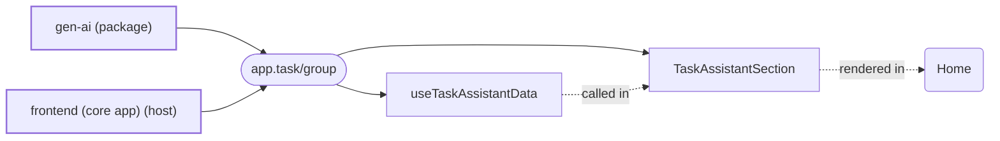

### app.task/item

Adds a task item to a task group in the Task Assistant.

Tasks with a `tabRoutePageId` destination are automatically hidden when the
referenced tab-route page has no contributed tabs.

Declared as [TaskItemExtension](../src/extension-points/tasks.ts#L34).

**Properties:**

| Property | Required | Type | CodeRef of | Description |
| --- | --- | --- | --- | --- |
| `id` | yes | `string` | — | A unique identifier for this task item. |
| `group` | yes | `string` | — | The `id` of the parent `app.task/group` this task belongs to. |
| `title` | yes | `string` | — | The display name of the task. |
| `destination` | yes | `TaskItemDestination` | — | The navigation target for this task. |
| `order` | yes | `string` | — | Lexicographic sort key for ordering items within the parent group. |

**Implemented by:** [autorag](../../autorag/docs/extensions.md#contributes-to-apptaskitem), [eval-hub](../../eval-hub/docs/extensions.md#contributes-to-apptaskitem), [feature-store](../../feature-store/docs/extensions.md#contributes-to-apptaskitem), [gen-ai](../../gen-ai/docs/extensions.md#contributes-to-apptaskitem), [frontend (core app)](../../../frontend/docs/extensions.md#contributes-to-apptaskitem), [maas](../../maas/docs/extensions.md#contributes-to-apptaskitem), [mlflow-embedded](../../mlflow-embedded/docs/extensions.md#contributes-to-apptaskitem), [model-training](../../model-training/docs/extensions.md#contributes-to-apptaskitem)

**Consumed in:** [frontend (core app)](../../../frontend/docs/extensions.md#consumes-apptaskitem)

**Consumers:**

| Consumer | Package | Query | Uses | Rendered or called in |
| --- | --- | --- | --- | --- |
| [TaskAssistantSection](../../../frontend/src/pages/home/taskAssistant/TaskAssistantSection.tsx#L30-L156) | frontend (core app) | — | `properties` — read, direct ([TaskAssistantSection.tsx:129](../../../frontend/src/pages/home/taskAssistant/TaskAssistantSection.tsx#L129) (+1 more)) | Home ([Home.tsx:37](../../../frontend/src/pages/home/Home.tsx#L37)) |
| [useTaskAssistantData](../../../frontend/src/pages/home/taskAssistant/useTaskAssistantData.ts#L15-L92) | frontend (core app) | [useResolvedExtensions](../../../frontend/src/pages/home/taskAssistant/useTaskAssistantData.ts#L23) | `properties.destination` — read, direct ([useTaskAssistantData.ts:47](../../../frontend/src/pages/home/taskAssistant/useTaskAssistantData.ts#L47)) `properties.group` — read, direct ([useTaskAssistantData.ts:61](../../../frontend/src/pages/home/taskAssistant/useTaskAssistantData.ts#L61)) `properties.order` — read, direct ([useTaskAssistantData.ts:72](../../../frontend/src/pages/home/taskAssistant/useTaskAssistantData.ts#L72) (+1 more)) | TaskAssistantSection (called at [TaskAssistantSection.tsx:32](../../../frontend/src/pages/home/taskAssistant/TaskAssistantSection.tsx#L32)) |

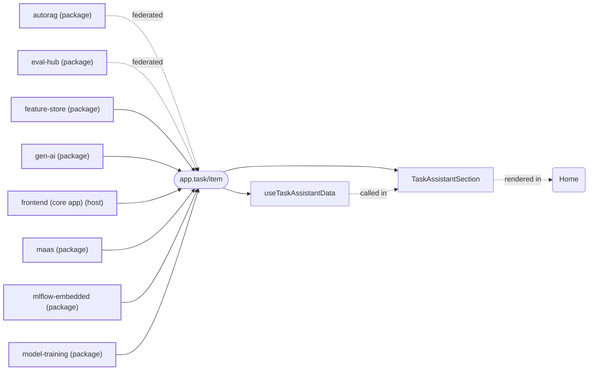

### core.action

Generic extension point for actions (header dropdowns, table row actions, etc.).

Contributors set `group` to target a specific surface
(e.g. `'model-registry.registered-models.header'`).

Declared as [ActionExtension](../src/extension-points/actions.ts#L27).

**Properties:**

| Property | Required | Type | CodeRef of | Description |
| --- | --- | --- | --- | --- |
| `id` | yes | `string` | — | A unique identifier for this action. |
| `label` | yes | `string` | — | The display label for the action. |
| `component` | yes | `ComponentCodeRef` | `{ default: ComponentType<AnyObject>; }` | The component to render for this action. |
| `group` | — | `string` | — | Identifies which page/surface this action belongs to. |

**Implemented by:** [mlflow](../../mlflow/docs/extensions.md#contributes-to-coreaction), [model-registry](../../model-registry/docs/extensions.md#contributes-to-coreaction), [model-serving](../../model-serving/docs/extensions.md#contributes-to-coreaction)

**Consumed in:** [mlflow-embedded](../../mlflow-embedded/docs/extensions.md#consumes-coreaction), [model-registry](../../model-registry/docs/extensions.md#consumes-coreaction)

**Consumers:**

| Consumer | Package | Query | Uses | Rendered or called in |
| --- | --- | --- | --- | --- |
| [MlflowMcpRegistryDetailPage](../../mlflow-embedded/mcp-registry/MlflowMcpRegistryDetailPage.tsx#L39-L195) | mlflow-embedded | [useExtensions](../../mlflow-embedded/mcp-registry/MlflowMcpRegistryDetailPage.tsx#L47) | — | — |
| [ExtendedRegisteredModelTableRow](../../model-registry/upstream/frontend/src/odh/components/ExtendedRegisteredModelTableRow.tsx#L53-L273) | model-registry | [useExtensions](../../model-registry/upstream/frontend/src/odh/components/ExtendedRegisteredModelTableRow.tsx#L78) | — | ExtendedRegisteredModelTable ([ExtendedRegisteredModelTable.tsx:114](../../model-registry/upstream/frontend/src/odh/components/ExtendedRegisteredModelTable.tsx#L114-L121)) |
| [McpServerDetailsPage](../../model-registry/upstream/frontend/src/app/pages/mcpCatalog/screens/McpServerDetailsPage.tsx#L38-L142) | model-registry | [useExtensions](../../model-registry/upstream/frontend/src/app/pages/mcpCatalog/screens/McpServerDetailsPage.tsx#L42) | — | McpCatalogRoutes ([McpCatalogRoutes.tsx:13](../../model-registry/upstream/frontend/src/app/pages/mcpCatalog/McpCatalogRoutes.tsx#L13)) |
| [ModelDetailsPage](../../model-registry/upstream/frontend/src/app/pages/modelCatalog/screens/ModelDetailsPage.tsx#L61-L299) | model-registry | [useExtensions](../../model-registry/upstream/frontend/src/app/pages/modelCatalog/screens/ModelDetailsPage.tsx#L74) | `properties.group` — read, direct ([ModelDetailsPage.tsx:76](../../model-registry/upstream/frontend/src/app/pages/modelCatalog/screens/ModelDetailsPage.tsx#L76)) | OdhModelDetailsPage ([OdhModelDetailsPage.tsx:14](../../model-registry/upstream/frontend/src/odh/components/OdhModelDetailsPage.tsx#L14)) OdhModelDetailsPage ([OdhModelDetailsPage.tsx:18](../../model-registry/upstream/frontend/src/odh/components/OdhModelDetailsPage.tsx#L18-L35)) |
| [ModelVersionsDetailsContent](../../model-registry/upstream/frontend/src/app/pages/modelRegistry/screens/ModelVersionDetails/ModelVersionDetails.tsx#L45-L159) | model-registry | [useExtensions](../../model-registry/upstream/frontend/src/app/pages/modelRegistry/screens/ModelVersionDetails/ModelVersionDetails.tsx#L49) | — | ModelVersionsDetails ([ModelVersionDetails.tsx:180](../../model-registry/upstream/frontend/src/app/pages/modelRegistry/screens/ModelVersionDetails/ModelVersionDetails.tsx#L180)) |
| [ModelVersionsHeaderActions](../../model-registry/upstream/frontend/src/app/pages/modelRegistry/screens/ModelVersions/ModelVersionsHeaderActions.tsx#L28-L101) | model-registry | [useExtensions](../../model-registry/upstream/frontend/src/app/pages/modelRegistry/screens/ModelVersions/ModelVersionsHeaderActions.tsx#L38) | — | ModelVersionsContent ([ModelVersions.tsx:69](../../model-registry/upstream/frontend/src/app/pages/modelRegistry/screens/ModelVersions/ModelVersions.tsx#L69)) |
| [ModelVersionsTableRow](../../model-registry/upstream/frontend/src/app/pages/modelRegistry/screens/ModelVersions/ModelVersionsTableRow.tsx#L43-L200) | model-registry | [useExtensions](../../model-registry/upstream/frontend/src/app/pages/modelRegistry/screens/ModelVersions/ModelVersionsTableRow.tsx#L54) | — | ModelVersionsArchiveTable ([ModelVersionsArchiveTable.tsx:29](../../model-registry/upstream/frontend/src/app/pages/modelRegistry/screens/ModelVersionsArchive/ModelVersionsArchiveTable.tsx#L29)) OdhModelVersionsTableContent ([OdhModelVersionsTable.tsx:51](../../model-registry/upstream/frontend/src/odh/components/OdhModelVersionsTable.tsx#L51-L57)) |
| [RegisteredModelTableRow](../../model-registry/upstream/frontend/src/app/pages/modelRegistry/screens/RegisteredModels/RegisteredModelTableRow.tsx#L49-L240) | model-registry | [useExtensions](../../model-registry/upstream/frontend/src/app/pages/modelRegistry/screens/RegisteredModels/RegisteredModelTableRow.tsx#L64) | — | RegisteredModelsArchiveTable ([RegisteredModelsArchiveTable.tsx:32](../../model-registry/upstream/frontend/src/app/pages/modelRegistry/screens/RegisteredModelsArchive/RegisteredModelsArchiveTable.tsx#L32-L38)) enhancedRowRenderer ([OdhRegisteredModelTable.tsx:55](../../model-registry/upstream/frontend/src/odh/components/OdhRegisteredModelTable.tsx#L55-L62)) |
| [RuntimeCatalogDetailsView](../../model-registry/upstream/frontend/src/odh/pages/runtimeCatalog/RuntimeCatalogDetailsView.tsx#L57-L293) | model-registry | [useExtensions](../../model-registry/upstream/frontend/src/odh/pages/runtimeCatalog/RuntimeCatalogDetailsView.tsx#L66) | — | RuntimeCatalogDetailsRoutes ([RuntimeCatalogDetailsRoutes.tsx:33](../../model-registry/upstream/frontend/src/odh/pages/runtimeCatalog/RuntimeCatalogDetailsRoutes.tsx#L33-L51)) |

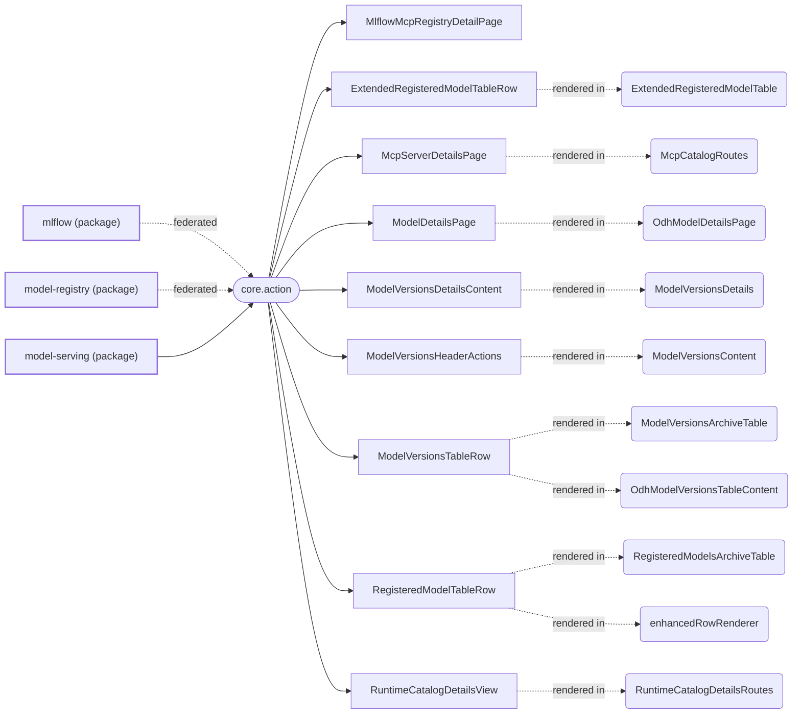

### core.detail-card

Generic extension point for detail cards on any detail page.

Contributors set `group` to target a specific page
(e.g. `'model-registry.model-details'`).

Declared as [DetailCardExtension](../src/extension-points/detail-cards.ts#L22).

**Properties:**

| Property | Required | Type | CodeRef of | Description |
| --- | --- | --- | --- | --- |
| `component` | yes | `ComponentCodeRef` | `{ default: ComponentType<AnyObject>; }` | The component to render as the detail card content. |
| `group` | — | `string` | — | Identifies which page/surface this card belongs to. |

**Implemented by:** [model-serving](../../model-serving/docs/extensions.md#contributes-to-coredetail-card)

**Consumed in:** [model-registry](../../model-registry/docs/extensions.md#consumes-coredetail-card)

**Consumers:**

| Consumer | Package | Query | Uses | Rendered or called in |
| --- | --- | --- | --- | --- |
| [ModelDetailsView](../../model-registry/upstream/frontend/src/app/pages/modelRegistry/screens/ModelVersions/ModelDetailsView.tsx#L18-L48) | model-registry | [useExtensions](../../model-registry/upstream/frontend/src/app/pages/modelRegistry/screens/ModelVersions/ModelDetailsView.tsx#L24) | `properties.group` — read, direct ([ModelDetailsView.tsx:26](../../model-registry/upstream/frontend/src/app/pages/modelRegistry/screens/ModelVersions/ModelDetailsView.tsx#L26)) `properties.component` — lazy-render, direct ([ModelDetailsView.tsx:30](../../model-registry/upstream/frontend/src/app/pages/modelRegistry/screens/ModelVersions/ModelDetailsView.tsx#L30)) | ModelVersionsTabs ([ModelVersionsTabs.tsx:60](../../model-registry/upstream/frontend/src/app/pages/modelRegistry/screens/ModelVersions/ModelVersionsTabs.tsx#L60-L64)) |

**Flow:** model-serving → core.detail-card → model-registry · ModelDetailsView → rendered in ModelVersionsTabs

### core.detail/tab

Generic extension point for tabs on any detail page.

Contributors set `group` to target a specific page (e.g. `'model-registry.details'`).
Consumers filter by `group` via the `ExtensibleDetailTabs` component or manually.

Declared as [DetailTabExtension](../src/extension-points/detail-tabs.ts#L51).

**Properties:**

| Property | Required | Type | CodeRef of | Description |
| --- | --- | --- | --- | --- |
| `id` | yes | `string` | — | A unique identifier for this tab. |
| `title` | yes | `string` | — | The display title for the tab. |
| `component` | yes | `ComponentCodeRef` | `{ default: ComponentType<AnyObject>; }` | The component to render as tab content. |
| `group` | — | `string` | — | Identifies which page/surface this tab belongs to. |
| `label` | — | `string` | — | Optional label badge displayed alongside the tab title. |
| `visibilityErrorMessage` | — | `string` | — | Message shown when the visibility predicate cannot determine whether the tab is available. |
| `shouldShow` | — | `(props: Record<string, unknown>) => boolean \| Promise<boolean>` | — | Optional predicate controlling tab visibility. Receives the same `componentProps` passed to `ExtensibleDetailTabs`. Return `true` to show, `false` to hide. When omitted the tab always shows. May return a `Promise<boolean>` for async checks. The tab is hidden while the result is pending unless it is active, in which case it remains rendered until the result resolves. |

**Implemented by:** [maas](../../maas/docs/extensions.md#contributes-to-coredetailtab), [model-registry](../../model-registry/docs/extensions.md#contributes-to-coredetailtab), [model-serving](../../model-serving/docs/extensions.md#contributes-to-coredetailtab)

**Consumed in:** [model-registry](../../model-registry/docs/extensions.md#consumes-coredetailtab), [model-serving](../../model-serving/docs/extensions.md#consumes-coredetailtab)

**Consumers:**

| Consumer | Package | Query | Uses | Rendered or called in |
| --- | --- | --- | --- | --- |
| [ModelCatalogRoutes](../../model-registry/upstream/frontend/src/app/pages/modelCatalog/ModelCatalogRoutes.tsx#L13-L44) | model-registry | [useExtensions](../../model-registry/upstream/frontend/src/app/pages/modelCatalog/ModelCatalogRoutes.tsx#L14) | — | AppRoutes ([AppRoutes.tsx:96](../../model-registry/upstream/frontend/src/app/AppRoutes.tsx#L96)) ModelCatalogWrapperContent ([ModelCatalogWrapper.tsx:39](../../model-registry/upstream/frontend/src/odh/ModelCatalogWrapper.tsx#L39)) |
| [ModelDetailsTabs](../../model-registry/upstream/frontend/src/app/pages/modelCatalog/screens/ModelDetailsTabs.tsx#L36-L120) | model-registry | [useExtensions](../../model-registry/upstream/frontend/src/app/pages/modelCatalog/screens/ModelDetailsTabs.tsx#L47) | — | ModelDetailsPage ([ModelDetailsPage.tsx:285](../../model-registry/upstream/frontend/src/app/pages/modelCatalog/screens/ModelDetailsPage.tsx#L285-L294)) |
| [ModelRegistryRoutes](../../model-registry/upstream/frontend/src/app/pages/modelRegistry/ModelRegistryRoutes.tsx#L23-L129) | model-registry | [useExtensions](../../model-registry/upstream/frontend/src/app/pages/modelRegistry/ModelRegistryRoutes.tsx#L24) | — | AppRoutes ([AppRoutes.tsx:93](../../model-registry/upstream/frontend/src/app/AppRoutes.tsx#L93)) ModelRegistryWrapperContent ([ModelRegistryWrapper.tsx:40](../../model-registry/upstream/frontend/src/odh/ModelRegistryWrapper.tsx#L40)) |
| [ModelVersionDetailsTabs](../../model-registry/upstream/frontend/src/app/pages/modelRegistry/screens/ModelVersionDetails/ModelVersionDetailsTabs.tsx#L25-L80) | model-registry | [useExtensions](../../model-registry/upstream/frontend/src/app/pages/modelRegistry/screens/ModelVersionDetails/ModelVersionDetailsTabs.tsx#L36) | `properties.id` — read, direct ([ModelVersionDetailsTabs.tsx:44](../../model-registry/upstream/frontend/src/app/pages/modelRegistry/screens/ModelVersionDetails/ModelVersionDetailsTabs.tsx#L44)) | ModelVersionsDetailsContent ([ModelVersionDetails.tsx:147](../../model-registry/upstream/frontend/src/app/pages/modelRegistry/screens/ModelVersionDetails/ModelVersionDetails.tsx#L147-L155)) ArchiveModelVersionDetails ([ArchiveModelVersionDetails.tsx:83](../../model-registry/upstream/frontend/src/app/pages/modelRegistry/screens/ModelVersionsArchive/ArchiveModelVersionDetails.tsx#L83-L92)) ModelVersionsArchiveDetails ([ModelVersionArchiveDetails.tsx:91](../../model-registry/upstream/frontend/src/app/pages/modelRegistry/screens/ModelVersionsArchive/ModelVersionArchiveDetails.tsx#L91-L100)) |
| [ModelVersionsTabs](../../model-registry/upstream/frontend/src/app/pages/modelRegistry/screens/ModelVersions/ModelVersionsTabs.tsx#L27-L88) | model-registry | [useExtensions](../../model-registry/upstream/frontend/src/app/pages/modelRegistry/screens/ModelVersions/ModelVersionsTabs.tsx#L36) | `properties.id` — read, direct ([ModelVersionsTabs.tsx:44](../../model-registry/upstream/frontend/src/app/pages/modelRegistry/screens/ModelVersions/ModelVersionsTabs.tsx#L44)) | ModelVersionsContent ([ModelVersions.tsx:76](../../model-registry/upstream/frontend/src/app/pages/modelRegistry/screens/ModelVersions/ModelVersions.tsx#L76-L82)) RegisteredModelsArchiveDetails ([RegisteredModelArchiveDetails.tsx:72](../../model-registry/upstream/frontend/src/app/pages/modelRegistry/screens/RegisteredModelsArchive/RegisteredModelArchiveDetails.tsx#L72-L79)) |
| [GlobalModelsPage](../../model-serving/src/components/global/GlobalModelsPage.tsx#L105-L196) | model-serving | [useExtensions](../../model-serving/src/components/global/GlobalModelsPage.tsx#L109) | `properties.group` — read, direct ([GlobalModelsPage.tsx:113](../../model-serving/src/components/global/GlobalModelsPage.tsx#L113)) | GlobalModelsRoutes ([GlobalModelsRoutes.tsx:22](../../model-serving/src/GlobalModelsRoutes.tsx#L22)) GlobalModelsRoutes ([GlobalModelsRoutes.tsx:23](../../model-serving/src/GlobalModelsRoutes.tsx#L23)) GlobalModelsRoutes ([GlobalModelsRoutes.tsx:24](../../model-serving/src/GlobalModelsRoutes.tsx#L24)) GlobalModelsRoutes ([GlobalModelsRoutes.tsx:25](../../model-serving/src/GlobalModelsRoutes.tsx#L25)) GlobalModelsRoutes ([GlobalModelsRoutes.tsx:27](../../model-serving/src/GlobalModelsRoutes.tsx#L27)) GlobalModelsRoutes ([GlobalModelsRoutes.tsx:28](../../model-serving/src/GlobalModelsRoutes.tsx#L28)) |

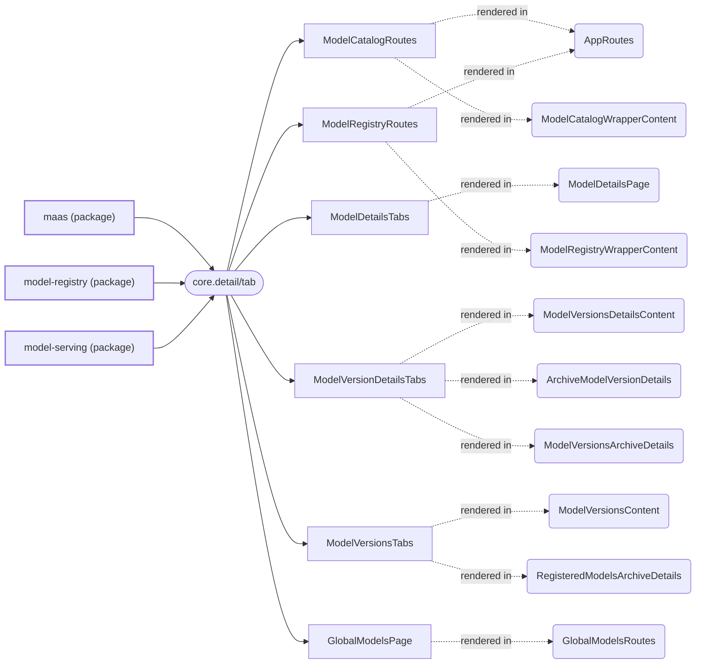

### core.table-column

Generic extension point for table columns.

Contributors set `group` to target a specific table
(e.g. `'model-registry.registered-models'`).

Declared as [TableColumnExtension](../src/extension-points/table-columns.ts#L22).

**Properties:**

| Property | Required | Type | CodeRef of | Description |
| --- | --- | --- | --- | --- |
| `component` | yes | `ComponentCodeRef` | `{ default: ComponentType<AnyObject>; }` | The component to render as the column cell content. |
| `group` | — | `string` | — | Identifies which table/surface this column belongs to. |

**Implemented by:** [model-serving](../../model-serving/docs/extensions.md#contributes-to-coretable-column)

**Consumed in:** [model-registry](../../model-registry/docs/extensions.md#consumes-coretable-column)

**Consumers:**

| Consumer | Package | Query | Uses | Rendered or called in |
| --- | --- | --- | --- | --- |
| [ExtendedRegisteredModelTable](../../model-registry/upstream/frontend/src/odh/components/ExtendedRegisteredModelTable.tsx#L24-L125) | model-registry | [useResolvedExtensions](../../model-registry/upstream/frontend/src/odh/components/ExtendedRegisteredModelTable.tsx#L32) | `properties.group` — read, direct ([ExtendedRegisteredModelTable.tsx:54](../../model-registry/upstream/frontend/src/odh/components/ExtendedRegisteredModelTable.tsx#L54)) | ExtendedRegisteredModelListView ([ExtendedRegisteredModelListView.tsx:110](../../model-registry/upstream/frontend/src/odh/components/ExtendedRegisteredModelListView.tsx#L110-L126)) |
| [ExtendedRegisteredModelTableRow](../../model-registry/upstream/frontend/src/odh/components/ExtendedRegisteredModelTableRow.tsx#L53-L273) | model-registry | [useExtensions](../../model-registry/upstream/frontend/src/odh/components/ExtendedRegisteredModelTableRow.tsx#L70) | `properties.group` — read, direct ([ExtendedRegisteredModelTableRow.tsx:72](../../model-registry/upstream/frontend/src/odh/components/ExtendedRegisteredModelTableRow.tsx#L72)) | ExtendedRegisteredModelTable ([ExtendedRegisteredModelTable.tsx:114](../../model-registry/upstream/frontend/src/odh/components/ExtendedRegisteredModelTable.tsx#L114-L121)) |
| [renderExtensionColumns](../../model-registry/upstream/frontend/src/odh/components/ExtendedRegisteredModelTableRow.tsx#L92-L109) | model-registry | — | `properties.component` — lazy-render, direct ([ExtendedRegisteredModelTableRow.tsx:100](../../model-registry/upstream/frontend/src/odh/components/ExtendedRegisteredModelTableRow.tsx#L100)) | ExtendedRegisteredModelTableRow (called at [ExtendedRegisteredModelTableRow.tsx:144](../../model-registry/upstream/frontend/src/odh/components/ExtendedRegisteredModelTableRow.tsx#L144)) |

```mermaid
flowchart LR
  classDef pkg stroke-width:2px
  classDef point stroke-width:1px
  n_pkg__odh_dashboard_model_serving_d0bfea["model-serving (package)"]:::pkg
  n_core_table_column_c42d41(["core.table-column"]):::point
  n_pkg__odh_dashboard_model_serving_d0bfea --> n_core_table_column_c42d41
  n_symbol_packages_model_registry_upstream_frontend_src_odh_components_ExtendedRegisteredModelTable_tsx_ExtendedRegisteredModelTable_2439e8["ExtendedRegisteredModelTable"]
  n_core_table_column_c42d41 --> n_symbol_packages_model_registry_upstream_frontend_src_odh_components_ExtendedRegisteredModelTable_tsx_ExtendedRegisteredModelTable_2439e8
  n_symbol_packages_model_registry_upstream_frontend_src_odh_components_ExtendedRegisteredModelTableRow_tsx_ExtendedRegisteredModelTableRow_a8e028["ExtendedRegisteredModelTableRow"]
  n_core_table_column_c42d41 --> n_symbol_packages_model_registry_upstream_frontend_src_odh_components_ExtendedRegisteredModelTableRow_tsx_ExtendedRegisteredModelTableRow_a8e028
  n_symbol_packages_model_registry_upstream_frontend_src_odh_components_ExtendedRegisteredModelTableRow_tsx_renderExtensionColumns_733992["renderExtensionColumns"]
  n_core_table_column_c42d41 --> n_symbol_packages_model_registry_upstream_frontend_src_odh_components_ExtendedRegisteredModelTableRow_tsx_renderExtensionColumns_733992
  n_symbol_packages_model_registry_upstream_frontend_src_odh_components_ExtendedRegisteredModelListView_tsx_ExtendedRegisteredModelListView_072a6c("ExtendedRegisteredModelListView")
  n_symbol_packages_model_registry_upstream_frontend_src_odh_components_ExtendedRegisteredModelTable_tsx_ExtendedRegisteredModelTable_2439e8 -. "rendered in" .-> n_symbol_packages_model_registry_upstream_frontend_src_odh_components_ExtendedRegisteredModelListView_tsx_ExtendedRegisteredModelListView_072a6c
  n_symbol_packages_model_registry_upstream_frontend_src_odh_components_ExtendedRegisteredModelTableRow_tsx_ExtendedRegisteredModelTableRow_a8e028 -. "rendered in" .-> n_symbol_packages_model_registry_upstream_frontend_src_odh_components_ExtendedRegisteredModelTable_tsx_ExtendedRegisteredModelTable_2439e8
  n_symbol_packages_model_registry_upstream_frontend_src_odh_components_ExtendedRegisteredModelTableRow_tsx_renderExtensionColumns_733992 -. "called in" .-> n_symbol_packages_model_registry_upstream_frontend_src_odh_components_ExtendedRegisteredModelTableRow_tsx_ExtendedRegisteredModelTableRow_a8e028
```

## Consumes

The extension points this package's code queries or uses, one table per point. A use is a property read from an extension, followed wherever the extension is passed; "rendered in" is one hop up: where the consumer itself is rendered or called.

### Consumes app.navigation/section

Defined in [app.navigation/section](#appnavigationsection).

| Consumer | Query | Uses | Rendered in |
| --- | --- | --- | --- |
| [getTopLevelExtensions](../src/core/navigation.ts#L13-L60) | — | `properties.id` — read, direct ([navigation.ts:16](../src/core/navigation.ts#L16) (+2 more)) `type` — filter, direct ([navigation.ts:16](../src/core/navigation.ts#L16)) | ShellNav (called at [ShellNav.tsx:187](../../../distributions/base/src/ShellNav.tsx#L187)) ExtensibleNav (called at [ExtensibleNav.tsx:22](../../../frontend/src/app/navigation/ExtensibleNav.tsx#L22)) |

### Consumes app.patch

Defined in [app.patch](#apppatch).

| Consumer | Query | Uses | Rendered in |
| --- | --- | --- | --- |
| [extractPatches](../src/core/extensionResolution.ts#L66-L93) | — | `type` — type-check, direct ([extensionResolution.ts:73](../src/core/extensionResolution.ts#L73)) | PluginStore (called at [plugin-store.ts:51](../src/core/plugin-store.ts#L51)) |

### Consumes app.suppress

Defined in [app.suppress](#appsuppress).

| Consumer | Query | Uses | Rendered in |
| --- | --- | --- | --- |
| [applySuppress](../src/core/extensionResolution.ts#L103-L154) | — | `type` — type-check, direct ([extensionResolution.ts:107](../src/core/extensionResolution.ts#L107) (+1 more)) | PluginStore (called at [plugin-store.ts:53](../src/core/plugin-store.ts#L53)) |

## Diagnostics

What the analysis could not prove, or thought worth reporting, about this package: warnings are things the analysis could not prove, which are gaps in the map; info entries are findings about the code, which the map reports in full.

| Code | Severity | Message | Source |
| --- | --- | --- | --- |
| `point-id-literal` | warning | The string 'app.navigation/href' names an extension point outside its declaration and outside an extension. | [extensionResolution.ts:8](../src/core/extensionResolution.ts#L8) |
| `point-id-literal` | warning | The string 'app.navigation/section' names an extension point outside its declaration and outside an extension. | [extensionResolution.ts:9](../src/core/extensionResolution.ts#L9) |
| `point-id-literal` | warning | The string 'app.tab-route/page' names an extension point outside its declaration and outside an extension. | [extensionResolution.ts:10](../src/core/extensionResolution.ts#L10) |
| `point-no-jsdoc` | warning | Extension point 'app.connection-types/service' (ConnectionTypesServiceExtension) has no JSDoc. | [connection-types.ts:21](../src/extension-points/connection-types.ts#L21-L24) |
| `point-no-consumers` | info | No code in this repository queries or uses extensions of 'app.connection-types/form-fields'. | [connection-types.ts:45](../src/extension-points/connection-types.ts#L45-L48) |
| `point-no-jsdoc` | warning | Extension point 'app.connection-types/form-fields' (ConnectionTypeFormFieldsExtension) has no JSDoc. | [connection-types.ts:45](../src/extension-points/connection-types.ts#L45-L48) |
| `point-no-consumers` | info | No code in this repository queries or uses extensions of 'app.connection-types/details-helper'. | [connection-types.ts:58](../src/extension-points/connection-types.ts#L58-L61) |
| `point-no-jsdoc` | warning | Extension point 'app.connection-types/details-helper' (ConnectionDetailsHelperTextExtension) has no JSDoc. | [connection-types.ts:58](../src/extension-points/connection-types.ts#L58-L61) |
| `point-no-consumers` | info | No code in this repository queries or uses extensions of 'app.connection-types/default-value-renderer'. | [connection-types.ts:74](../src/extension-points/connection-types.ts#L74-L77) |
| `point-no-jsdoc` | warning | Extension point 'app.connection-types/default-value-renderer' (DefaultValueTextRendererExtension) has no JSDoc. | [connection-types.ts:74](../src/extension-points/connection-types.ts#L74-L77) |
| `point-no-consumers` | info | No code in this repository queries or uses extensions of 'app.connection-types/form'. | [connection-types.ts:84](../src/extension-points/connection-types.ts#L84-L87) |
| `point-no-jsdoc` | warning | Extension point 'app.connection-types/form' (ConnectionTypeFormExtension) has no JSDoc. | [connection-types.ts:84](../src/extension-points/connection-types.ts#L84-L87) |
| `point-no-contributors` | info | No package in this repository contributes an extension of 'app.masthead/brand'. | [masthead.ts:17](../src/extension-points/masthead.ts#L17-L27) |
| `point-unused` | info | Nothing in this repository contributes an extension of 'app.masthead/user-menu' or queries or uses it. | [masthead.ts:53](../src/extension-points/masthead.ts#L53-L63) |
| `point-unused` | info | Nothing in this repository contributes an extension of 'app.masthead/about' or queries or uses it. | [masthead.ts:70](../src/extension-points/masthead.ts#L70-L76) |
| `point-no-jsdoc` | warning | Extension point 'app.project-details/overview-section' (OverviewSectionExtension) has no JSDoc. | [overview-card.ts:4](../src/extension-points/overview-card.ts#L4-L11) |
| `point-no-jsdoc` | warning | Extension point 'app.patch' (PatchExtension) has no JSDoc. | [patch.ts:17](../src/extension-points/patch.ts#L17-L24) |
| `point-no-jsdoc` | warning | Extension point 'app.project-details/tab' (ProjectDetailsTab) has no JSDoc. | [project-details.ts:4](../src/extension-points/project-details.ts#L4-L12) |
| `point-no-jsdoc` | warning | Extension point 'app.project-details/settings-card' (ProjectDetailsSettingsCardExtension) has no JSDoc. | [project-details.ts:20](../src/extension-points/project-details.ts#L20-L27) |
| `point-no-jsdoc` | warning | Extension point 'app.suppress' (SuppressExtension) has no JSDoc. | [suppress.ts:5](../src/extension-points/suppress.ts#L5-L11) |

## Legend

Every diagram on this page is one extension point's flow: the packages that contribute
extensions of it, the point, the code that queries or uses it, and where that code is itself
rendered or called. The Consumers table above each diagram carries a link for every node.

| Edge | What it means in these diagrams |
| --- | --- |
| `A --> B` | Proven use: package A contributes extensions of point B, or consumer B queries or uses point A. |
| `A -. "rendered in" .-> B` | B renders A as a JSX element (one hop up). |
| `A -. "called in" .-> B` | B calls A (one hop up). |
| `A -. "federated" .-> B` | A reaches the host only through a Module Federation remote, loaded at runtime. |

Anything the analysis could not resolve is never drawn — it is listed in a "Not resolved" table
instead.
